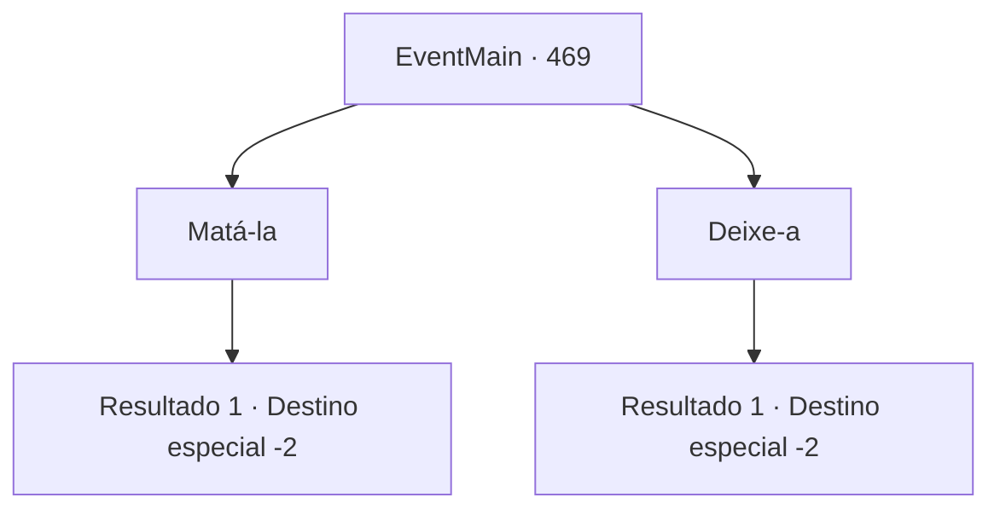

# Eventos principais · 469

[Índice da tabela](index.md) · [Índice geral](../index.md)

ID: `pt:EventMain:469` · Fonte: `EventMain4` · Versão: 1.2.47.

Mapeamento estático dos arquivos; a disponibilidade e a execução dependem do estado da run.

## Texto do evento

*Sem texto no arquivo.*

## Dados de entrada

```json
{
  "id": 469,
  "grade": 1,
  "normalGoal": "",
  "required": ""
}
```

## Mapa das escolhas



## Escolhas e resultados

### Escolha 1

Matá-la

Requisitos e outros campos da escolha:

```json
{
  "required": ""
}
```

#### Resultado 1.1

Ela implorou por misericórdia com uma voz de choro, mas você se recusou a atender ao seu pedido. Então veio o sussurro de Kior. 

 "Não há ninguém no mundo em quem confiar. Coitadinho... Vou te mostrar como aumentar sua força."

 Ele diz para você, encontre um adorador de demônios em uma aldeia chamada 'Kahida' e peça sua ajuda. Você caminha para Kahida de acordo com suas palavras.

Continuação registrada: [Destino especial `-2`](../destinos-especiais.md).

```json
{
  "required": "",
  "chance": "1",
  "nextEvent": -2,
  "type": 2,
  "reward": "0_3_-5|13_4_1"
}
```

### Escolha 2

Deixe-a

Requisitos e outros campos da escolha:

```json
{
  "required": ""
}
```

#### Resultado 2.1

Depois de olhar para Natasha por um longo tempo, você coloca sua arma e sai de lá. Atrás de você, vem a voz dela gritando: Obrigado. Então, novamente, veio o sussurro de Kior. 

 "Não há ninguém no mundo em quem confiar. Coitadinho... Vou te mostrar como aumentar sua força."

 Ele diz para você, encontre um adorador de demônios em uma aldeia chamada 'Kahida' e peça sua ajuda. Você caminha para Kahida de acordo com suas palavras.

Continuação registrada: [Destino especial `-2`](../destinos-especiais.md).

```json
{
  "required": "",
  "chance": "1",
  "nextEvent": -2,
  "type": 2,
  "reward": "0_3_1|13_4_1"
}
```

## Referências que chegam a este evento

- [Evento 468 · escolha 1 · resultado 1](0468.md#escolha-1)
