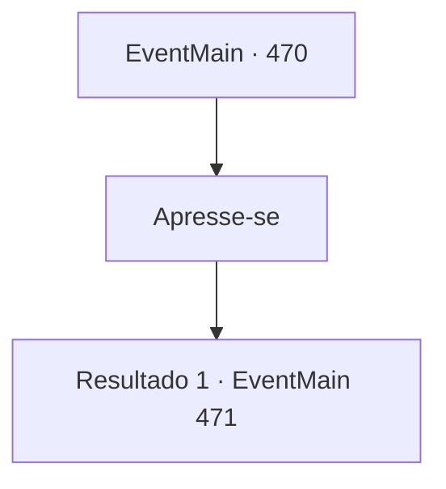

# Eventos principais · 470

[Índice da tabela](index.md) · [Índice geral](../index.md)

ID: `pt:EventMain:470` · Fonte: `EventMain4` · Versão: 1.2.47.

Mapeamento estático dos arquivos; a disponibilidade e a execução dependem do estado da run.

## Texto do evento

Enquanto você caminha por uma floresta silenciosa, um som estranho sai. 
'Su.. ss..'
 Você fala com Kior em sua cabeça, mas ele não responde. O vento calmo carrega uma estranha tensão.

## Dados de entrada

```json
{
  "id": 470,
  "grade": 1,
  "normalGoal": "",
  "required": "1_2_10|13_4_1"
}
```

## Mapa das escolhas



## Escolhas e resultados

### Escolha 1

Apresse-se

Requisitos e outros campos da escolha:

```json
{
  "required": ""
}
```

#### Resultado 1.1

Você ignora o som e se apressa em direção à Vila Kahida. É só então. De repente, Paladinos saem dos arbustos e cercam você. O primeiro deles é um elfo loiro de armadura branca. Sua armadura é gravada com o símbolo de Teresia. Ele te olha e diz. |drawing_viyork| 

 "Prazer em conhecê-lo {1}. Você não quer falar comigo por um segundo?"


Continuação registrada: [Evento 471](0471.md) na mesma tabela.

```json
{
  "required": "",
  "chance": "1",
  "nextEvent": 471,
  "type": 2,
  "reward": ""
}
```

## Referências que chegam a este evento

Nenhum `nextEvent` positivo da mesma tabela aponta para este nó. Isso não prova que seja inacessível: sorteio e estado de história podem selecioná-lo.

