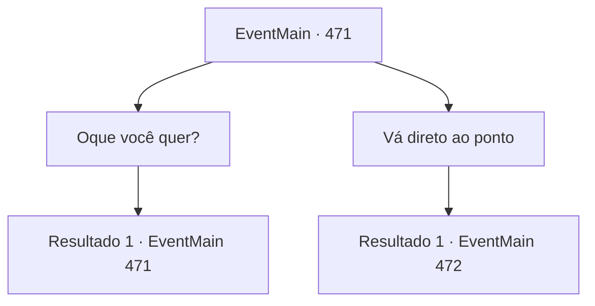

# Eventos principais · 471

[Índice da tabela](index.md) · [Índice geral](../index.md)

ID: `pt:EventMain:471` · Fonte: `EventMain4` · Versão: 1.2.47.

Mapeamento estático dos arquivos; a disponibilidade e a execução dependem do estado da run.

## Texto do evento

*Sem texto no arquivo.*

## Dados de entrada

```json
{
  "id": 471,
  "grade": 1,
  "normalGoal": "",
  "required": ""
}
```

## Mapa das escolhas



## Escolhas e resultados

### Escolha 1

Oque você quer?

Requisitos e outros campos da escolha:

```json
{
  "required": "5_351_0"
}
```

#### Resultado 1.1

Ao perguntar por você, o homem diz olá em um gesto elegante. 

 "Antes de responder a essa pergunta, deixe-me apresentar-me. Eu sou Viyork. Como podem ver, sou um paladino de Teresia. Estou encarregado de investigar crimes religiosos e prender criminosos."

 Viyork continua, examinando você. 

 "Eu sei um pouco sobre você. Você foi queimado na fogueira com sua família por adorar o demônio? E... o corpo que estava pendurado desapareceu. O fato de que você, que morreu, ter sobrevivido ao fogo deve ter sido pelo fato de que você foi ajudado pelo demônio que trabalha ao seu favor."

 Há um momento de silêncio entre você e Viyork. Depois de olhar para você por um tempo, ele sorri e abre a boca novamente. 

 "De qualquer forma, eu não me importo"


Continuação registrada: [Evento 471](0471.md) na mesma tabela.

```json
{
  "required": "",
  "chance": "1",
  "nextEvent": 471,
  "type": 2,
  "reward": "5_351_1"
}
```

### Escolha 2

Vá direto ao ponto

Requisitos e outros campos da escolha:

```json
{
  "required": "5_351_1"
}
```

#### Resultado 2.1


 "Ok. {1}. Acho que você quer se vingar de sua família..."

 Você fica em silêncio com a resposta, mas ele continua com um leve sorriso. 

 "Eu só quero te ajudar. Teresianos são tão arrogantes... Eles acreditam que tudo o que fazem é a própria justiça. E não duvidam nada disso."

 Ele lhe entrega um pequeno pedaço de pergaminho, dizendo que entende sua injustiça. Diz sobre os cargos e nomes das pessoas-chave de Teresia.
 Onil, que colocou sua família no fogo.
 Danica, a sacerdotisa que acusou sua família de adorar o demônio.
 Finalmente, o arcebispo que aprovou e ordenou a queima, Publius.
 Viyork verifica se você terminou de ler o pergaminho e o pega de volta.

Continuação registrada: [Evento 472](0472.md) na mesma tabela.

```json
{
  "required": "",
  "chance": "1",
  "nextEvent": 472,
  "type": 2,
  "reward": "5_351_2"
}
```

## Referências que chegam a este evento

- [Evento 470 · escolha 1 · resultado 1](0470.md#escolha-1)
- [Evento 471 · escolha 1 · resultado 1](0471.md#escolha-1)
