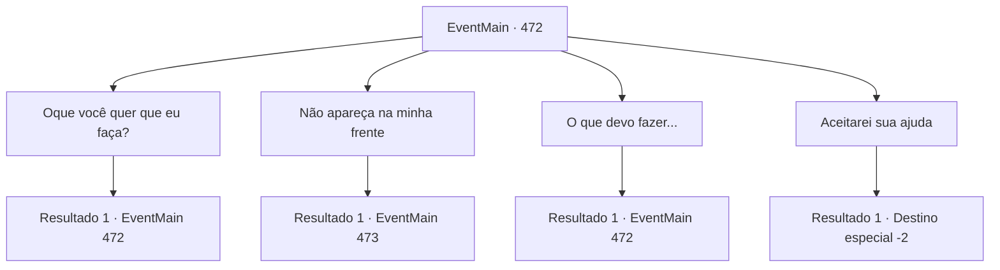

# Eventos principais · 472

[Índice da tabela](index.md) · [Índice geral](../index.md)

ID: `pt:EventMain:472` · Fonte: `EventMain4` · Versão: 1.2.47.

Mapeamento estático dos arquivos; a disponibilidade e a execução dependem do estado da run.

## Texto do evento

*Sem texto no arquivo.*

## Dados de entrada

```json
{
  "id": 472,
  "grade": 1,
  "normalGoal": "",
  "required": ""
}
```

## Mapa das escolhas



## Escolhas e resultados

### Escolha 1

Oque você quer que eu faça?

Requisitos e outros campos da escolha:

```json
{
  "required": "5_352_0"
}
```

#### Resultado 1.1

Ele ainda sorri e responde à sua pergunta. 

 "Você pode se vingar de sua família. Eu só quero ajudá-lo a lamentar sua morte injusta."

 Ele diz que com a ajuda dele a vingança será muito mais fácil. Então ele acrescenta outra palavra. 

 "Oh, se você conseguir minha ajuda, não quero mais ninguém envolvido. Quanto mais longa a cauda, ​​maior a chance de ser pisada."

 Isso significa que, com a ajuda dele, você não conseguirá entrar em contato com adoradores de demônios.

Continuação registrada: [Evento 472](0472.md) na mesma tabela.

```json
{
  "required": "",
  "chance": "1",
  "nextEvent": 472,
  "type": 2,
  "reward": "5_352_1"
}
```

### Escolha 2

Não apareça na minha frente

Requisitos e outros campos da escolha:

```json
{
  "required": "18_352_0"
}
```

#### Resultado 2.1

Você recusa a ajuda de Viyork e deixa o lugar. Viyork está desapontado por ter sido rejeitado, mas não o impede de seguir seu rumo. Depois de terminar com ele, você corre para aldeia Kahida.

 Chegando à vila de Kahida cerca de meio-dia de viagem, você olha em volta. Não há vestígios de pessoas lá, e as casas estão todas cobertas de poeira e parecem prestes a desabar. A aldeia Kahida, que dizem ter adoradores de demônios, é literalmente um lugar em ruínas.

Continuação registrada: [Evento 473](0473.md) na mesma tabela.

```json
{
  "required": "",
  "chance": "1",
  "nextEvent": 473,
  "type": 2,
  "reward": ""
}
```

### Escolha 3

O que devo fazer...

Requisitos e outros campos da escolha:

```json
{
  "required": "5_352_1"
}
```

#### Resultado 3.1


 "Haha... Os olhos dele estão cheios de ambição. Que engraçado. As coisas vão correr muito mais tranquilamente se você trabalhar com pessoas de dentro. Talvez ele seja mais útil do que meus adoradores."

 Kior responde à sua pergunta, decidindo que seria melhor conseguir ajuda de Viyork.

Continuação registrada: [Evento 472](0472.md) na mesma tabela.

```json
{
  "required": "",
  "chance": "1",
  "nextEvent": 472,
  "type": 2,
  "reward": "5_352_2"
}
```

### Escolha 4

Aceitarei sua ajuda

Requisitos e outros campos da escolha:

```json
{
  "required": "5_352_2"
}
```

#### Resultado 4.1

Você decide obter a ajuda de Viyork. Ele estende a mão e pede um aperto de mão, e você aperta sua mão. 

 "Então, entrarei em contato em breve."

 Com essas palavras, Viyork se retira.

Continuação registrada: [Destino especial `-2`](../destinos-especiais.md).

```json
{
  "required": "",
  "chance": "1",
  "nextEvent": -2,
  "type": 2,
  "reward": "13_4_2"
}
```

## Referências que chegam a este evento

- [Evento 471 · escolha 2 · resultado 1](0471.md#escolha-2)
- [Evento 472 · escolha 1 · resultado 1](0472.md#escolha-1)
- [Evento 472 · escolha 3 · resultado 1](0472.md#escolha-3)
