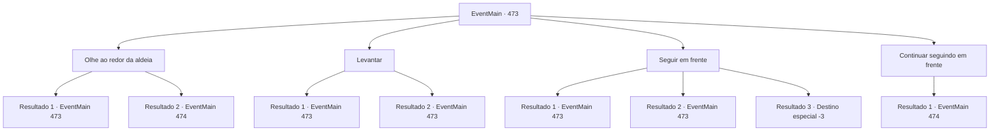

# Eventos principais · 473

[Índice da tabela](index.md) · [Índice geral](../index.md)

ID: `pt:EventMain:473` · Fonte: `EventMain4` · Versão: 1.2.47.

Mapeamento estático dos arquivos; a disponibilidade e a execução dependem do estado da run.

## Texto do evento

*Sem texto no arquivo.*

## Dados de entrada

```json
{
  "id": 473,
  "grade": 1,
  "normalGoal": "",
  "required": ""
}
```

## Mapa das escolhas



## Escolhas e resultados

### Escolha 1

Olhe ao redor da aldeia

Requisitos e outros campos da escolha:

```json
{
  "required": "5_353_0"
}
```

#### Resultado 1.1

Você olha ao redor da aldeia de Kahida e procura por adoradores de demônios. Então, em um pilar quebrado, você encontra uma passagem subterrânea escondida. A entrada para a passagem subterrânea é coberta com tábuas de madeira velhas e mofadas. Você remove a placa e entra no corredor escuro. Nesse momento, o cheiro desagradável perfura seu nariz e de repente sua visão escurece e você desmaia.

Continuação registrada: [Evento 473](0473.md) na mesma tabela.

```json
{
  "required": "21_55_1|21_7_4",
  "chance": "1",
  "nextEvent": 473,
  "type": 2,
  "reward": "5_353_1"
}
```

#### Resultado 1.2

Você olha ao redor da aldeia de Kahida e procura por adoradores de demônios. Então, em um pilar quebrado, você encontra uma passagem subterrânea escondida. A entrada para a passagem subterrânea é coberta com tábuas de madeira velhas e mofadas. Você remove a placa e entra no corredor escuro. E enquanto você passa por um corredor estreito e escuro, você dá de cara com homens em túnicas cinza-escuro. Eles abaixam a cabeça ao te ver, e um deles gagueja,  

 "G-Grande, me-mestre, e contratante... Eu sou Ge-Gess. É uma ho-honra... co-conhecê-lo."|drawing_gess| Gess tem cabelos brancos, suas gengivas são retraídas e seus olhos não tem brilho.  Mas a expressão dele olhando para você é cheia de alegria.

Continuação registrada: [Evento 474](0474.md) na mesma tabela.

```json
{
  "required": "-1|20_55_1|20_7_4",
  "chance": "1",
  "nextEvent": 474,
  "type": 2,
  "reward": "5_355_9"
}
```

### Escolha 2

Levantar

Requisitos e outros campos da escolha:

```json
{
  "required": "5_353_1"
}
```

#### Resultado 2.1

Quando você acorda de repente, é um lugar escuro onde você não consegue ver nada. Existe apenas você, e a luz fraca flutua no ar como uma saída. Você começa a caminhar em direção à luz fraca, pisando no chão que não consegue sentir. 

 "Papai! Papai! O fogo está ardendo! Me leve com você!"

 Então, você para de andar com uma voz atrás de suas costas. É a voz de seu filho que te faz muita falta. 

 "Ignore e siga em frente."

 Mas o sussurro de Kior acelera seus passos. 

Continuação registrada: [Evento 473](0473.md) na mesma tabela.

```json
{
  "required": "11_0_0",
  "chance": "1",
  "nextEvent": 473,
  "type": 2,
  "reward": "5_353_2"
}
```

#### Resultado 2.2

Quando você acorda de repente, é um lugar escuro onde você não consegue ver nada. Existe apenas você, e a luz fraca flutua no ar como uma saída. Você começa a caminhar em direção à luz fraca, pisando no chão que não consegue sentir. 

 "Papai! Papai! O fogo está ardendo! Me leve com você!"

 Então, você para de andar com uma voz atrás de suas costas. É a voz de seu filho que te faz muita falta. 

 "Ignore e siga em frente."

 Mas o sussurro de Kior acelera seus passos. 

Continuação registrada: [Evento 473](0473.md) na mesma tabela.

```json
{
  "required": "11_0_1",
  "chance": "1",
  "nextEvent": 473,
  "type": 2,
  "reward": "5_353_2"
}
```

### Escolha 3

Seguir em frente

Requisitos e outros campos da escolha:

```json
{
  "required": "5_353_2"
}
```

#### Resultado 3.1

Você cai em si com as palavras de Kior e segue em frente. A ilusão de seu filho não pode substituir seu filho já morto. <color=red><link=shake>

 "AHHHH!! Me ajuda! Está tão quente! AHHHHHHHHHH!!"

</link></color> A terrível ilusão tão vividamente tenta te fazer virar. Mas você não cede e deu um passo difícil.

Continuação registrada: [Evento 473](0473.md) na mesma tabela.

```json
{
  "required": "",
  "chance": "1|0_14_1",
  "nextEvent": 473,
  "type": 0,
  "reward": "0_2_1|5_353_3"
}
```

#### Resultado 3.2

Você cai em si com as palavras de Kior e segue em frente. A ilusão de seu filho não pode substituir seu filho já morto. <color=red><link=shake>

 "AAAHH!!! Me ajuda! Está tão quente!! AAAAHHHHHHHHHH!!!!"

</link></color> A terrível ilusão tão vividamente tenta te fazer virar. Mesmo sabendo que é uma ilusão, aperta tanto seu coração que você não consegue seguir em frente. Você fecha os olhos e cobre os ouvidos, com lágrimas nos olhos.

Continuação registrada: [Evento 473](0473.md) na mesma tabela.

```json
{
  "required": "1_1_2",
  "chance": "11",
  "nextEvent": 473,
  "type": 1,
  "reward": "0_1_-1|5_353_3"
}
```

#### Resultado 3.3

Olhando para trás, você vê seu filho, a quem tanto sente falta. No mesmo instante, porém, um fogo ardente explode e começa a queimá-lo. <color=red><link=shake>

 "Aaahh!! Me ajude! Está muito quente! Ahhhhhhhhhhhhhhhhhhh!!"

</link></color> Você corre em direção ao seu filho, envolto pelas chamas. Mesmo com a respiração ofegante e os membros quase pesados demais para se mover, você corre, corre, corre e corre. Mas suas mãos não conseguem alcançá-lo, e você desaba.

Continuação registrada: [Destino especial `-3`](../destinos-especiais.md).

```json
{
  "required": "2_1_2",
  "chance": "11",
  "nextEvent": -3,
  "type": 1,
  "reward": "0_1_-1|5_353_3"
}
```

### Escolha 4

Continuar seguindo em frente

Requisitos e outros campos da escolha:

```json
{
  "required": "5_353_3"
}
```

#### Resultado 4.1

Você continua seguindo em frente. Os gritos do seu filho morrendo nas chamas ficam cada vez mais fracos. A luz que você viu à distância se torna cada vez mais brilhante, dificultando olhar diretamente para ela. E quando você finalmente toca a luz, volta à realidade. 

 Ao abrir os olhos, você vê uma caverna subterrânea escura e sombria. Homens com túnicas cinzas se curvam ao perceber que você acordou. 

 "G-Grande, me-mestre, e contratante... Eu sou Ge-Gess. É uma ho-honra... co-conhecê-lo."|drawing_gess| Gess tem cabelos grisalhos, gengivas afundadas e olhos turvos. Mas sua expressão é cheia de alegria enquanto ele olha para você.

Continuação registrada: [Evento 474](0474.md) na mesma tabela.

```json
{
  "required": "",
  "chance": "1",
  "nextEvent": 474,
  "type": 2,
  "reward": "5_353_4"
}
```

## Referências que chegam a este evento

- [Evento 472 · escolha 2 · resultado 1](0472.md#escolha-2)
- [Evento 473 · escolha 1 · resultado 1](0473.md#escolha-1)
- [Evento 473 · escolha 2 · resultado 1](0473.md#escolha-2)
- [Evento 473 · escolha 2 · resultado 2](0473.md#escolha-2)
- [Evento 473 · escolha 3 · resultado 1](0473.md#escolha-3)
- [Evento 473 · escolha 3 · resultado 2](0473.md#escolha-3)
- [Evento 475 · escolha 2 · resultado 1](0475.md#escolha-2)
