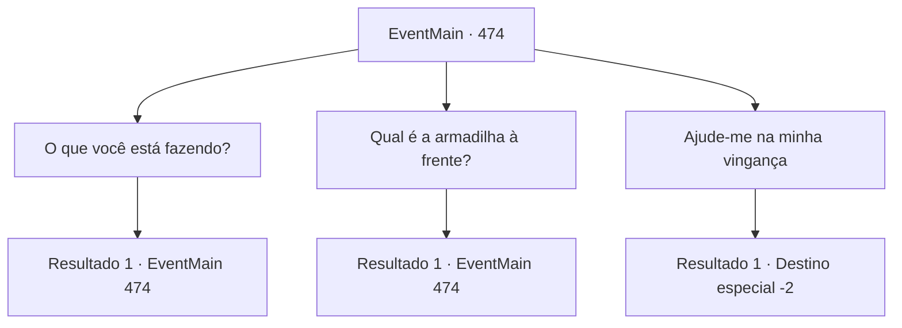

# Eventos principais · 474

[Índice da tabela](index.md) · [Índice geral](../index.md)

ID: `pt:EventMain:474` · Fonte: `EventMain4` · Versão: 1.2.47.

Mapeamento estático dos arquivos; a disponibilidade e a execução dependem do estado da run.

## Texto do evento

*Sem texto no arquivo.*

## Dados de entrada

```json
{
  "id": 474,
  "grade": 1,
  "normalGoal": "",
  "required": ""
}
```

## Mapa das escolhas



## Escolhas e resultados

### Escolha 1

O que você está fazendo?

Requisitos e outros campos da escolha:

```json
{
  "required": "5_354_0"
}
```

#### Resultado 1.1

Quando questionado por você, Gess repetidamente abaixa a cabeça e responde. 

 "E-eu estou servindo Ki-Kior..."

 Segundo ele, ele é o líder daqueles que servem Kior, Em seu sonho, Ele disse a Kior que havia dado uma revelação de que você viria. 

 "Contratante...! A energia dele... Ah... dá pra sentir...!"

 Ele quase se agarra a você, parecendo animado.

Continuação registrada: [Evento 474](0474.md) na mesma tabela.

```json
{
  "required": "",
  "chance": "1",
  "nextEvent": 474,
  "type": 2,
  "reward": "5_354_1"
}
```

### Escolha 2

Qual é a armadilha à frente?

Requisitos e outros campos da escolha:

```json
{
  "required": "5_355_0"
}
```

#### Resultado 2.1

Você se lembra da experiência desagradável que teve antes, e perguntou qual era a armadilha. Então Gess responde com cuidado, olhando para o seu rosto. 

 "Isso é... te-tentando parar pa-paladinos... Desculpe... desculpe! Eu deveria ter desmontado, uh, quando... E-eu não sabia que você viria. Não sabia..."


Continuação registrada: [Evento 474](0474.md) na mesma tabela.

```json
{
  "required": "",
  "chance": "1",
  "nextEvent": 474,
  "type": 2,
  "reward": "5_355_1"
}
```

### Escolha 3

Ajude-me na minha vingança

Requisitos e outros campos da escolha:

```json
{
  "required": ""
}
```

#### Resultado 3.1

Você pede a Gess para ajudá-lo a se vingar de sua família. Então Gess se vira e grita com os outros adoradores. 

 "O-Ouçam! Re-Reúnam todas as informações sobre o Co-contratante, Teresianos, to-todos eles!"

 Ao seu grito, os homens de túnica cinza saem correndo do esconderijo subterrâneo. Então Gess se vira para você novamente e sussurra. 

 "Ah, assim que de-descobrirmos, eu te-te conto, então, po-po-por favor, volte depois"

 Você sai de lá com Gess atrás de você.

Continuação registrada: [Destino especial `-2`](../destinos-especiais.md).

```json
{
  "required": "",
  "chance": "1",
  "nextEvent": -2,
  "type": 2,
  "reward": "13_4_3"
}
```

## Referências que chegam a este evento

- [Evento 473 · escolha 1 · resultado 2](0473.md#escolha-1)
- [Evento 473 · escolha 4 · resultado 1](0473.md#escolha-4)
- [Evento 474 · escolha 1 · resultado 1](0474.md#escolha-1)
- [Evento 474 · escolha 2 · resultado 1](0474.md#escolha-2)
