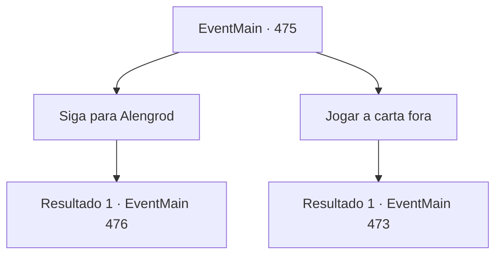

# Eventos principais · 475

[Índice da tabela](index.md) · [Índice geral](../index.md)

ID: `pt:EventMain:475` · Fonte: `EventMain4` · Versão: 1.2.47.

Mapeamento estático dos arquivos; a disponibilidade e a execução dependem do estado da run.

## Texto do evento

Você sente o olhar de alguém e olhou para lá. Há um pombo branco sentado na parede. O pombo faz contato visual com você, voa direto e senta em seu braço. Você encontra uma carta amarrada na perna do pombo e verifica seu conteúdo. 

 'Onil geralmente fica no forte para treinar os cadetes Paladinos. No entanto, desta vez, ele se dirigiu para a pequena aldeia montanhosa 'Alengrod' para executar outra queima. Ele está com alguns paladinos, então se você está procurando um tempo para ficar sozinho, você será capaz de lidar com ele facilmente.'

## Dados de entrada

```json
{
  "id": 475,
  "grade": 1,
  "normalGoal": "",
  "required": "13_4_2|1_2_25"
}
```

## Mapa das escolhas



## Escolhas e resultados

### Escolha 1

Siga para Alengrod

Requisitos e outros campos da escolha:

```json
{
  "required": ""
}
```

#### Resultado 1.1

Você vai para Alengrod como Viyork lhe disse. E algumas horas depois, você chega a um pico com vista para uma pequena aldeia na montanha. Apesar da correria, o sol começa a se pôr no vale. E a fumaça escura já está subindo na praça da cidade. Você olha ao redor da estaca cheia de fumaça, e observe que Onil e os homens de Onil estão lá. Só então, uma voz familiar vem de trás de suas costas. 

 "Bem-vindo. Felizmente, parece que a carta foi bem entregue."

 Olhando para trás, você vê Viyork se aproximando de você.

Continuação registrada: [Evento 476](0476.md) na mesma tabela.

```json
{
  "required": "",
  "chance": "1",
  "nextEvent": 476,
  "type": 2,
  "reward": ""
}
```

### Escolha 2

Jogar a carta fora

Requisitos e outros campos da escolha:

```json
{
  "required": ""
}
```

#### Resultado 2.1

Você mudou de ideia. Você joga fora a carta de Viyork e voltou para encontrar os adoradores de demônios. 

 Chegando à aldeia de Kahida cerca de meio-dia depois, você olha em volta. Não há vestígios de pessoas lá, e as casas estão todas cobertas de poeira e parecem prestes a desabar. A aldeia Kahida, que dizem ter adoradores de demônios, é literalmente um lugar em ruínas.

Continuação registrada: [Evento 473](0473.md) na mesma tabela.

```json
{
  "required": "",
  "chance": "1",
  "nextEvent": 473,
  "type": 2,
  "reward": ""
}
```

## Referências que chegam a este evento

Nenhum `nextEvent` positivo da mesma tabela aponta para este nó. Isso não prova que seja inacessível: sorteio e estado de história podem selecioná-lo.

