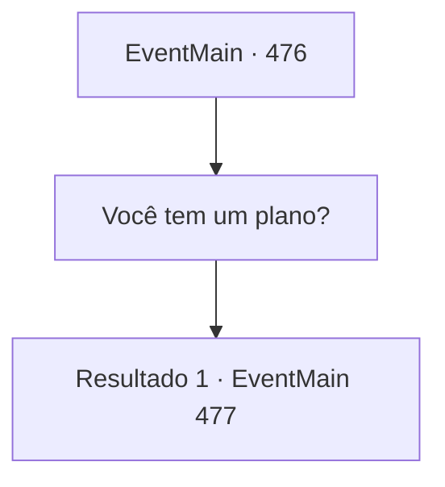

# Eventos principais · 476

[Índice da tabela](index.md) · [Índice geral](../index.md)

ID: `pt:EventMain:476` · Fonte: `EventMain4` · Versão: 1.2.47.

Mapeamento estático dos arquivos; a disponibilidade e a execução dependem do estado da run.

## Texto do evento

*Sem texto no arquivo.*

## Dados de entrada

```json
{
  "id": 476,
  "grade": 1,
  "normalGoal": "",
  "required": ""
}
```

## Mapa das escolhas



## Escolhas e resultados

### Escolha 1

Você tem um plano?

Requisitos e outros campos da escolha:

```json
{
  "required": ""
}
```

#### Resultado 1.1

Viyork sorri e acena positivamente com cabeça.. 

 "Agora que você deu informações suficientes, é hora de mostrar suas habilidades. Vá matar Onil. Vou deixar isso para você."

 Ele continua, olhando para você, com ansiedade em seus olhos. 

 "Mesmo se você falhar, eu vou te ajudar, então não se preocupe."

 Nas palavras de Viyork, você olha para Onil e seus homens à distância. Eles parecem terminar a queima e se preparam para deixar a aldeia.

Continuação registrada: [Evento 477](0477.md) na mesma tabela.

```json
{
  "required": "",
  "chance": "1",
  "nextEvent": 477,
  "type": 2,
  "reward": ""
}
```

## Referências que chegam a este evento

- [Evento 475 · escolha 1 · resultado 1](0475.md#escolha-1)
