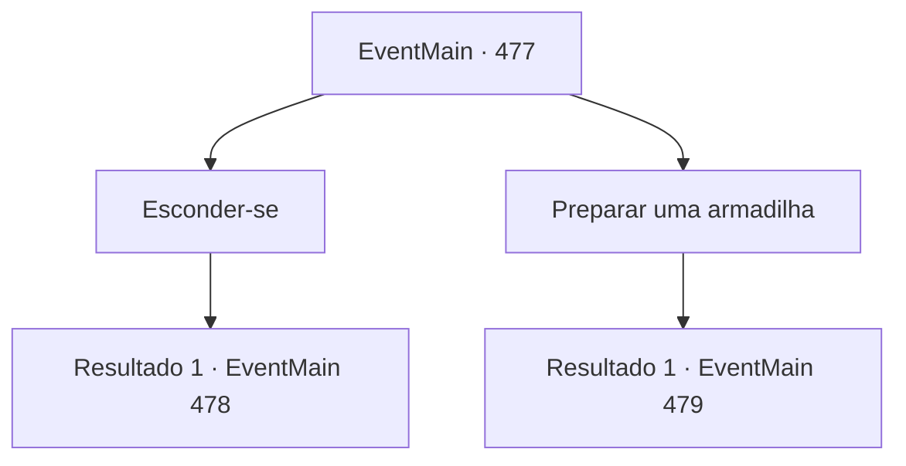

# Eventos principais · 477

[Índice da tabela](index.md) · [Índice geral](../index.md)

ID: `pt:EventMain:477` · Fonte: `EventMain4` · Versão: 1.2.47.

Mapeamento estático dos arquivos; a disponibilidade e a execução dependem do estado da run.

## Texto do evento

*Sem texto no arquivo.*

## Dados de entrada

```json
{
  "id": 477,
  "grade": 1,
  "normalGoal": "",
  "required": ""
}
```

## Mapa das escolhas



## Escolhas e resultados

### Escolha 1

Esconder-se

Requisitos e outros campos da escolha:

```json
{
  "required": ""
}
```

#### Resultado 1.1

Você espera por Onil, escondido atrás de uma rocha perto da aldeia de Alengrod. Logo depois, a escuridão caiu sobre a aldeia da montanha.

 Três paladinos que acabaram de queimar saem da vila. Eles conversam sobre algo e se separam. Um deles é Onil, um homem-lagarto paladino com escamas amarelas. Ele está andando devagar, como se não tivesse notado que você está se escondendo.

Continuação registrada: [Evento 478](0478.md) na mesma tabela.

```json
{
  "required": "",
  "chance": "1",
  "nextEvent": 478,
  "type": 2,
  "reward": ""
}
```

### Escolha 2

Preparar uma armadilha

Requisitos e outros campos da escolha:

```json
{
  "required": "8_38_1"
}
```

#### Resultado 2.1

Você antecipa o caminho de Onil e cava um buraco. E cobre com galhos e folhas, o camuflando. Quando você termina, já está escuro ao redor.

 Três paladinos que terminaram de queimar algo saem da aldeia. Eles conversam sobre algo e se separam. Um deles saiu sozinho, é Onil, o homem-lagarto paladino com escamas amarelas. Andando lentamente pela rua, Onil logo te encontra, e seus olhos amarelos rasgados verticalmente se voltam para você. 

 "Eu posso sentir o espírito do mal. Eu vou te executar aqui!"

 Onil se aproxima de você com sua espada. Então, com um estrondo, ele cai no buraco que você cavou. 

 "Que brincadeira...!!"

 Onil rapidamente sai da armadilha e pula em sua direção. Ele parece ter torcido o tornozelo, mas balança a espada mesmo assim.

Continuação registrada: [Evento 479](0479.md) na mesma tabela.

```json
{
  "required": "",
  "chance": "1",
  "nextEvent": 479,
  "type": 2,
  "reward": "6_2_145",
  "place": 4
}
```

## Referências que chegam a este evento

- [Evento 476 · escolha 1 · resultado 1](0476.md#escolha-1)
