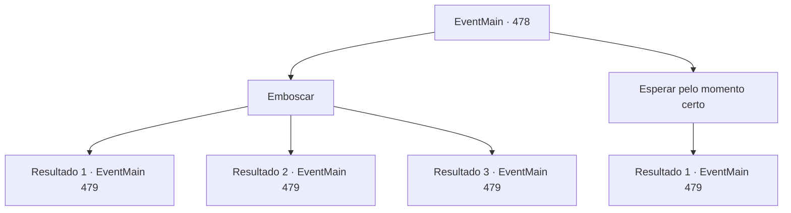

# Eventos principais · 478

[Índice da tabela](index.md) · [Índice geral](../index.md)

ID: `pt:EventMain:478` · Fonte: `EventMain4` · Versão: 1.2.47.

Mapeamento estático dos arquivos; a disponibilidade e a execução dependem do estado da run.

## Texto do evento

*Sem texto no arquivo.*

## Dados de entrada

```json
{
  "id": 478,
  "grade": 1,
  "normalGoal": "",
  "required": ""
}
```

## Mapa das escolhas



## Escolhas e resultados

### Escolha 1

Emboscar

Requisitos e outros campos da escolha:

```json
{
  "required": ""
}
```

#### Resultado 1.1

Você rapidamente corre para Onil e faz um ataque surpresa. 

 "K... Huukk!"

 Com um grito curto, Onil aperta seu braço. No entanto, ele grita, sacando sua arma. 

 "...Que idiota!"

 Você vê um reflexo de uma espada indo até você.

Continuação registrada: [Evento 479](0479.md) na mesma tabela.

```json
{
  "required": "21_5_2",
  "chance": "1|0_6_1",
  "nextEvent": 479,
  "type": 0,
  "reward": "6_2_145",
  "place": 4
}
```

#### Resultado 1.2

Você tenta surpreender o ataque Onil. Mas mais rápido do que isso, seus olhos rasgados verticalmente se voltam para você. 

 "...Saia daí!"

 Ele saca sua espada e aponta para você. Você sai detrás da rocha e o confronta. 

 "Eu posso sentir o espírito maligno. Eu vou ter que executar você aqui!"


Continuação registrada: [Evento 479](0479.md) na mesma tabela.

```json
{
  "required": "21_5_2",
  "chance": "12",
  "nextEvent": 479,
  "type": 1,
  "reward": "6_0_145",
  "place": 4
}
```

#### Resultado 1.3

Você rapidamente corre para Onil e faz um ataque surpresa. 

 "K... Huukk!"

 Com um grito curto, Onil aperta seu braço. No entanto, ele grita, sacando sua arma. 

 "...Que idiota!"

 Você vê um reflexo de uma espada indo até você.

Continuação registrada: [Evento 479](0479.md) na mesma tabela.

```json
{
  "required": "20_5_2",
  "chance": "1",
  "nextEvent": 479,
  "type": 2,
  "reward": "6_2_145",
  "place": 4
}
```

### Escolha 2

Esperar pelo momento certo

Requisitos e outros campos da escolha:

```json
{
  "required": ""
}
```

#### Resultado 2.1

Você decide esperar por um tempo mais definido. Mas o julgamento foi um erro. Onil, que caminhava vagarosamente, olha exatamente para o local onde você está escondido. 

 "...Venha para fora!"

 Ele saca sua espada e aponta para você Você sai de uma fenda na rocha e o confronta. 

 "Eu posso sentir o espírito maligno. Eu vou executar você aqui!"


Continuação registrada: [Evento 479](0479.md) na mesma tabela.

```json
{
  "required": "",
  "chance": "1",
  "nextEvent": 479,
  "type": 2,
  "reward": "6_0_145",
  "place": 4
}
```

## Referências que chegam a este evento

- [Evento 477 · escolha 1 · resultado 1](0477.md#escolha-1)
