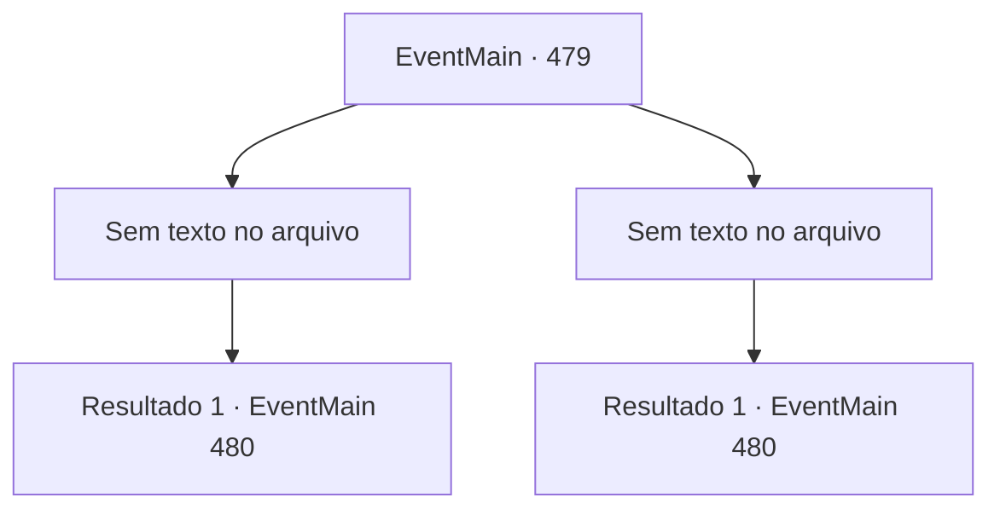

# Eventos principais · 479

[Índice da tabela](index.md) · [Índice geral](../index.md)

ID: `pt:EventMain:479` · Fonte: `EventMain4` · Versão: 1.2.47.

Mapeamento estático dos arquivos; a disponibilidade e a execução dependem do estado da run.

## Texto do evento

*Sem texto no arquivo.*

## Dados de entrada

```json
{
  "id": 479,
  "grade": 1,
  "normalGoal": "",
  "required": ""
}
```

## Mapa das escolhas



## Escolhas e resultados

### Escolha 1

*Sem texto no arquivo; o papel dessa opção depende da interface do jogo.*

Requisitos e outros campos da escolha:

```json
{
  "required": ""
}
```

#### Resultado 1.1

Onil, que lutou bravamente contra você, acaba de joelhos. Ele levanta a cabeça com dificuldade e olha para você com um olhar embaçado. 

 "... Você foi queimado...! Vivo!!... Como?... *cof* *cof*"

 Cada vez que Onil tosse, o sangue jorra. Mas ele não para de falar, mesmo sentindo que sua morte está se aproximando. 

 "Haha... Vingança pela família... É isso..? *cof*. Me perdoa. Isso é... apenas... justiça..."

 Ele parece ter dificuldade para respirar. Então, você ouve a voz de Kior 

 "Boa luta. Agora alcance seu rosto e traga sua alma."


Continuação registrada: [Evento 480](0480.md) na mesma tabela.

```json
{
  "required": "",
  "chance": "1",
  "nextEvent": 480,
  "type": 2,
  "reward": ""
}
```

### Escolha 2

*Sem texto no arquivo; o papel dessa opção depende da interface do jogo.*

Requisitos e outros campos da escolha:

```json
{
  "required": ""
}
```

#### Resultado 2.1

No momento em que a espada de Onil está prestes a atingir seu pescoço, Viyork aparece de repente e corre para Onil, como se estivesse se escondendo em algum lugar. A adaga afiada de Viyork está cravada em sua costela, e Onil não resiste à dor e se ajoelha no local. 

 "O quê, por que você está... *cof*!"

 Você se aproxima daquele que está vomitando sangue. O olhar turvo de Onil se volta para você. 

 "... Você foi queimado...! Vivo!!... Como?... *cof* *cof*"

 Cada vez que Onil tosse, o sangue jorra. Ele parece ter dificuldade para respirar. Então, você ouve a voz de Kior  

 "Boa luta, porém o garoto acabou com graça. Agora alcance seu rosto e traga sua alma."


Continuação registrada: [Evento 480](0480.md) na mesma tabela.

```json
{
  "required": "",
  "chance": "1",
  "nextEvent": 480,
  "type": 2,
  "reward": "5_356_1"
}
```

## Referências que chegam a este evento

- [Evento 477 · escolha 2 · resultado 1](0477.md#escolha-2)
- [Evento 478 · escolha 1 · resultado 1](0478.md#escolha-1)
- [Evento 478 · escolha 1 · resultado 2](0478.md#escolha-1)
- [Evento 478 · escolha 1 · resultado 3](0478.md#escolha-1)
- [Evento 478 · escolha 2 · resultado 1](0478.md#escolha-2)
