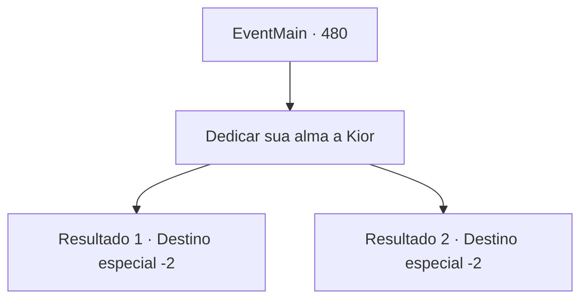

# Eventos principais · 480

[Índice da tabela](index.md) · [Índice geral](../index.md)

ID: `pt:EventMain:480` · Fonte: `EventMain4` · Versão: 1.2.47.

Mapeamento estático dos arquivos; a disponibilidade e a execução dependem do estado da run.

## Texto do evento

*Sem texto no arquivo.*

## Dados de entrada

```json
{
  "id": 480,
  "grade": 1,
  "normalGoal": "",
  "required": ""
}
```

## Mapa das escolhas



## Escolhas e resultados

### Escolha 1

Dedicar sua alma a Kior

Requisitos e outros campos da escolha:

```json
{
  "required": ""
}
```

#### Resultado 1.1

|drawing_drain| Você colocou a mão no rosto de Onil como Kior mandou. Então uma névoa pálida e densa flui de todos os buracos no rosto de Onil. É a alma dele. 

 "Kuuuck! Kuu.. hukk..!!!"

 Onil não suporta a dor e treme todo, e a névoa que flui passa para Kior através de sua mão. Depois de um tempo, quando você absorve toda a alma de Onil e retira sua mão, ele não respira mais. É só então. Viyork aparece dos arbustos atrás de você. 

 "Bom trabalho. Você fez um ótimo trabalho."

 Ele aplaude levemente, dizendo que está assistindo a tudo. Então ele pega o mapa e mostra para você e diz. 

 "Em cerca de um mês, Danica passará por aqui nesta cidade chamada 'Rudel'."

 Ele sugere que surpreenda Danica enquanto ela passa pelo caminho da montanha perto da aldeia. Você acena com a cabeça e ele se afasta com um sorriso satisfeito.

Continuação registrada: [Destino especial `-2`](../destinos-especiais.md).

```json
{
  "required": "18_356_1",
  "chance": "1",
  "nextEvent": -2,
  "type": 2,
  "reward": "0_3_-5|8_249_1|13_4_4"
}
```

#### Resultado 1.2

|drawing_drain|  Você colocou a mão no rosto de Onil como Kior mandou.  Então uma névoa pálida e densa flui de todos os buracos no rosto de Onil.  É a alma dele.  

 "Kuuuck! Kuu.. hukk..!!!"

  Onil não suporta a dor e treme todo, e a névoa que flui passa para Kior através de sua mão.  Depois de um tempo, quando você absorve toda a alma de Onil e retira sua mão, ele não respira mais.  É só então. Viyork aparece dos arbustos atrás de você.  

 "Bom trabalho. Você fez um ótimo trabalho."

  Ele aplaude levemente, dizendo que está assistindo a tudo.  Então ele pega o mapa e mostra para você e diz.  

 "Em cerca de um mês, Danica passará por aqui nesta cidade chamada 'Rudel'."

  Ele sugere que surpreenda Danica enquanto ela passa pelo caminho da montanha perto da aldeia.  Você acena com a cabeça e ele se afasta com um sorriso satisfeito.

Continuação registrada: [Destino especial `-2`](../destinos-especiais.md).

```json
{
  "required": "5_356_1",
  "chance": "1",
  "nextEvent": -2,
  "type": 2,
  "reward": "0_3_-5|8_249_1|13_4_4"
}
```

## Referências que chegam a este evento

- [Evento 479 · escolha 1 · resultado 1](0479.md#escolha-1)
- [Evento 479 · escolha 2 · resultado 1](0479.md#escolha-2)
