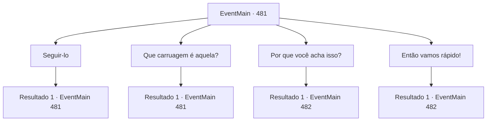

# Eventos principais · 481

[Índice da tabela](index.md) · [Índice geral](../index.md)

ID: `pt:EventMain:481` · Fonte: `EventMain4` · Versão: 1.2.47.

Mapeamento estático dos arquivos; a disponibilidade e a execução dependem do estado da run.

## Texto do evento

De madrugada, você chegou à vila chamada 'Ludel' na data que Viyork havia mencionado. A vila, construída ao pé da montanha, tinha caminhos de pedra impressionantes, feitos com pequenas rochas empilhadas. Na entrada de Ludel, um homem vestindo um manto se aproximou como se já estivesse esperando por você. 

 "O Sr. Viyork está aguardando. Por favor, siga-me."

 Apesar de ainda não ser a hora marcada, ele parecia ansioso.

## Dados de entrada

```json
{
  "id": 481,
  "grade": 1,
  "normalGoal": "",
  "required": "13_4_4|1_2_50"
}
```

## Mapa das escolhas



## Escolhas e resultados

### Escolha 1

Seguir-lo

Requisitos e outros campos da escolha:

```json
{
  "required": "5_357_0"
}
```

#### Resultado 1.1

Você segue o homem até Viyork. Viyork está em uma montanha próxima com seus homens, olhando para algum lugar. Quando você chega, Viyork diz com um sorriso brilhante. 

 "Felizmente, não é tarde demais. {1}. Eu tenho que parar aquela carruagem agora!"

 Viyork diz a você e aponta para baixo da montanha. Na direção que ele aponta, várias carroças de quatro rodas passam em alta velocidade.

Continuação registrada: [Evento 481](0481.md) na mesma tabela.

```json
{
  "required": "",
  "chance": "1",
  "nextEvent": 481,
  "type": 2,
  "reward": "5_357_1"
}
```

### Escolha 2

Que carruagem é aquela?

Requisitos e outros campos da escolha:

```json
{
  "required": "5_357_1"
}
```

#### Resultado 2.1

Viyork responde sua pergunta com um olhar sério. 

 "Uma dessas carroças está levando uma certa 'Danica' que acusou sua família de cultuar demônios. Ela é um halfling, então você pode reconhecê-la de relance."

 Danica, junto com o trabalho missionário, é responsável por coletar informações fora da igreja, diz Viyork. E então eles passam essas informações para o Arcebispo, que dá ordens com base nas informações que ela entrega. Viyork diz que ela deve ter notado seu relacionamento com você. 

 "Danica deveria parar em 'Rudel' e seguir para 'Verpen'. Mas agora ela está indo na direção oposta. Deve estar indo para a 'Catedral de Yerut', onde o arcebispo está. Se você não a impedir agora, o Arcebispo Publius saberá que eu te ajudei!"


Continuação registrada: [Evento 481](0481.md) na mesma tabela.

```json
{
  "required": "",
  "chance": "1",
  "nextEvent": 481,
  "type": 2,
  "reward": "5_357_2"
}
```

### Escolha 3

Por que você acha isso? 

Requisitos e outros campos da escolha:

```json
{
  "required": "5_357_2|1_7_12"
}
```

#### Resultado 3.1

Você pergunta a ele, por que ele pensa assim. 

 "Danica não gostou de mim desde o começo. Ela era sempre suspeita. De qualquer forma, esse não é o ponto agora. Apresse-se e siga-me. Temos que nos livrar de Danica."

 Viyork, que encobre suas palavras grosseiramente, assume a liderança e caminha, e você o segue. Você chega com Viyork no penhasco com vista para o caminho da carruagem de Danica. 

 "A carruagem de Danica logo passará por aqui. Você fica no caminho deles. Eu vou proteger a retaguarda."


Continuação registrada: [Evento 482](0482.md) na mesma tabela.

```json
{
  "required": "",
  "chance": "1",
  "nextEvent": 482,
  "type": 2,
  "reward": ""
}
```

### Escolha 4

Então vamos rápido!

Requisitos e outros campos da escolha:

```json
{
  "required": "5_357_2"
}
```

#### Resultado 4.1

Viyork realmente ia fazer isso, ele disse com pressa. Você chega com Viyork no penhasco com vista para o caminho da carruagem de Danica. 

 "A carruagem de Danica logo passará por aqui. Você fica no caminho deles. Eu vou proteger a retaguarda."


Continuação registrada: [Evento 482](0482.md) na mesma tabela.

```json
{
  "required": "",
  "chance": "1",
  "nextEvent": 482,
  "type": 2,
  "reward": ""
}
```

## Referências que chegam a este evento

- [Evento 481 · escolha 1 · resultado 1](0481.md#escolha-1)
- [Evento 481 · escolha 2 · resultado 1](0481.md#escolha-2)
