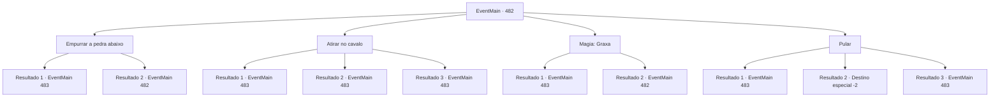

# Eventos principais · 482

[Índice da tabela](index.md) · [Índice geral](../index.md)

ID: `pt:EventMain:482` · Fonte: `EventMain4` · Versão: 1.2.47.

Mapeamento estático dos arquivos; a disponibilidade e a execução dependem do estado da run.

## Texto do evento

*Sem texto no arquivo.*

## Dados de entrada

```json
{
  "id": 482,
  "grade": 1,
  "normalGoal": "",
  "required": ""
}
```

## Mapa das escolhas



## Escolhas e resultados

### Escolha 1

Empurrar a pedra abaixo

Requisitos e outros campos da escolha:

```json
{
  "required": "5_358_0"
}
```

#### Resultado 1.1

Você empurra a pedra perto do penhasco e a rola pelo penhasco. A rocha, que começa a rolar rapidamente, que atinge, destruindo a primeira carruagem, que faz parar as carruagens que se seguiram uma após a outra. Viyork bate palmas enquanto observa os paladinos na outra carruagem saindo. 

 "Gostaria que Danica estivesse naquela carruagem quebrada. Vamos descer e verificar."

 Com isso, você desce o penhasco com Viyork e seus homens. |drawing_danica| Quando você chega ao fundo do penhasco, Você vê paladinos tentando remover a pedra e a sacerdotisa halfling 'Danica'. Danica vira a cabeça ao som de passos e grita com Viyork. 

 "...Viyork! Você fez isso?"

 Em vez de responder, Viyork saca sua espada e comanda o ataque. Logo em seguida, a luta começa com um grito.

Continuação registrada: [Evento 483](0483.md) na mesma tabela.

```json
{
  "required": "",
  "chance": "1|0_5_1",
  "nextEvent": 483,
  "type": 0,
  "reward": "0_2_1|6_0_50",
  "place": 1
}
```

#### Resultado 1.2

Você tentou empurrar a pedra perto do penhasco para bloquear o caminho da carruagem. Mas a rocha não se move. Viyork grita com uma voz furiosa. 

 "O que você está fazendo!? Não é hora para brincadeira!"

 Com a pressão de Viyork, você decide tentar outra coisa.

Continuação registrada: [Evento 482](0482.md) na mesma tabela.

```json
{
  "required": "",
  "chance": "13",
  "nextEvent": 482,
  "type": 1,
  "reward": "5_358_1"
}
```

### Escolha 2

Atirar no cavalo

Requisitos e outros campos da escolha:

```json
{
  "required": "20_6_1"
}
```

#### Resultado 2.1

Você atira na carruagem da frente. O cavalo que a puxava desaba repentinamente, causando múltiplas colisões de carruagens atrás dela. Viyork estala a língua enquanto observa os paladinos saírem das carruagens. 

 "Hmph, grande habilidade. Agora, vamos descer e lidar com o resto."

 Com isso, você desce o penhasco junto com Viyork e seus homens. |drawing_danica| Quando chega ao sopé do penhasco, vê paladinos tentando limpar os destroços com a sacerdotisa halfling 'Danica'. Danica vira a cabeça ao ouvir o som dos seus passos e grita para Viyork. 

 "...Viyork! Foi você quem fez isso?"

 Em vez de responder, Viyork saca sua espada e sinaliza o ataque. Seus homens gritam, e a batalha começa.

Continuação registrada: [Evento 483](0483.md) na mesma tabela.

```json
{
  "required": "21_6_3",
  "chance": "1|0_6_1",
  "nextEvent": 483,
  "type": 0,
  "reward": "0_2_1|6_0_50",
  "place": 1
}
```

#### Resultado 2.2

Você atira na carruagem da frente. Os cavalos que a puxavam escapam por pouco do ataque e começam a correr descontrolados em pânico. Viyork estala a língua enquanto observa as carruagens parando lentamente. 

 "Tsc... Teria sido bom se as carruagens tivessem colidido. Agora, vamos descer e resolver isso."

 Com isso, você desce o penhasco junto com Viyork e seus homens. |drawing_danica| Quando chega ao sopé do penhasco, vê paladinos tentando acalmar os cavalos junto com a sacerdotisa halfling 'Danica'. Danica vira a cabeça ao ouvir o som dos seus passos e grita para Viyork. 

 "...Viyork! Foi você quem fez isso?"

 Em vez de responder, Viyork saca sua espada e sinaliza o ataque. Seus homens gritam, e a batalha começa.

Continuação registrada: [Evento 483](0483.md) na mesma tabela.

```json
{
  "required": "21_6_3",
  "chance": "13",
  "nextEvent": 483,
  "type": 1,
  "reward": "6_3_50",
  "place": 1
}
```

#### Resultado 2.3

Você atira na carruagem da frente.  O cavalo que a puxava desaba repentinamente, causando múltiplas colisões de carruagens atrás dela. Viyork estala a língua enquanto observa os paladinos saírem das carruagens.  

 "Hmph, grande habilidade. Agora, vamos descer e lidar com o resto."

  Com isso, você desce o penhasco junto com Viyork e seus homens.  |drawing_danica|  Quando chega ao sopé do penhasco, vê paladinos tentando limpar os destroços com a sacerdotisa halfling 'Danica'.  Danica vira a cabeça ao ouvir o som dos seus passos e grita para Viyork.  

 "...Viyork! Foi você quem fez isso?"

  Em vez de responder, Viyork saca sua espada e sinaliza o ataque.  Seus homens gritam, e a batalha começa.

Continuação registrada: [Evento 483](0483.md) na mesma tabela.

```json
{
  "required": "20_6_3",
  "chance": "1",
  "nextEvent": 483,
  "type": 2,
  "reward": "0_2_1|6_0_50",
  "place": 1
}
```

### Escolha 3

Magia: Graxa

Requisitos e outros campos da escolha:

```json
{
  "required": "20_0_1|1_1_2|5_359_0"
}
```

#### Resultado 3.1

Você conjura Graxa na estrada à frente da carruagem. O óleo faz com que as rodas da carruagem deslizem, e as carruagens colidem uma após a outra. Viyork estala a língua enquanto observa os paladinos saindo das carruagens. 

 "Eu gostaria que isso os tivesse matado. Agora, vamos descer e acabar com isso."

 Com isso, você desce o penhasco junto com Viyork e seus homens. |drawing_danica| Quando chega ao sopé do penhasco, vê os paladinos tentando limpar os destroços com a sacerdotisa halfling 'Danica'. Danica vira a cabeça ao som dos seus passos e grita para Viyork. 

 "...Viyork! Foi você quem fez isso?"

 Em vez de responder, Viyork saca sua espada e sinaliza o ataque. Seus homens gritam, e a batalha começa.

Continuação registrada: [Evento 483](0483.md) na mesma tabela.

```json
{
  "required": "",
  "chance": "1|0_14_1",
  "nextEvent": 483,
  "type": 0,
  "reward": "0_2_1|6_0_50|0_1_-1",
  "place": 1
}
```

#### Resultado 3.2

Você tenta bloquear o caminho da carruagem conjurando Graxa. No entanto, você falha em lançar a magia, talvez por falta de concentração. Viyork grita com uma voz urgente. 

 "O que você está fazendo!? Não é hora de brincadeiras!"

 Com a pressão de Viyork, você decide tentar outra coisa.

Continuação registrada: [Evento 482](0482.md) na mesma tabela.

```json
{
  "required": "",
  "chance": "13",
  "nextEvent": 482,
  "type": 1,
  "reward": "5_359_1|0_1_-1"
}
```

### Escolha 4

Pular

Requisitos e outros campos da escolha:

```json
{
  "required": ""
}
```

#### Resultado 4.1

Você desce rapidamente o penhasco e bloqueia o caminho das caravanas. 

 "Que insolente!"

 Com um grito, os paladinos saltam das carruagens. E, como Viyork mencionou, a sacerdotisa halfling, Danica, também desce da carroça. |drawing_danica| Ela olha para você com olhos arregalados. 

 "O que está acontecendo? Por que está bloqueando a carruagem...?"

 Então, ofegante, Viyork o alcança. 

 "Hah... Hah... Eu não sabia que você ia saltar tão imprudentemente."

 Danica, ao ver Viyork, franze a sobrancelha e grita. 

 "...Viyork! O que você está fazendo?"

 Em vez de responder, Viyork saca sua espada e sinaliza o ataque. Seus homens gritam, e a luta começa.

Continuação registrada: [Evento 483](0483.md) na mesma tabela.

```json
{
  "required": "21_10_1",
  "chance": "1|0_6_1",
  "nextEvent": 483,
  "type": 0,
  "reward": "0_2_1|6_0_50",
  "place": 1
}
```

#### Resultado 4.2

Você tenta descer rapidamente o penhasco.   Mas perde o equilíbrio. Quase cai para a morte, mas Viyork o agarra e puxa de volta para o topo do penhasco.   Enquanto isso, a carruagem de Danica já se distanciou demais para ser atacada.   

 "...Ah, não... Não acredito que você estragou esse trabalho. Por agora, é melhor você ir embora. Vou tentar entrar em contato com você em breve."

   Com essas palavras, você se separa de Viyork e parte.

Continuação registrada: [Destino especial `-2`](../destinos-especiais.md).

```json
{
  "required": "21_10_1",
  "chance": "12",
  "nextEvent": -2,
  "type": 1,
  "reward": "13_4_5"
}
```

#### Resultado 4.3

Você pula pela beirada do penhasco e corre rapidamente para baixo. E bloqueia a procissão das carruagens. 

 "Que idiota!"

 Com um grito, os paladinos saem das carruagens. E, como Viyork disse, o sacerdote halfling, Danica, também sai da carroça. |drawing_danica| Ela olha para você com os olhos arregalados. 

 "O que é isso? Por que você está bloqueando a carruagem...?"

 Então, ofegante, Viyork chega correndo até você. 

 "Eu não sabia que você ia pular tão descuidadamente."

 Danica, ao ver Viyork, franze a testa e grita. 

 "...Viyork! O que você está fazendo?"

 Ao invés de responder, Viyork saca sua espada e sinaliza para o ataque. Seus homens gritam e a luta começa.

Continuação registrada: [Evento 483](0483.md) na mesma tabela.

```json
{
  "required": "20_10_1",
  "chance": "1",
  "nextEvent": 483,
  "type": 2,
  "reward": "0_2_1|6_0_50",
  "place": 1
}
```

## Referências que chegam a este evento

- [Evento 481 · escolha 3 · resultado 1](0481.md#escolha-3)
- [Evento 481 · escolha 4 · resultado 1](0481.md#escolha-4)
- [Evento 482 · escolha 1 · resultado 2](0482.md#escolha-1)
- [Evento 482 · escolha 3 · resultado 2](0482.md#escolha-3)
