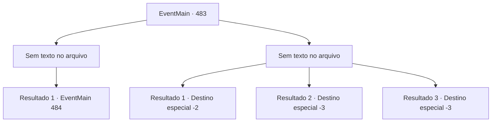

# Eventos principais · 483

[Índice da tabela](index.md) · [Índice geral](../index.md)

ID: `pt:EventMain:483` · Fonte: `EventMain4` · Versão: 1.2.47.

Mapeamento estático dos arquivos; a disponibilidade e a execução dependem do estado da run.

## Texto do evento

*Sem texto no arquivo.*

## Dados de entrada

```json
{
  "id": 483,
  "grade": 1,
  "normalGoal": "",
  "required": ""
}
```

## Mapa das escolhas



## Escolhas e resultados

### Escolha 1

*Sem texto no arquivo; o papel dessa opção depende da interface do jogo.*

Requisitos e outros campos da escolha:

```json
{
  "required": ""
}
```

#### Resultado 1.1

Enquanto você luta, vê Danica fugindo. Então, Viyork grita: 

 "{1}! Você precisa pegar Danica! Não deixe ela escapar!"

 Ao ouvir o chamado de Viyork, você chuta o paladino com quem estava lutando e sai correndo atrás dela.

Continuação registrada: [Evento 484](0484.md) na mesma tabela.

```json
{
  "required": "",
  "chance": "1",
  "nextEvent": 484,
  "type": 2,
  "reward": ""
}
```

### Escolha 2

*Sem texto no arquivo; o papel dessa opção depende da interface do jogo.*

Requisitos e outros campos da escolha:

```json
{
  "required": ""
}
```

#### Resultado 2.1

O plano de Viyork para capturar Danica falhou. Ele e seus homens foram derrotados pelas escoltas que a protegiam. Tudo o que você podia fazer era fugir de lá com Viyork.

 Depois de um tempo, você e Viyork, que escaparam por pouco, respiram fundo e olham em volta. Felizmente, parece não haver vestígios dos paladinos. Então, Viyork suspira com uma expressão frustrada. Ele diz roendo as unhas. 

 "Droga... não consigo evitar... Primeiro de tudo, você deveria voltar. Vou tentar entrar em contato com você em breve."

 Com as palavras dele, você termina a conversa com Viyork e sai de lá.

Continuação registrada: [Destino especial `-2`](../destinos-especiais.md).

```json
{
  "required": "1_0_2|1_1_2",
  "chance": "1",
  "nextEvent": -2,
  "type": 2,
  "reward": "0_0_-1|0_1_-1|13_4_5"
}
```

#### Resultado 2.2

Os paladinos te cercam e atacam em sincronia  E no momento em que eles têm certeza de que você não pode escapar, todos eles correm, brandindo suas espadas.  Você não consegue bloquear todos os ataques, você é roubado e morto.

Continuação registrada: [Destino especial `-3`](../destinos-especiais.md).

```json
{
  "required": "2_0_2",
  "chance": "1",
  "nextEvent": -3,
  "type": 2,
  "reward": "0_0_-1|0_1_-1"
}
```

#### Resultado 2.3

Os paladinos te cercam e atacam em sincronia E no momento em que eles têm certeza de que você não pode escapar, todos eles correm, brandindo suas espadas. Você não consegue bloquear todos os ataques, você é roubado e morto.

Continuação registrada: [Destino especial `-3`](../destinos-especiais.md).

```json
{
  "required": "2_1_2",
  "chance": "1",
  "nextEvent": -3,
  "type": 2,
  "reward": "0_0_-1|0_1_-1"
}
```

## Referências que chegam a este evento

- [Evento 482 · escolha 1 · resultado 1](0482.md#escolha-1)
- [Evento 482 · escolha 2 · resultado 1](0482.md#escolha-2)
- [Evento 482 · escolha 2 · resultado 2](0482.md#escolha-2)
- [Evento 482 · escolha 2 · resultado 3](0482.md#escolha-2)
- [Evento 482 · escolha 3 · resultado 1](0482.md#escolha-3)
- [Evento 482 · escolha 4 · resultado 1](0482.md#escolha-4)
- [Evento 482 · escolha 4 · resultado 3](0482.md#escolha-4)
