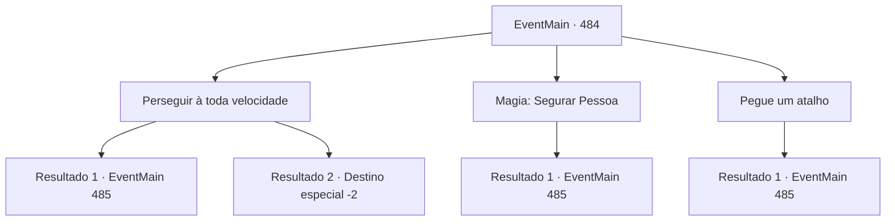

# Eventos principais · 484

[Índice da tabela](index.md) · [Índice geral](../index.md)

ID: `pt:EventMain:484` · Fonte: `EventMain4` · Versão: 1.2.47.

Mapeamento estático dos arquivos; a disponibilidade e a execução dependem do estado da run.

## Texto do evento

*Sem texto no arquivo.*

## Dados de entrada

```json
{
  "id": 484,
  "grade": 1,
  "normalGoal": "",
  "required": ""
}
```

## Mapa das escolhas



## Escolhas e resultados

### Escolha 1

Perseguir à toda velocidade

Requisitos e outros campos da escolha:

```json
{
  "required": ""
}
```

#### Resultado 1.1

Você persegue Danica a toda velocidade e a alcança. Ela é pega por você e resiste ferozmente, mas acaba sendo dominada e jogada no chão. 

 "Essa é a... a energia de K-Kior... Tenho certeza que você foi... executado..."

 Danica reconhece você e gagueja de medo. Você segura o pulso dela com força.

Continuação registrada: [Evento 485](0485.md) na mesma tabela.

```json
{
  "required": "",
  "chance": "1|0_6_1",
  "nextEvent": 485,
  "type": 0,
  "reward": ""
}
```

#### Resultado 1.2

Você persegue Danica a toda velocidade, mas os pés dela são mais ligeiros. Ela se esconde em uma floresta densa. Mesmo Viyork e seus homens não conseguem encontrá-la. Conforme o sol se põe, Viyork interrompe a busca com um rosto sério. 

 "Eu não posso evitar... Primeiro de tudo, você deveria voltar. Vou tentar entrar em contato com você em breve."

 Com as palavras dele, você termina a conversa com Viyork e sai de lá.

Continuação registrada: [Destino especial `-2`](../destinos-especiais.md).

```json
{
  "required": "",
  "chance": "14",
  "nextEvent": -2,
  "type": 1,
  "reward": "13_4_5"
}
```

### Escolha 2

Magia: Segurar Pessoa

Requisitos e outros campos da escolha:

```json
{
  "required": "20_0_2|1_1_2"
}
```

#### Resultado 2.1

Você conjura 'Segurar pessoa' e prende Danica. Ela tentou desesperadamente escapar, mas foi subjugada e caiu no chão. 

 "Essa é a... a energia de K-Kior... Tenho certeza que você foi... executado..."

 Danica reconhece você e gagueja de medo. A tua mão, que a segura, põe força nela.

Continuação registrada: [Evento 485](0485.md) na mesma tabela.

```json
{
  "required": "",
  "chance": "1",
  "nextEvent": 485,
  "type": 2,
  "reward": "0_1_-1"
}
```

### Escolha 3

Pegue um atalho

Requisitos e outros campos da escolha:

```json
{
  "required": "1_14_14"
}
```

#### Resultado 3.1

Você intuitivamente descobre o atalho. E por lá, Você alcança a frente de Danica. Ela tenta fugir de você até o final, mas é subjugada e jogada no chão. 

 "Isto é... Ki... a energia de Kior... Tenho certeza que você foi... executado..."

 Danica reconhece você e gagueja de medo. Você segura o pulso dela com força.

Continuação registrada: [Evento 485](0485.md) na mesma tabela.

```json
{
  "required": "",
  "chance": "1",
  "nextEvent": 485,
  "type": 2,
  "reward": ""
}
```

## Referências que chegam a este evento

- [Evento 483 · escolha 1 · resultado 1](0483.md#escolha-1)
