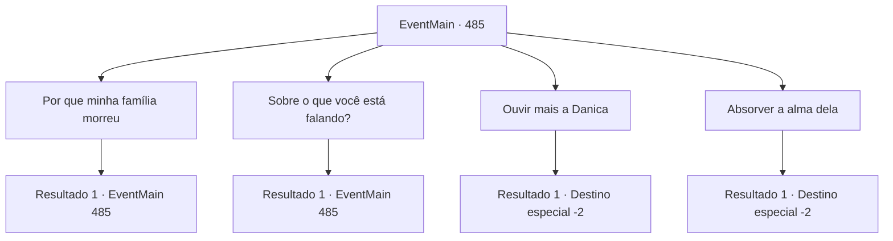

# Eventos principais · 485

[Índice da tabela](index.md) · [Índice geral](../index.md)

ID: `pt:EventMain:485` · Fonte: `EventMain4` · Versão: 1.2.47.

Mapeamento estático dos arquivos; a disponibilidade e a execução dependem do estado da run.

## Texto do evento

*Sem texto no arquivo.*

## Dados de entrada

```json
{
  "id": 485,
  "grade": 1,
  "normalGoal": "",
  "required": ""
}
```

## Mapa das escolhas



## Escolhas e resultados

### Escolha 1

Por que minha família morreu

Requisitos e outros campos da escolha:

```json
{
  "required": "5_360_0"
}
```

#### Resultado 1.1

Você pergunta a Danica por que ela acusou sua família de estar possuída pelo demônio. Por causa disso, você e sua família tiveram que sofrer uma morte terrível. Danica diz com a voz trêmula. 

 "Naquele dia... Seu cônjuge fez um pacto com Kior! Então, eu tinha que relatar...!"

 Danica olha diretamente para você, balançando os ombros. 

 "Você está... sendo manipulado por aquele demônio!"


Continuação registrada: [Evento 485](0485.md) na mesma tabela.

```json
{
  "required": "",
  "chance": "1",
  "nextEvent": 485,
  "type": 2,
  "reward": "5_360_1"
}
```

### Escolha 2

Sobre o que você está falando?

Requisitos e outros campos da escolha:

```json
{
  "required": "5_360_1"
}
```

#### Resultado 2.1

Você pergunta a Danica o que ela estava dizendo. Mas é Kior, não Danica, quem responde à sua pergunta primeiro. 

 "Ela está falando qualquer coisa, porque ela quer viver."

 Danica, incapaz de ouvir o sussurro, diz desesperada. 

 "Não se envolva com o demônio! Tenho certeza que você vai pagar por isso..!"

 Kior nega suas palavras, sussurrando em sua cabeça. 

 "Você não a precisa ouvir... Agora, dedique a alma dela a mim."


Continuação registrada: [Evento 485](0485.md) na mesma tabela.

```json
{
  "required": "",
  "chance": "1",
  "nextEvent": 485,
  "type": 2,
  "reward": "5_360_2"
}
```

### Escolha 3

Ouvir mais a Danica

Requisitos e outros campos da escolha:

```json
{
  "required": "5_360_2"
}
```

#### Resultado 3.1

Você decide ouvir mais o que Danica tem a dizer.    Você não consegue afastar a dúvida de que você seja apenas um brinquedo nas mãos de um demônio.    Mas, antes que ela possa abrir a boca novamente, a espada de Viyork perfura seu abdômen.    Danica vomita sangue e morre enquanto tenta falar.    Você olha para Viyork.    Então, ele dá de ombros e pergunta o que há de errado.    Você ouve a voz de Kior novamente.    

 "A curiosidade é uma emoção inútil. Não perca mais tempo e dedique rapidamente a alma de Danica a mim."

    Você coloca sua mão no rosto de Danica.    Você absorve sua alma assim como fez com a de Onil.    Logo depois de tomar toda a sua alma, a voz de Kior ressoa em sua cabeça.    

 "Que alma maravilhosa..! Eu vou te deixar mais forte em troca de sua fé."

    O poder de Kior preenche você, e uma estranha vitalidade flui por todo o seu corpo.    Enquanto isso, Viyork manda seus homens jogar os corpos de Danica e dos paladinos penhasco abaixo.    

 "Realmente não há muito tempo. Eu vou te chamar em breve."

    Então, ele sai do local com seus homens, exibindo um grande sorriso.

Continuação registrada: [Destino especial `-2`](../destinos-especiais.md).

```json
{
  "required": "",
  "chance": "1",
  "nextEvent": -2,
  "type": 2,
  "reward": "0_5_1|0_6_1|0_12_1|13_4_6"
}
```

### Escolha 4

Absorver a alma dela

Requisitos e outros campos da escolha:

```json
{
  "required": "5_360_2"
}
```

#### Resultado 4.1

Você coloca sua mão no rosto de Danica, e absorve sua alma assim como fez com a de Onil. O grito de dor dela não dura muito. O grito desaparece, e você ouve a voz de Kior. 

 "Que alma maravilhosa...! Eu vou te deixar mais forte em troca de sua fé."

 O poder de Kior preenche você, e uma estranha vitalidade flui por todo o seu corpo. Sorrindo com essa energia estranha, você volta para Viyork. A luta acabou, e Viyork está ofegante. 

 "O que aconteceu com Danica?"

 Você responde apontando para o corpo de Danica, que se tornou pálido. Após confirmar que ela está morta, Viyork solta um suspiro de alívio. Seus homens jogam os corpos de Danica e dos paladinos penhasco abaixo. 

 "Realmente não há muito tempo. Eu vou te chamar em breve."

 Então, ele sai do local com seus homens, exibindo um grande sorriso.

Continuação registrada: [Destino especial `-2`](../destinos-especiais.md).

```json
{
  "required": "",
  "chance": "1",
  "nextEvent": -2,
  "type": 2,
  "reward": "0_3_-5|0_5_1|0_6_1|0_12_1|13_4_6"
}
```

## Referências que chegam a este evento

- [Evento 484 · escolha 1 · resultado 1](0484.md#escolha-1)
- [Evento 484 · escolha 2 · resultado 1](0484.md#escolha-2)
- [Evento 484 · escolha 3 · resultado 1](0484.md#escolha-3)
- [Evento 485 · escolha 1 · resultado 1](0485.md#escolha-1)
- [Evento 485 · escolha 2 · resultado 1](0485.md#escolha-2)
