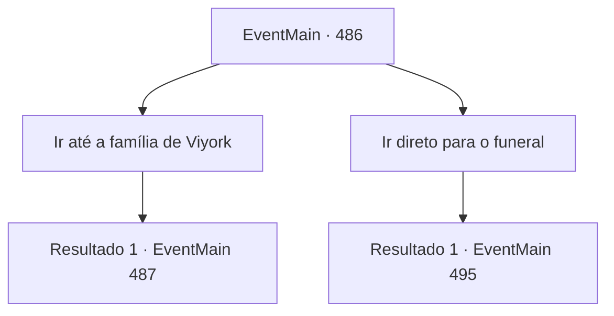

# Eventos principais · 486

[Índice da tabela](index.md) · [Índice geral](../index.md)

ID: `pt:EventMain:486` · Fonte: `EventMain4` · Versão: 1.2.47.

Mapeamento estático dos arquivos; a disponibilidade e a execução dependem do estado da run.

## Texto do evento

Você, à convite de Viyork, chegou à mansão dele, escondida na montanha Ort. A mansão, uma casa de madeira de estilo rústico, emanava uma atmosfera antiga e imponente. Recebendo você no salão de estar, Viyork bebia um chá fumegante e disse: 

 "Sente-se."

 Ele recostou-se em um sofá adornado com padrões bordados e girou a xícara nas mãos antes de continuar: 

 "Agora, só resta Publius. Mas, antes disso, há algo que você precisa fazer."

 Viyork explicou que queria evacuar sua família antecipadamente, aproveitando a confusão na ordem religiosa. Ele estava preocupado que sua família pudesse se machucar com os perigos que viriam. 

 "Eu mesmo faria isso, se pudesse, mas há o funeral de Danica. Todos estarão lá, e se eu não comparecer, levantarei suspeitas, não acha?"

 Sem dar espaço para a sua opinião, ele começou a listar as preparações necessárias. Foi então que você ouviu o sussurro de Kior: 

 "Seria melhor ir direto ao funeral. Caso contrário, você pode perder a oportunidade perfeita para eliminar o arcebispo."


## Dados de entrada

```json
{
  "id": 486,
  "grade": 1,
  "normalGoal": "",
  "required": "1_2_80|13_4_6"
}
```

## Mapa das escolhas



## Escolhas e resultados

### Escolha 1

Ir até a família de Viyork

Requisitos e outros campos da escolha:

```json
{
  "required": ""
}
```

#### Resultado 1.1

Você decidiu ir atrás da família de Viyork. Como se já esperasse por isso, Viyork lhe informou o local que você deveria visitar. 

 "Volte com a minha família. Leve-os para a mansão e, depois disso, deixe o resto comigo."

 Com as instruções gravadas em sua mente, você partiu daquele lugar.

 Após cerca de meio dia de caminhada, você chegou em frente à casa de Viyork. Diferente de uma mansão luxuosa, era uma residência modesta, com paredes brancas e um telhado azul. Assim que você se posicionou diante do portão principal, Kior murmurou subitamente. 

 "Estou sentindo uma força sagrada forte aqui... Faz sentido, já que é a casa de Viyork, mas mesmo assim..."

 Com o aviso de Kior em mente, você bateu cuidadosamente na porta. Logo, a voz de uma jovem mulher pôde ser ouvida do lado de dentro. 

 "Quem é?"


Continuação registrada: [Evento 487](0487.md) na mesma tabela.

```json
{
  "required": "",
  "chance": "1",
  "nextEvent": 487,
  "type": 2,
  "reward": ""
}
```

### Escolha 2

Ir direto para o funeral

Requisitos e outros campos da escolha:

```json
{
  "required": ""
}
```

#### Resultado 2.1

Você recusou o pedido de Viyork e afirmou que resolveria tudo ali mesmo, insistindo em acompanhar o funeral. Ao ouvir suas palavras, Viyork pareceu surpreso, mas acabou assentindo, como se não tivesse escolha. 

 "Muito bem. Se essa é isso que você quer, que seja. Mas se você aparecer por lá, será descoberto em pouco tempo. É melhor que espere em outro lugar."

 Viyork indicou o cemitério onde Danica seria enterrada e sugeriu que você se escondesse lá. Segundo ele, Publius certamente estaria presente no funeral e, no momento certo, Viyork daria um sinal. Você aceitou a proposta e seguiu para o cemitério.

 Não se sabe quanto tempo passou desde que você se escondeu entre os túmulos. De repente, o som de uma procissão chamou sua atenção, e você ergueu a cabeça para observar. Seguindo pela estrada, era possível ver Viyork e os sacerdotes carregando um caixão em direção ao local.

Continuação registrada: [Evento 495](0495.md) na mesma tabela.

```json
{
  "required": "",
  "chance": "1",
  "nextEvent": 495,
  "type": 2,
  "reward": ""
}
```

## Referências que chegam a este evento

Nenhum `nextEvent` positivo da mesma tabela aponta para este nó. Isso não prova que seja inacessível: sorteio e estado de história podem selecioná-lo.

