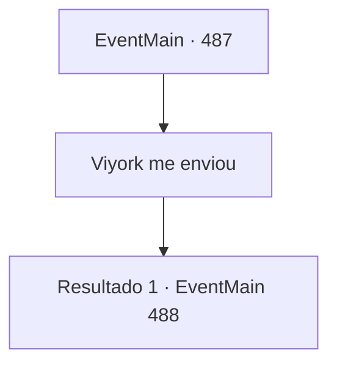

# Eventos principais · 487

[Índice da tabela](index.md) · [Índice geral](../index.md)

ID: `pt:EventMain:487` · Fonte: `EventMain4` · Versão: 1.2.47.

Mapeamento estático dos arquivos; a disponibilidade e a execução dependem do estado da run.

## Texto do evento

*Sem texto no arquivo.*

## Dados de entrada

```json
{
  "id": 487,
  "grade": 1,
  "normalGoal": "",
  "required": ""
}
```

## Mapa das escolhas



## Escolhas e resultados

### Escolha 1

Viyork me enviou

Requisitos e outros campos da escolha:

```json
{
  "required": ""
}
```

#### Resultado 1.1


 "...Entre, por favor."

 Quando a porta se abriu, você entrou e observou a família de Viyork. Uma mulher de meia-idade, visivelmente tensa, limpava a mesa com um pano, enquanto dois garotos brincavam com alguns brinquedos no chão. A jovem que havia aberto a porta fechou-a atrás de você e perguntou em voz baixa: 

 "O que o meu pai disse?"


Continuação registrada: [Evento 488](0488.md) na mesma tabela.

```json
{
  "required": "",
  "chance": "1",
  "nextEvent": 488,
  "type": 2,
  "reward": ""
}
```

## Referências que chegam a este evento

- [Evento 486 · escolha 1 · resultado 1](0486.md#escolha-1)
