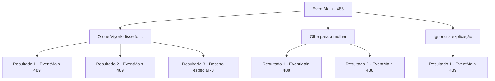

# Eventos principais · 488

[Índice da tabela](index.md) · [Índice geral](../index.md)

ID: `pt:EventMain:488` · Fonte: `EventMain4` · Versão: 1.2.47.

Mapeamento estático dos arquivos; a disponibilidade e a execução dependem do estado da run.

## Texto do evento

*Sem texto no arquivo.*

## Dados de entrada

```json
{
  "id": 488,
  "grade": 1,
  "normalGoal": "",
  "required": ""
}
```

## Mapa das escolhas



## Escolhas e resultados

### Escolha 1

O que Viyork disse foi...

Requisitos e outros campos da escolha:

```json
{
  "required": ""
}
```

#### Resultado 1.1

Para acalmar a família de Viyork, você respondeu que ele havia pedido para que fossem evacuados em segurança.  Mas, naquele exato momento, uma energia avassaladora emanou da jovem que o chamou de 'pai'. Sua espada brilhou como um raio e avançou em sua direção. Você rolou para o lado, escapando por pouco da lâmina afiada.  

 "A visão do Arcebispo estava certa. Viyork... Brincando com um adorador de demônios!"

  Com uma expressão tomada pela fúria, ela investiu novamente contra você. Os gritos assustados da mulher de meia-idade e das crianças ecoaram pela sala, criando um caos ensurdecedor.

Continuação registrada: [Evento 489](0489.md) na mesma tabela.

```json
{
  "required": "",
  "chance": "1|0_6_1",
  "nextEvent": 489,
  "type": 0,
  "reward": "6_0_146",
  "place": 4
}
```

#### Resultado 1.2

 Você tentou acalmar a família de Viyork, explicando que ele havia pedido para que os levasse para um refúgio. Mas, de repente, algo aconteceu. Uma enorme onda de energia emana da jovem mulher, e sua espada, em um flash, voou em sua direção. Você não conseguiu desviar a tempo, e o sangue se espalhou pelo chão. 

 "O discernimento do Grande Arcebispo estava correto. Viyork... está brincando com adoradores de demônios!"

 Com um olhar furioso, ela se lançou contra você, enquanto os gritos surpresos da mulher de meia-idade e das crianças ecoavam em seus ouvidos.

Continuação registrada: [Evento 489](0489.md) na mesma tabela.

```json
{
  "required": "1_0_2",
  "chance": "24",
  "nextEvent": 489,
  "type": 1,
  "reward": "0_0_-1|6_0_146",
  "place": 4
}
```

#### Resultado 1.3

Você tentou tranquilizar a família de Viyork, contando tudo o que havia acontecido e explicando o pedido dele.  Foi então que uma energia esmagadora explodiu da jovem que o chamou de 'pai'. Antes que pudesse reagir, a lâmina dela brilhou como um relâmpago e atravessou o espaço entre vocês.  Você não teve tempo de se esquivar. A dor rasgou seu corpo, e o sangue se espalhou no chão. Tossindo violentamente, você cuspiu um pouco de sangue e, sem forças, suas pernas cederam, fazendo você desabar no chão.  

 "A visão do Arcebispo estava certa... Viyork, aliando-se a um adorador de demônios?!"

 gritou ela, com os olhos brilhando de fúria.  A última coisa que você viu foi o reflexo frio da lâmina dela descendo em sua direção. Em seguida, a escuridão envolveu tudo.

Continuação registrada: [Destino especial `-3`](../destinos-especiais.md).

```json
{
  "required": "2_0_2",
  "chance": "24",
  "nextEvent": -3,
  "type": 1,
  "reward": "0_0_-1"
}
```

### Escolha 2

Olhe para a mulher

Requisitos e outros campos da escolha:

```json
{
  "required": "5_361_0"
}
```

#### Resultado 2.1

|drawing_unarmedValen| Você olhou brevemente para a jovem mulher. Ela tinha os cabelos ruivos presos para cima, a pele tão pálida que parecia quase translúcida, e uma figura esguia, com as orelhas ligeiramente pontiagudas. Seus braços eram mais rudes do que os de outros membros da família de Viyork, e sob suas roupas, um corpo bem treinado estava escondido. Ela olhou para você, aparentemente esperando uma resposta.

Continuação registrada: [Evento 488](0488.md) na mesma tabela.

```json
{
  "required": "",
  "chance": "1|0_14_1",
  "nextEvent": 488,
  "type": 0,
  "reward": "0_2_1|5_361_1"
}
```

#### Resultado 2.2

|drawing_unarmedValen| Você olhou brevemente para a jovem mulher. Ela tinha os cabelos ruivos presos para cima, a pele tão pálida que parecia quase translúcida, e uma figura esguia, com as orelhas ligeiramente pontiagudas. Ela olhou para você, aparentemente esperando uma resposta.

Continuação registrada: [Evento 488](0488.md) na mesma tabela.

```json
{
  "required": "",
  "chance": "16",
  "nextEvent": 488,
  "type": 1,
  "reward": "5_361_2"
}
```

### Escolha 3

Ignorar a explicação

Requisitos e outros campos da escolha:

```json
{
  "required": "5_361_1"
}
```

#### Resultado 3.1

Você deu uma resposta vaga e deu um passo para trás. Foi então que, como um relâmpago, a lâmina dela voou em sua direção. Você mal conseguiu desviar da lâmina, gritando em protesto. A jovem mulher respondeu em um tom frio à sua pergunta. 

 "Por que um adorador de demônios está aqui? Preciso ouvir toda a história."

 A lâmina dela foi levantada novamente, pronta para atacar.  

Continuação registrada: [Evento 489](0489.md) na mesma tabela.

```json
{
  "required": "",
  "chance": "1",
  "nextEvent": 489,
  "type": 2,
  "reward": "6_0_146",
  "place": 4
}
```

## Referências que chegam a este evento

- [Evento 487 · escolha 1 · resultado 1](0487.md#escolha-1)
- [Evento 488 · escolha 2 · resultado 1](0488.md#escolha-2)
- [Evento 488 · escolha 2 · resultado 2](0488.md#escolha-2)
