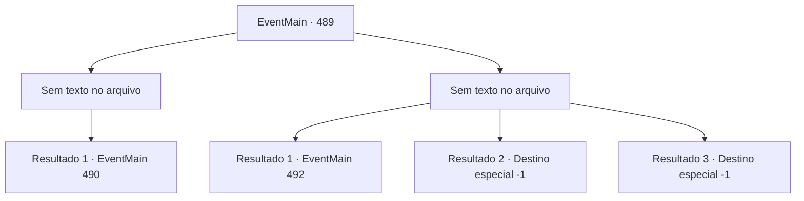

# Eventos principais · 489

[Índice da tabela](index.md) · [Índice geral](../index.md)

ID: `pt:EventMain:489` · Fonte: `EventMain4` · Versão: 1.2.47.

Mapeamento estático dos arquivos; a disponibilidade e a execução dependem do estado da run.

## Texto do evento

*Sem texto no arquivo.*

## Dados de entrada

```json
{
  "id": 489,
  "grade": 1,
  "normalGoal": "",
  "required": ""
}
```

## Mapa das escolhas



## Escolhas e resultados

### Escolha 1

*Sem texto no arquivo; o papel dessa opção depende da interface do jogo.*

Requisitos e outros campos da escolha:

```json
{
  "required": ""
}
```

#### Resultado 1.1

Você derrubou a jovem mulher e tentou interrogar sua identidade. Mas, ao invés de uma resposta, ela disparou. 

 "Você realmente acha que sairá ileso? Nem você, nem Viyork, poderão escapar. O castigo de Tere virá sobre você."

 Os familiares de Viyork estavam petrificados de medo, sem saber o que fazer. A mulher, depois de proferir suas palavras, permaneceu em silêncio, apenas te observando com olhos furiosos.

Continuação registrada: [Evento 490](0490.md) na mesma tabela.

```json
{
  "required": "",
  "chance": "1",
  "nextEvent": 490,
  "type": 2,
  "reward": ""
}
```

### Escolha 2

*Sem texto no arquivo; o papel dessa opção depende da interface do jogo.*

Requisitos e outros campos da escolha:

```json
{
  "required": ""
}
```

#### Resultado 2.1

Você perdeu para a jovem e fugiu. A perseguição dela continua, mas você consegue se livrar dela depois de fugir desesperadamente. 

 Depois de escapar dela, você recupera o fôlego e segue para a villa de Viyork. Então Kior sussurra em sua cabeça que Viyork deve ter traído você. 

 "Pense nisso. Se ele não tivesse traído você, como tal monstro poderia estar esperando por você?"

 Ele sente pena de você, dizendo que você é traído onde quer que vá. 

 Depois de um tempo, você chega à vila e encontra Viyork esperando lá. Como se tivesse acabado de voltar do funeral, ele veste um casaco com o símbolo de Teresia e seu rosto está suando. 

 "Minha família... Conseguiu evacuar minha família?"


Continuação registrada: [Evento 492](0492.md) na mesma tabela.

```json
{
  "required": "1_0_2|1_1_2",
  "chance": "1",
  "nextEvent": 492,
  "type": 2,
  "reward": "0_0_-1|0_1_-1"
}
```

#### Resultado 2.2

Você é atacado por uma mulher e cai. A mulher de cabelos ruivos se aproxima lentamente de você, Diz pisando em seu estômago. 

 "Um servo do mau. Não pense que você vai morrer em paz."

 Então o pé dela chuta seu queixo. Você perde a consciência com isso.

Continuação registrada: [Destino especial `-1`](../destinos-especiais.md).

```json
{
  "required": "2_0_2",
  "chance": "1",
  "nextEvent": -1,
  "type": 2,
  "reward": "0_0_-1|0_1_-1|15_5_2|15_5_13"
}
```

#### Resultado 2.3

Você é atacado por uma mulher e cai. A mulher de cabelos ruivos se aproxima lentamente de você, Diz pisando em seu estômago. 

 "Um servo do mau. Não pense que você vai morrer em paz."

 Então o pé dela chuta seu queixo. Você perde a consciência com isso.

Continuação registrada: [Destino especial `-1`](../destinos-especiais.md).

```json
{
  "required": "2_1_2",
  "chance": "1",
  "nextEvent": -1,
  "type": 2,
  "reward": "0_0_-1|0_1_-1|15_5_2|15_5_13"
}
```

## Referências que chegam a este evento

- [Evento 488 · escolha 1 · resultado 1](0488.md#escolha-1)
- [Evento 488 · escolha 1 · resultado 2](0488.md#escolha-1)
- [Evento 488 · escolha 3 · resultado 1](0488.md#escolha-3)
