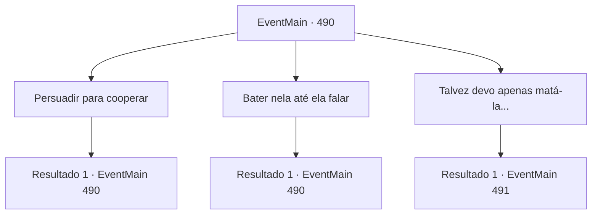

# Eventos principais · 490

[Índice da tabela](index.md) · [Índice geral](../index.md)

ID: `pt:EventMain:490` · Fonte: `EventMain4` · Versão: 1.2.47.

Mapeamento estático dos arquivos; a disponibilidade e a execução dependem do estado da run.

## Texto do evento

*Sem texto no arquivo.*

## Dados de entrada

```json
{
  "id": 490,
  "grade": 1,
  "normalGoal": "",
  "required": ""
}
```

## Mapa das escolhas



## Escolhas e resultados

### Escolha 1

Persuadir para cooperar

Requisitos e outros campos da escolha:

```json
{
  "required": "5_362_0"
}
```

#### Resultado 1.1

Com palavras gentis, você pede que ela se acalme e coopere. 

 Quanto tempo se passou, minha boca está doendo agora. No entanto, apesar da persuasão repetida, ela permanece em silêncio de maneira dura.

Continuação registrada: [Evento 490](0490.md) na mesma tabela.

```json
{
  "required": "",
  "chance": "1",
  "nextEvent": 490,
  "type": 2,
  "reward": "5_362_1"
}
```

### Escolha 2

Bater nela até ela falar

Requisitos e outros campos da escolha:

```json
{
  "required": "5_363_0"
}
```

#### Resultado 2.1

Você amarra a mulher a uma cadeira e pede cooperação com o punho.
 'Bam, Pow--!'
 O som abafado de batidas reverbera pela casa. A família de Viyork se une e tenta não ver isso. 

 Quanto tempo se passou, você está sem fôlego. E ainda assim ela não disse nada Ela nem gritou. Ela apenas olha para você com olhos ardentes. 

 "... Não importa qual conversa doce ou insulto difícil de segurar, eu não vou cooperar com você"

 A mulher ri de você e cospe em você.

Continuação registrada: [Evento 490](0490.md) na mesma tabela.

```json
{
  "required": "",
  "chance": "1",
  "nextEvent": 490,
  "type": 2,
  "reward": "5_363_1"
}
```

### Escolha 3

Talvez devo apenas matá-la...

Requisitos e outros campos da escolha:

```json
{
  "required": "5_362_1|5_363_1"
}
```

#### Resultado 3.1

Então, a voz de Kior é ouvida. 

 "Hahahaha! Você está passando por muita coisa. Este corpo vai ajudar. Coloque a mão na cabeça dela."

 Você colocou a mão na cabeça da mulher como Kior disse. Então, a mana negra que se estende de sua mão penetra na cabeça da mulher. <color=red><link=shake> 

 "A..Arggg...O que..Que diabos você...está fazendo?! Grr..!"

</link></color> O corpo da mulher treme violentamente como se tivesse sido eletrocutada. Ela morde os lábios como se fosse para suportar a dor, e o sangue escorre de seu nariz e boca. Suas mãos também sentem o inchaço e dormência do tendão. E logo depois, a mana preta explode, e sua mão bate na cabeça dela. 

 "...Está arruinado. Essa coisa terrível. Resistindo à minha lavagem cerebral... Embora você possa fazer uma pergunta simples a ela."

 Como Kior disse, ela perde o foco em seus olhos e fica sentada como uma boneca quebrada.

Continuação registrada: [Evento 491](0491.md) na mesma tabela.

```json
{
  "required": "",
  "chance": "1",
  "nextEvent": 491,
  "type": 2,
  "reward": ""
}
```

## Referências que chegam a este evento

- [Evento 489 · escolha 1 · resultado 1](0489.md#escolha-1)
- [Evento 490 · escolha 1 · resultado 1](0490.md#escolha-1)
- [Evento 490 · escolha 2 · resultado 1](0490.md#escolha-2)
