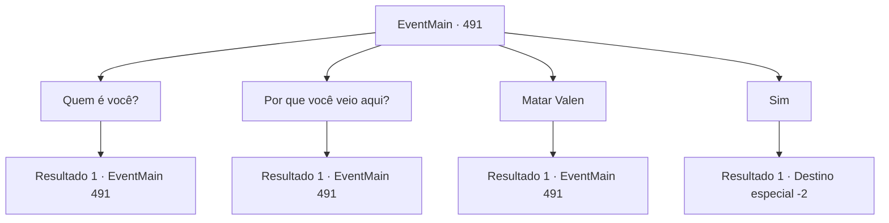

# Eventos principais · 491

[Índice da tabela](index.md) · [Índice geral](../index.md)

ID: `pt:EventMain:491` · Fonte: `EventMain4` · Versão: 1.2.47.

Mapeamento estático dos arquivos; a disponibilidade e a execução dependem do estado da run.

## Texto do evento

*Sem texto no arquivo.*

## Dados de entrada

```json
{
  "id": 491,
  "grade": 1,
  "normalGoal": "",
  "required": ""
}
```

## Mapa das escolhas



## Escolhas e resultados

### Escolha 1

Quem é você?

Requisitos e outros campos da escolha:

```json
{
  "required": "5_364_0"
}
```

#### Resultado 1.1

A mulher ruiva gagueja e se apresenta quando você pergunta quem ela é. 

 "Eu... sou... Valen... A espada... do... arcebispo."

 Seu nome é Valen e ela é chamada de a espada do Arcebispo Publius.

Continuação registrada: [Evento 491](0491.md) na mesma tabela.

```json
{
  "required": "",
  "chance": "1",
  "nextEvent": 491,
  "type": 2,
  "reward": "5_364_1"
}
```

### Escolha 2

Por que você veio aqui?

Requisitos e outros campos da escolha:

```json
{
  "required": "5_365_0"
}
```

#### Resultado 2.1

Você pergunta à mulher por que ela te atacou.  Ela hesita por um momento e murmura lentamente a resposta.  

 "O arcebispo... Ordem... Irmã Danica... foi embora. Viyork... Questionando..."


Continuação registrada: [Evento 491](0491.md) na mesma tabela.

```json
{
  "required": "",
  "chance": "1",
  "nextEvent": 491,
  "type": 2,
  "reward": "5_365_1"
}
```

### Escolha 3

Matar Valen

Requisitos e outros campos da escolha:

```json
{
  "required": "5_364_1|5_365_1"
}
```

#### Resultado 3.1

Após o interrogatório, você mata Valen e dedica sua alma a Kior. Uma sensação agradável flui através de você sempre que dedica uma alma. Então você segue para a vila de Viyork com a família de Viyork. 

 Meio dia depois, você encontra Viyork, que retornou do funeral de Danica. Ele respira aliviado, olhando para sua família. 

 "Ufa! Você os trouxe em segurança!"

 Ele cumprimenta sua família e pede para você esperar do lado de fora por um momento. Então ele entra na vila com sua família. Você espera por ele sair. Cerca de doze minutos depois, ele abre a porta e sai. 

 "Eu soube disso pela minha família. Você derrubou Valen?"


Continuação registrada: [Evento 491](0491.md) na mesma tabela.

```json
{
  "required": "",
  "chance": "1",
  "nextEvent": 491,
  "type": 2,
  "reward": "0_3_-5|5_366_1|5_365_2"
}
```

### Escolha 4

Sim

Requisitos e outros campos da escolha:

```json
{
  "required": "5_366_1|5_365_2"
}
```

#### Resultado 4.1

Depois de ouvir sua resposta, Viyork diz com um sorriso satisfeito. 

 "Você fez um ótimo trabalho! Na verdade, Publius já está suspeitando do meu relacionamento com você. Então, acho que ele estava planejando enviar Valen para me pressionar..."

 Viyork ajusta seu casaco e suspira. Talvez a notícia sobre Valen o tenha deixado nervoso, já que suas roupas estão suadas. 

 "Você matou Valen, a espada do arcebispo, então o plano de Publius falhou. Ufa... agora só precisamos nos livrar de Publius."

 Viyork lhe entrega uma bolsa de ouro para agradecer por salvar sua família. 

 "O arcebispo perdeu todas as suas mãos e pés. Mais cedo ou mais tarde, você terá a chance de acertá-lo no pescoço."

 Você assente enquanto recebe a bolsa dele. Então você parte, prometendo encontrá-lo novamente.

Continuação registrada: [Destino especial `-2`](../destinos-especiais.md).

```json
{
  "required": "",
  "chance": "1",
  "nextEvent": -2,
  "type": 2,
  "reward": "13_4_24|0_4_100"
}
```

## Referências que chegam a este evento

- [Evento 490 · escolha 3 · resultado 1](0490.md#escolha-3)
- [Evento 491 · escolha 1 · resultado 1](0491.md#escolha-1)
- [Evento 491 · escolha 2 · resultado 1](0491.md#escolha-2)
- [Evento 491 · escolha 3 · resultado 1](0491.md#escolha-3)
