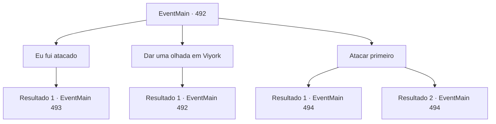

# Eventos principais · 492

[Índice da tabela](index.md) · [Índice geral](../index.md)

ID: `pt:EventMain:492` · Fonte: `EventMain4` · Versão: 1.2.47.

Mapeamento estático dos arquivos; a disponibilidade e a execução dependem do estado da run.

## Texto do evento

*Sem texto no arquivo.*

## Dados de entrada

```json
{
  "id": 492,
  "grade": 1,
  "normalGoal": "",
  "required": ""
}
```

## Mapa das escolhas



## Escolhas e resultados

### Escolha 1

Eu fui atacado

Requisitos e outros campos da escolha:

```json
{
  "required": "5_367_0"
}
```

#### Resultado 1.1

Você fala sobre como foi atacado e fugiu, e pergunta a Viyork por que isso pode ter acontecido. Ao ouvir a pergunta, Viyork pausa por um momento e então fala com voz trêmula. 

 "É mesmo? Talvez meu relacionamento com você tenha vazado de alguma forma. Vou descobrir. Vamos nos separar apenas por precaução, caso alguém esteja nos observando."

 Depois de conversar, Viyork suspira, evitando seu olhar. Assim que você assente com a cabeça, vira as costas para sair. Mas naquele exato momento, você pode ouvir o som fraco de uma espada sendo desembainhada atrás de você.

Continuação registrada: [Evento 493](0493.md) na mesma tabela.

```json
{
  "required": "",
  "chance": "1",
  "nextEvent": 493,
  "type": 2,
  "reward": ""
}
```

### Escolha 2

Dar uma olhada em Viyork

Requisitos e outros campos da escolha:

```json
{
  "required": "5_367_0|1_14_10"
}
```

#### Resultado 2.1

Você se segura para não responder e olha para Viyork. Ele está com uma expressão tensa e suor frio escorre de sua testa. Seus olhos se movem inquietos. Ele não consegue esperar pela sua resposta. Parece estar preocupado com algo. 

 "Diga-me algo... O que diabos aconteceu?"


Continuação registrada: [Evento 492](0492.md) na mesma tabela.

```json
{
  "required": "",
  "chance": "1",
  "nextEvent": 492,
  "type": 2,
  "reward": "5_367_1"
}
```

### Escolha 3

Atacar primeiro

Requisitos e outros campos da escolha:

```json
{
  "required": "5_367_1"
}
```

#### Resultado 3.1

Após considerar a aparência de Viyork, você percebe que a suspeita de Kior é verdadeira. Você finge responder à sua pergunta, mas em vez disso puxa sua arma e ataca Viyork de surpresa. 

 "Kh...! Quando você percebeu?"

 Viyork ferido tropeça, mas puxa sua espada. Você olha para a expressão perturbada de Viyork e continua a atacar.

Continuação registrada: [Evento 494](0494.md) na mesma tabela.

```json
{
  "required": "",
  "chance": "1|0_5_1",
  "nextEvent": 494,
  "type": 0,
  "reward": "6_2_147",
  "place": 10
}
```

#### Resultado 3.2

Após considerar a aparência de Viyork, você percebe que a suspeita de Kior é verdadeira. Mas antes mesmo de você conseguir pegar sua espada, Viyork te ataca primeiro. 

 "Desculpe, mas... Por favor, morra!"

 Você revida, desviando enquanto o ataque de Viyork roça sua bochecha.

Continuação registrada: [Evento 494](0494.md) na mesma tabela.

```json
{
  "required": "",
  "chance": "14",
  "nextEvent": 494,
  "type": 1,
  "reward": "6_0_147",
  "place": 10
}
```

## Referências que chegam a este evento

- [Evento 489 · escolha 2 · resultado 1](0489.md#escolha-2)
- [Evento 492 · escolha 2 · resultado 1](0492.md#escolha-2)
