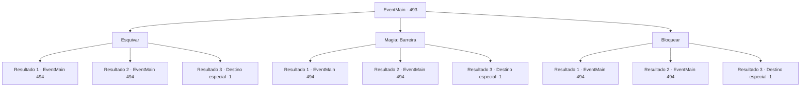

# Eventos principais · 493

[Índice da tabela](index.md) · [Índice geral](../index.md)

ID: `pt:EventMain:493` · Fonte: `EventMain4` · Versão: 1.2.47.

Mapeamento estático dos arquivos; a disponibilidade e a execução dependem do estado da run.

## Texto do evento

*Sem texto no arquivo.*

## Dados de entrada

```json
{
  "id": 493,
  "grade": 1,
  "normalGoal": "",
  "required": ""
}
```

## Mapa das escolhas



## Escolhas e resultados

### Escolha 1

Esquivar

Requisitos e outros campos da escolha:

```json
{
  "required": ""
}
```

#### Resultado 1.1

Você rapidamente evita o ataque de Viyork e olha para trás. Você vê Viyork encarando você com sua espada erguida. 

 "Desculpe, mas... Por favor, morra!"

 Viyork retoma o ataque antes que você possa perguntar o que ele está fazendo. Você sabe que não tem escolha a não ser lutar contra ele, então você tira sua arma e a balança.

Continuação registrada: [Evento 494](0494.md) na mesma tabela.

```json
{
  "required": "",
  "chance": "1|0_6_1",
  "nextEvent": 494,
  "type": 0,
  "reward": "6_0_147",
  "place": 10
}
```

#### Resultado 1.2

A espada de Viyork corta suas costas antes que você possa reagir. Seu sangue é salpicado no chão, e você se ajoelha em intensa dor. Os cantos da boca de Viyork se contorcem para você. 

 "Sinto muito que isso tenha que acontecer, mas... Por favor, morra!"

 Viyork retoma o ataque antes que você possa perguntar o que ele está fazendo. Tudo o que você pode fazer é levantar-se e se defender desesperadamente.

Continuação registrada: [Evento 494](0494.md) na mesma tabela.

```json
{
  "required": "1_0_2",
  "chance": "14",
  "nextEvent": 494,
  "type": 1,
  "reward": "0_0_-1|6_0_147",
  "place": 10
}
```

#### Resultado 1.3

A espada de Viyork corta suas costas antes que você possa reagir. Seu sangue é salpicado no chão, e você se ajoelha em intensa dor. Os cantos da boca de Viyork se contorcem para você. 

 "Sinto muito que isso tenha que acontecer, mas... Por favor, morra!"

 Viyork retoma o ataque antes que você possa perguntar o que ele está fazendo. Tudo o que você pode fazer é assistir a morte chegar.

Continuação registrada: [Destino especial `-1`](../destinos-especiais.md).

```json
{
  "required": "2_0_2",
  "chance": "14",
  "nextEvent": -1,
  "type": 1,
  "reward": "0_0_-1|15_5_2|15_5_13"
}
```

### Escolha 2

Magia: Barreira

Requisitos e outros campos da escolha:

```json
{
  "required": "20_0_2|1_1_2"
}
```

#### Resultado 2.1

Você rapidamente conjura Barreira para parar o ataque e então olha para trás. Você vê Viyork encarando você com sua espada erguida. 

 "Tsk... Você é tão rápido. Desculpe, mas... Por favor, morra!"

 Viyork retoma o ataque antes que você possa perguntar o que ele está fazendo. Você sabe que não tem escolha a não ser lutar contra ele, então você pega sua arma e a balança.

Continuação registrada: [Evento 494](0494.md) na mesma tabela.

```json
{
  "required": "",
  "chance": "1|0_14_1",
  "nextEvent": 494,
  "type": 0,
  "reward": "6_0_147|0_1_-1",
  "place": 10
}
```

#### Resultado 2.2

A espada de Viyork corta suas costas antes que você possa reagir. Seu sangue é salpicado no chão, e você se ajoelha em intensa dor. Os cantos da boca de Viyork se contorcem para você. 

 "Sinto muito que isso tenha que acontecer, mas... Por favor, morra!"

 Viyork retoma o ataque antes que você pergunte o que ele está fazendo. Tudo o que você pode fazer é levantar-se e se defender desesperadamente.

Continuação registrada: [Evento 494](0494.md) na mesma tabela.

```json
{
  "required": "1_0_2",
  "chance": "14",
  "nextEvent": 494,
  "type": 1,
  "reward": "0_0_-1|6_0_147|0_1_-1",
  "place": 10
}
```

#### Resultado 2.3

A espada de Viyork corta suas costas antes que você possa reagir. Seu sangue é salpicado no chão, e você se ajoelha em intensa dor. Os cantos da boca de Viyork se contorcem para você. 

 "Sinto muito que isso tenha que acontecer, mas... Por favor, morra!"

 Viyork retoma o ataque antes que você possa perguntar o que ele está fazendo. Tudo o que você pode fazer é assistir a morte chegar.

Continuação registrada: [Destino especial `-1`](../destinos-especiais.md).

```json
{
  "required": "2_0_2",
  "chance": "14",
  "nextEvent": -1,
  "type": 1,
  "reward": "0_0_-1|15_5_2|15_5_13|0_1_-1"
}
```

### Escolha 3

Bloquear

Requisitos e outros campos da escolha:

```json
{
  "required": "20_9_1"
}
```

#### Resultado 3.1

Você rapidamente conjura Barreira para parar o ataque e então olha para trás. Você vê Viyork encarando você com sua espada erguida. 

 "Tsk... Você é tão rápido. Desculpe, mas... Por favor, morra!"

 Viyork retoma o ataque antes que você possa perguntar o que ele está fazendo. Você sabe que não tem escolha a não ser lutar contra ele, então você pega sua arma e a balança.

Continuação registrada: [Evento 494](0494.md) na mesma tabela.

```json
{
  "required": "",
  "chance": "1|0_13_1",
  "nextEvent": 494,
  "type": 0,
  "reward": "6_0_147",
  "place": 10
}
```

#### Resultado 3.2

A espada de Viyork corta suas costas antes que você possa reagir. Seu sangue é salpicado no chão, e você se ajoelha em intensa dor. Os cantos da boca de Viyork se contorcem para você. 

 "Sinto muito que isso tenha que acontecer, mas... Por favor, morra!"

 Viyork retoma o ataque antes que você pergunte o que ele está fazendo. Tudo o que você pode fazer é levantar-se e se defender desesperadamente.

Continuação registrada: [Evento 494](0494.md) na mesma tabela.

```json
{
  "required": "1_0_2",
  "chance": "10",
  "nextEvent": 494,
  "type": 1,
  "reward": "0_0_-1|6_0_147",
  "place": 10
}
```

#### Resultado 3.3

A espada de Viyork corta suas costas antes que você possa reagir. Seu sangue é salpicado no chão, e você se ajoelha em intensa dor. Os cantos da boca de Viyork se contorcem para você. 

 "Sinto muito que isso tenha que acontecer, mas... Por favor, morra!"

 Viyork retoma o ataque antes que você possa perguntar o que ele está fazendo. Tudo o que você pode fazer é assistir a morte chegar.

Continuação registrada: [Destino especial `-1`](../destinos-especiais.md).

```json
{
  "required": "2_0_2",
  "chance": "10",
  "nextEvent": -1,
  "type": 1,
  "reward": "0_0_-1|15_5_2|15_5_13"
}
```

## Referências que chegam a este evento

- [Evento 492 · escolha 1 · resultado 1](0492.md#escolha-1)
