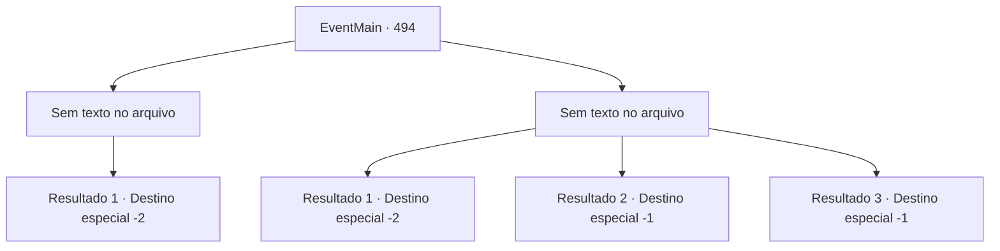

# Eventos principais · 494

[Índice da tabela](index.md) · [Índice geral](../index.md)

ID: `pt:EventMain:494` · Fonte: `EventMain4` · Versão: 1.2.47.

Mapeamento estático dos arquivos; a disponibilidade e a execução dependem do estado da run.

## Texto do evento

*Sem texto no arquivo.*

## Dados de entrada

```json
{
  "id": 494,
  "grade": 1,
  "normalGoal": "",
  "required": ""
}
```

## Mapa das escolhas



## Escolhas e resultados

### Escolha 1

*Sem texto no arquivo; o papel dessa opção depende da interface do jogo.*

Requisitos e outros campos da escolha:

```json
{
  "required": ""
}
```

#### Resultado 1.1

Você aponta sua arma para o pescoço de Viyork e pergunta por que ele te traiu. Viyork respira com dificuldade e implora por perdão. 

 "Poo, Poooblius questionou meu relacionamento com você. Respira... Ele fez minha família de refém e me pediu para provar minha fé. Então... Ah, eu não pude evitar! Por favor, me salve!"

 Viyork implora por misericórdia, mas você agarra sua cabeça imediatamente e espreme sua alma. Junto com o prazer vertiginoso, você ouve a voz satisfeita de Kior. 

 "Haha... É engraçado que um homem como ele fosse um paladino. Ele preferiria ter me servido do que a Tere."

 Você deixa a vila com as palavras de Kior ecoando em sua mente.

Continuação registrada: [Destino especial `-2`](../destinos-especiais.md).

```json
{
  "required": "",
  "chance": "1",
  "nextEvent": -2,
  "type": 2,
  "reward": "0_3_-5 |13_4_25"
}
```

### Escolha 2

*Sem texto no arquivo; o papel dessa opção depende da interface do jogo.*

Requisitos e outros campos da escolha:

```json
{
  "required": ""
}
```

#### Resultado 2.1

Você luta contra Viyork, mas no final você é gravemente ferido e foge. Você não sabe o motivo de sua traição repentina, mas fugir é uma prioridade maior do que descobrir. 

 "O que você vai fazer agora?"

 Você não consegue responder à pergunta repentina de Kior e fica em silêncio. Então você ouve sua voz novamente. 

 "E que tal visitar meus adoradores? Eles são pessoas leais que não vão te trair, ao contrário dos repugnantes servos de Tere."

 Kior reitera o fato de estarem na vila de Kahida. Depois de pensar um pouco, você decide ouvi-lo e seguir para Kahida.

Continuação registrada: [Destino especial `-2`](../destinos-especiais.md).

```json
{
  "required": "1_0_2|1_1_2",
  "chance": "1",
  "nextEvent": -2,
  "type": 2,
  "reward": "0_0_-1|0_1_-1|13_4_23"
}
```

#### Resultado 2.2

Você cai diante da espada de Viyork. 

 "...Desculpe-me. Minha fé está sendo testada. Não tive escolha a não ser traí-lo."

 Ele sussurra para você com um olhar de profundo arrependimento. Você o encara com olhos cada vez mais vazios e perde a consciência.

Continuação registrada: [Destino especial `-1`](../destinos-especiais.md).

```json
{
  "required": "2_0_2",
  "chance": "1",
  "nextEvent": -1,
  "type": 2,
  "reward": "0_0_-1|0_1_-1|15_5_2|15_5_13"
}
```

#### Resultado 2.3

Você cai diante da espada de Viyork. 

 "...Desculpe-me. Minha fé está sendo testada. Não tive escolha a não ser traí-lo."

 Ele sussurra para você com um olhar de profundo arrependimento. Você o encara com olhos cada vez mais vazios e perde a consciência.

Continuação registrada: [Destino especial `-1`](../destinos-especiais.md).

```json
{
  "required": "2_1_2",
  "chance": "1",
  "nextEvent": -1,
  "type": 2,
  "reward": "0_0_-1|0_1_-1|15_5_2|15_5_13"
}
```

## Referências que chegam a este evento

- [Evento 492 · escolha 3 · resultado 1](0492.md#escolha-3)
- [Evento 492 · escolha 3 · resultado 2](0492.md#escolha-3)
- [Evento 493 · escolha 1 · resultado 1](0493.md#escolha-1)
- [Evento 493 · escolha 1 · resultado 2](0493.md#escolha-1)
- [Evento 493 · escolha 2 · resultado 1](0493.md#escolha-2)
- [Evento 493 · escolha 2 · resultado 2](0493.md#escolha-2)
- [Evento 493 · escolha 3 · resultado 1](0493.md#escolha-3)
- [Evento 493 · escolha 3 · resultado 2](0493.md#escolha-3)
