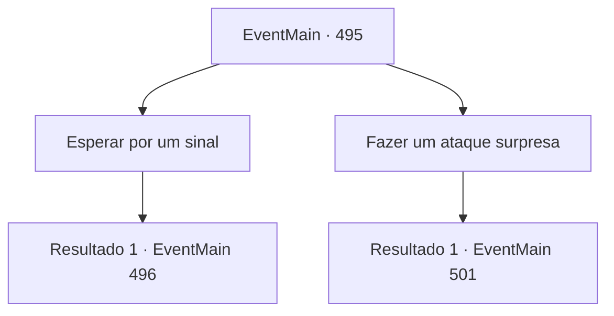

# Eventos principais · 495

[Índice da tabela](index.md) · [Índice geral](../index.md)

ID: `pt:EventMain:495` · Fonte: `EventMain4` · Versão: 1.2.47.

Mapeamento estático dos arquivos; a disponibilidade e a execução dependem do estado da run.

## Texto do evento

*Sem texto no arquivo.*

## Dados de entrada

```json
{
  "id": 495,
  "grade": 1,
  "normalGoal": "",
  "required": ""
}
```

## Mapa das escolhas



## Escolhas e resultados

### Escolha 1

Esperar por um sinal

Requisitos e outros campos da escolha:

```json
{
  "required": ""
}
```

#### Resultado 1.1

Você segura sua arma perto enquanto espera pelo sinal de Viyork. Enquanto isso, o caixão de Danica está sendo colocado no túmulo. Você olha para Viyork e se prepara para uma oportunidade de atacar. Mas Viyork não dá o sinal para atacar até que todos os procedimentos funerários tenham terminado.

Continuação registrada: [Evento 496](0496.md) na mesma tabela.

```json
{
  "required": "",
  "chance": "1",
  "nextEvent": 496,
  "type": 2,
  "reward": ""
}
```

### Escolha 2

Fazer um ataque surpresa

Requisitos e outros campos da escolha:

```json
{
  "required": ""
}
```

#### Resultado 2.1

Você não espera pelo sinal de Viyork. Você corre em direção a Publius. Publius está vestido com roupas elegantes condizentes com as de um arcebispo, então você consegue identificá-lo sem precisar perguntar. Mas no momento em que você corre em direção a Publius, Viyork saca sua espada e te bloqueia. 

 "Como você se atreve a tentar matar o Arcebispo? Eu não posso te perdoar! Morra!"

 Antes que você possa perguntar por que ele te impediu, Viyork balança sua espada em sua direção.

Continuação registrada: [Evento 501](0501.md) na mesma tabela.

```json
{
  "required": "",
  "chance": "1",
  "nextEvent": 501,
  "type": 2,
  "reward": "6_0_147",
  "place": 4
}
```

## Referências que chegam a este evento

- [Evento 486 · escolha 2 · resultado 1](0486.md#escolha-2)
