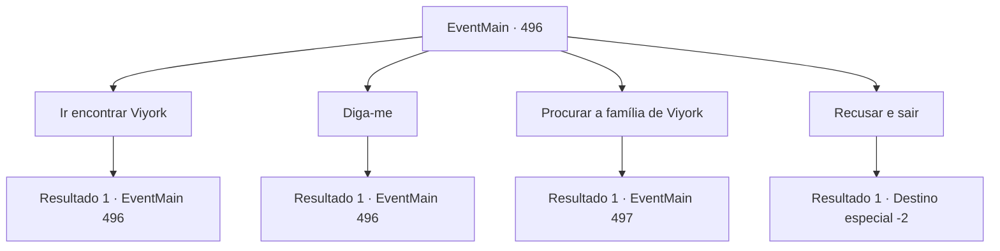

# Eventos principais · 496

[Índice da tabela](index.md) · [Índice geral](../index.md)

ID: `pt:EventMain:496` · Fonte: `EventMain4` · Versão: 1.2.47.

Mapeamento estático dos arquivos; a disponibilidade e a execução dependem do estado da run.

## Texto do evento

*Sem texto no arquivo.*

## Dados de entrada

```json
{
  "id": 496,
  "grade": 1,
  "normalGoal": "",
  "required": ""
}
```

## Mapa das escolhas



## Escolhas e resultados

### Escolha 1

Ir encontrar Viyork

Requisitos e outros campos da escolha:

```json
{
  "required": "5_368_0"
}
```

#### Resultado 1.1

Você guarda sua arma e segue para onde deveria encontrar Viyork. Você vai perguntar a ele por que ele não deu o sinal, mas acaba esperando por muito tempo no local de encontro. Viyork não aparece. 

 "Não sei por que, mas tenho certeza de que ele te traiu. {1}. É perda de tempo esperar mais."

 Com as palavras de Kior, você sai silenciosamente do local, decidindo matar Publius sozinho.

 Alguns dias depois, você está caminhando por um beco quando encontra um homem mascarado. Ele se curva educadamente para você e começa a falar. 

 "Espera... Há uma mensagem do senhor Viyork."


Continuação registrada: [Evento 496](0496.md) na mesma tabela.

```json
{
  "required": "",
  "chance": "1",
  "nextEvent": 496,
  "type": 2,
  "reward": "5_368_1"
}
```

### Escolha 2

Diga-me

Requisitos e outros campos da escolha:

```json
{
  "required": "5_368_1"
}
```

#### Resultado 2.1

Quando você pede a ele para lhe entregar a mensagem, o homem lhe entrega uma carta. Ela tem a elegante caligrafia de Viyork escrita nela.

 '{1}. Sinto muito por não ter cumprido minha promessa da última vez. Mas eu não pude evitar. Publius suspeitou que eu estava trabalhando com você e enviou seus homens para sequestrar minha família. Por favor, salve minha família. Estarei esperando por você na vila.'

 O próximo parágrafo da carta afirma que, se você salvar sua família, ele cooperará com você e o ajudará a matar Publius. Quando você termina de ler a carta, o homem mascarado lhe pergunta o que você fará.

Continuação registrada: [Evento 496](0496.md) na mesma tabela.

```json
{
  "required": "",
  "chance": "1",
  "nextEvent": 496,
  "type": 2,
  "reward": "5_368_2"
}
```

### Escolha 3

Procurar a família de Viyork

Requisitos e outros campos da escolha:

```json
{
  "required": "5_368_2"
}
```

#### Resultado 3.1

Você responde que irá procurar pela família de Viyork. O homem lhe diz onde a família foi vista pela última vez. 

 "A família de Viyork foi vista pela última vez na cidade de 'Tanaribo', a meio dia a leste daqui. Eles estavam com alguns paladinos."

 Você começa a seguir em direção à cidade. 

 Chegando em Tanaribo após uma longa caminhada, você pergunta aos moradores da rua sobre a família de Viyork. Você junta as informações que ouve e descobre onde encontrá-los. A família de Viyork está sendo detida em um esconderijo localizado no meio de uma área densamente povoada fora da cidade. Você descobre que está sendo guardado por três ou quatro paladinos.

Continuação registrada: [Evento 497](0497.md) na mesma tabela.

```json
{
  "required": "",
  "chance": "1",
  "nextEvent": 497,
  "type": 2,
  "reward": "5_368_3"
}
```

### Escolha 4

Recusar e sair

Requisitos e outros campos da escolha:

```json
{
  "required": "5_368_2"
}
```

#### Resultado 4.1

Você diz não ao homem e vai embora. 

 "O que você vai fazer agora?"

 Você não consegue responder à pergunta repentina de Kior e fica em silêncio. Então você ouve sua voz novamente. 

 "E que tal visitar meus adoradores? Eles são pessoas leais que não vão te trair, ao contrário dos nojentos servos de Tere."

 Kior reitera o fato de estarem na vila de Kahida. Depois de pensar um pouco, você decide ouvi-lo e seguir para Kahida.

Continuação registrada: [Destino especial `-2`](../destinos-especiais.md).

```json
{
  "required": "",
  "chance": "1",
  "nextEvent": -2,
  "type": 2,
  "reward": "5_368_3|13_4_23"
}
```

## Referências que chegam a este evento

- [Evento 495 · escolha 1 · resultado 1](0495.md#escolha-1)
- [Evento 496 · escolha 1 · resultado 1](0496.md#escolha-1)
- [Evento 496 · escolha 2 · resultado 1](0496.md#escolha-2)
