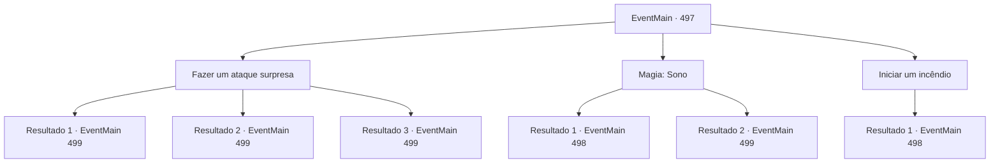

# Eventos principais · 497

[Índice da tabela](index.md) · [Índice geral](../index.md)

ID: `pt:EventMain:497` · Fonte: `EventMain4` · Versão: 1.2.47.

Mapeamento estático dos arquivos; a disponibilidade e a execução dependem do estado da run.

## Texto do evento

*Sem texto no arquivo.*

## Dados de entrada

```json
{
  "id": 497,
  "grade": 1,
  "normalGoal": "",
  "required": ""
}
```

## Mapa das escolhas



## Escolhas e resultados

### Escolha 1

Fazer um ataque surpresa

Requisitos e outros campos da escolha:

```json
{
  "required": ""
}
```

#### Resultado 1.1

Você salta em cima dos paladinos e lança um ataque surpresa. Um dos paladinos morre antes que eles possam reagir ao ataque, e os paladinos restantes vacilam em choque. Você empunha sua arma contra os paladinos restantes.

Continuação registrada: [Evento 499](0499.md) na mesma tabela.

```json
{
  "required": "21_5_2",
  "chance": "1|0_6_1",
  "nextEvent": 499,
  "type": 0,
  "reward": "6_2_50",
  "place": 4
}
```

#### Resultado 1.2

Você salta em cima dos paladinos e lança um ataque surpresa. Um dos paladinos morre antes que eles possam reagir ao ataque, e os paladinos restantes vacilam em choque. Você empunha sua arma contra os paladinos restantes.

Continuação registrada: [Evento 499](0499.md) na mesma tabela.

```json
{
  "required": "20_5_2",
  "chance": "1",
  "nextEvent": 499,
  "type": 2,
  "reward": "6_2_50",
  "place": 4
}
```

#### Resultado 1.3

Você lança um ataque surpresa nos paladinos. Mas eles calmamente sacam suas espadas em resposta e contra-atacam até te cercarem.

Continuação registrada: [Evento 499](0499.md) na mesma tabela.

```json
{
  "required": "21_5_2",
  "chance": "19",
  "nextEvent": 499,
  "type": 1,
  "reward": "6_0_50",
  "place": 4
}
```

### Escolha 2

Magia: Sono

Requisitos e outros campos da escolha:

```json
{
  "required": "20_0_1|1_1_2"
}
```

#### Resultado 2.1

Você coloca todos os paladinos para dormir lançando o feitiço Sono sobre eles. A sonolência poderosa faz com que todos os paladinos caiam. Você garante que eles estejam completamente adormecidos antes de se aproximar da porta do esconderijo.

Continuação registrada: [Evento 498](0498.md) na mesma tabela.

```json
{
  "required": "",
  "chance": "1|0_7_1|0_12_1",
  "nextEvent": 498,
  "type": 0,
  "reward": "0_1_-1"
}
```

#### Resultado 2.2

Você lança um feitiço e tenta colocar todos os paladinos para dormir. Mas antes de completar o feitiço, os paladinos percebem e correm em sua direção. Você cancela o lançamento, sacando sua arma para enfrentar o ataque deles.

Continuação registrada: [Evento 499](0499.md) na mesma tabela.

```json
{
  "required": "",
  "chance": "13",
  "nextEvent": 499,
  "type": 1,
  "reward": "6_0_50|0_1_-1",
  "place": 4
}
```

### Escolha 3

Iniciar um incêndio

Requisitos e outros campos da escolha:

```json
{
  "required": "23_3_1"
}
```

#### Resultado 3.1

Você se esgueira para dentro do estábulo ao lado do esconderijo e começa um incêndio. A palha seca que está acumulada se torna excelente lenha. Cavalos horrorizados fogem do estábulo. Os paladinos, assustados com a perturbação repentina, correm para o estábulo. Para evitar que o fogo se espalhe, eles o extinguem apressadamente. Escondido silenciosamente nas proximidades, você salta e os ataca. 

 "Ofegante! Ataque!"

 Você mata os paladinos que estavam tentando apagar o fogo antes que eles tenham a chance de se defender. Você passa pelos paladinos caídos e segue em direção ao esconderijo.

Continuação registrada: [Evento 498](0498.md) na mesma tabela.

```json
{
  "required": "",
  "chance": "1",
  "nextEvent": 498,
  "type": 2,
  "reward": "25_3_1"
}
```

## Referências que chegam a este evento

- [Evento 496 · escolha 3 · resultado 1](0496.md#escolha-3)
