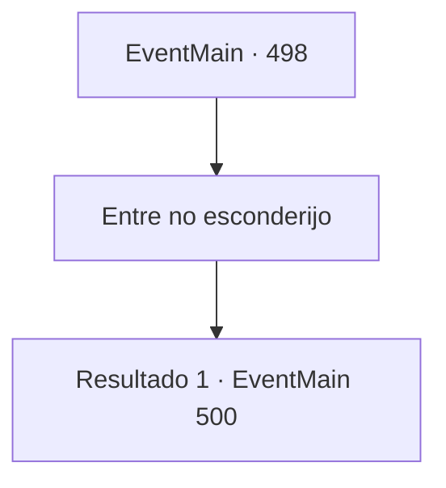

# Eventos principais · 498

[Índice da tabela](index.md) · [Índice geral](../index.md)

ID: `pt:EventMain:498` · Fonte: `EventMain4` · Versão: 1.2.47.

Mapeamento estático dos arquivos; a disponibilidade e a execução dependem do estado da run.

## Texto do evento

*Sem texto no arquivo.*

## Dados de entrada

```json
{
  "id": 498,
  "grade": 1,
  "normalGoal": "",
  "required": ""
}
```

## Mapa das escolhas



## Escolhas e resultados

### Escolha 1

Entre no esconderijo

Requisitos e outros campos da escolha:

```json
{
  "required": ""
}
```

#### Resultado 1.1

À medida que você entra no esconderijo, você vê uma mulher de meia-idade sentada impotente em uma cadeira e dois meninos brincando com brinquedos. A mulher de meia-idade olha para você e pergunta com voz surpresa. 

 "V, Você é...?"

 Você explica que Viyork te enviou e diz para ela se apressar e se preparar para sair. Mas naquele exato momento, você ouve passos do lado de fora da porta. Uma paladina ruiva chuta a porta e entra. Ela exala uma energia aterrorizante como a de um dragão. 

 "Você, nojento servo do demônio... Eu, 'Valen', vou te deter aqui!"

 No final de sua frase, ela balança sua espada com um flash.

Continuação registrada: [Evento 500](0500.md) na mesma tabela.

```json
{
  "required": "",
  "chance": "1",
  "nextEvent": 500,
  "type": 2,
  "reward": "6_0_148",
  "place": 4
}
```

## Referências que chegam a este evento

- [Evento 497 · escolha 2 · resultado 1](0497.md#escolha-2)
- [Evento 497 · escolha 3 · resultado 1](0497.md#escolha-3)
- [Evento 499 · escolha 1 · resultado 1](0499.md#escolha-1)
