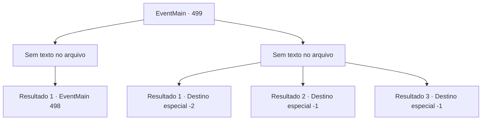

# Eventos principais · 499

[Índice da tabela](index.md) · [Índice geral](../index.md)

ID: `pt:EventMain:499` · Fonte: `EventMain4` · Versão: 1.2.47.

Mapeamento estático dos arquivos; a disponibilidade e a execução dependem do estado da run.

## Texto do evento

*Sem texto no arquivo.*

## Dados de entrada

```json
{
  "id": 499,
  "grade": 1,
  "normalGoal": "",
  "required": ""
}
```

## Mapa das escolhas



## Escolhas e resultados

### Escolha 1

*Sem texto no arquivo; o papel dessa opção depende da interface do jogo.*

Requisitos e outros campos da escolha:

```json
{
  "required": ""
}
```

#### Resultado 1.1

Você derruba todos os paladinos e sacode o sangue da sua arma. E depois de absorver todas as suas almas, você se aproxima da entrada do esconderijo e agarra a maçaneta da porta.

Continuação registrada: [Evento 498](0498.md) na mesma tabela.

```json
{
  "required": "",
  "chance": "1",
  "nextEvent": 498,
  "type": 2,
  "reward": ""
}
```

### Escolha 2

*Sem texto no arquivo; o papel dessa opção depende da interface do jogo.*

Requisitos e outros campos da escolha:

```json
{
  "required": ""
}
```

#### Resultado 2.1

Os paladinos que guardam o esconderijo são mais fortes do que você esperava. Você está ferido em muitos lugares e foge deles. Felizmente, os paladinos não te perseguem porque proteger o esconderijo é a prioridade deles. 

 "O que você vai fazer agora?"

 Você não consegue responder à pergunta repentina de Kior e fica em silêncio. Então você ouve a voz dele novamente. 

 "E que tal visitar meus adoradores? Eles são pessoas leais que não vão te trair, ao contrário dos nojentos servos de Tere."

 Kior reitera o fato de que eles estão na vila de Kahida. Depois de pensar um pouco, você decide ouvi-lo e seguir para Kahida.

Continuação registrada: [Destino especial `-2`](../destinos-especiais.md).

```json
{
  "required": "1_0_2|1_1_2",
  "chance": "1",
  "nextEvent": -2,
  "type": 2,
  "reward": "0_0_-1|0_1_-1|13_4_23"
}
```

#### Resultado 2.2

Os paladinos que guardam o esconderijo são mais fortes do que você esperava. Com seus ataques contínuos, você sangra intensamente e acaba desmoronando. A voz de um demônio triste ecoa em seu ouvido.

Continuação registrada: [Destino especial `-1`](../destinos-especiais.md).

```json
{
  "required": "2_0_2",
  "chance": "1",
  "nextEvent": -1,
  "type": 2,
  "reward": "0_0_-1|0_1_-1|15_5_2|15_5_13"
}
```

#### Resultado 2.3

Os paladinos que guardam o esconderijo são mais fortes do que você esperava. Com seus ataques contínuos, você sangra intensamente e acaba desmoronando. A voz de um demônio triste ecoa em seu ouvido.

Continuação registrada: [Destino especial `-1`](../destinos-especiais.md).

```json
{
  "required": "2_1_2",
  "chance": "1",
  "nextEvent": -1,
  "type": 2,
  "reward": "0_0_-1|0_1_-1|15_5_2|15_5_13"
}
```

## Referências que chegam a este evento

- [Evento 497 · escolha 1 · resultado 1](0497.md#escolha-1)
- [Evento 497 · escolha 1 · resultado 2](0497.md#escolha-1)
- [Evento 497 · escolha 1 · resultado 3](0497.md#escolha-1)
- [Evento 497 · escolha 2 · resultado 2](0497.md#escolha-2)
