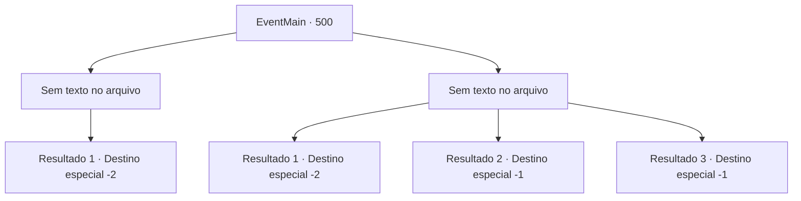

# Eventos principais · 500

[Índice da tabela](index.md) · [Índice geral](../index.md)

ID: `pt:EventMain:500` · Fonte: `EventMain4` · Versão: 1.2.47.

Mapeamento estático dos arquivos; a disponibilidade e a execução dependem do estado da run.

## Texto do evento

*Sem texto no arquivo.*

## Dados de entrada

```json
{
  "id": 500,
  "grade": 1,
  "normalGoal": "",
  "required": ""
}
```

## Mapa das escolhas



## Escolhas e resultados

### Escolha 1

*Sem texto no arquivo; o papel dessa opção depende da interface do jogo.*

Requisitos e outros campos da escolha:

```json
{
  "required": ""
}
```

#### Resultado 1.1

Você mata Valen e dedica sua alma a Kior. Então você leva apressadamente a família de Viyork para sua vila.

 Quando você entra na vila, Viyork respira aliviado e abraça sua família. E ele te agradece com um sorriso satisfeito. 

 "Obrigado por trazer minha família. Eu não esperava que você matasse a espada do arcebispo, 'Valen'. Isso é incrível."

 Ele continua, entregando uma bolsa contendo ouro. 

 "Tudo o que precisamos fazer agora é nos livrar de Publius. Mais cedo ou mais tarde, você terá a chance de cortar a garganta dele."

 Você sai, prometendo encontrar Viyork novamente.

Continuação registrada: [Destino especial `-2`](../destinos-especiais.md).

```json
{
  "required": "",
  "chance": "1",
  "nextEvent": -2,
  "type": 2,
  "reward": "13_4_24|0_4_100"
}
```

### Escolha 2

*Sem texto no arquivo; o papel dessa opção depende da interface do jogo.*

Requisitos e outros campos da escolha:

```json
{
  "required": ""
}
```

#### Resultado 2.1

Você não tem escolha a não ser fugir do feroz ataque de Valen. Ela te persegue, mas você consegue se livrar dela. 

 "O que você vai fazer agora?"

 Você não consegue responder à pergunta repentina de Kior e fica em silêncio. Então você ouve a voz dele novamente. 

 "E que tal visitar meus adoradores? Eles são pessoas leais que não vão te trair, ao contrário dos nojentos servos de Tere."

 Kior reitera o fato de estarem na vila de Kahida. Depois de pensar um pouco, você decide ouvi-lo e seguir para Kahida.

Continuação registrada: [Destino especial `-2`](../destinos-especiais.md).

```json
{
  "required": "1_0_2|1_1_2",
  "chance": "1",
  "nextEvent": -2,
  "type": 2,
  "reward": "0_0_-1|0_1_-1|13_4_23"
}
```

#### Resultado 2.2

Valen te ataca e te derruba. A mulher de cabelos vermelhos se aproxima lentamente de você, Ela coloca o pé em seu estômago. 

 "Um servo maligno. Não pense que você morrerá em paz."

 Então ela te chuta no queixo. Você desmaia com o golpe.

Continuação registrada: [Destino especial `-1`](../destinos-especiais.md).

```json
{
  "required": "2_0_2",
  "chance": "1",
  "nextEvent": -1,
  "type": 2,
  "reward": "0_0_-1|0_1_-1|15_5_2|15_5_13"
}
```

#### Resultado 2.3

Valen te ataca e te derruba. A mulher de cabelos vermelhos se aproxima lentamente de você, Ela coloca o pé em seu estômago. 

 "Um servo maligno. Não pense que você morrerá em paz."

 Então ela te chuta no queixo. Você desmaia com o golpe.

Continuação registrada: [Destino especial `-1`](../destinos-especiais.md).

```json
{
  "required": "2_1_2",
  "chance": "1",
  "nextEvent": -1,
  "type": 2,
  "reward": "0_0_-1|0_1_-1|15_5_2|15_5_13"
}
```

## Referências que chegam a este evento

- [Evento 498 · escolha 1 · resultado 1](0498.md#escolha-1)
