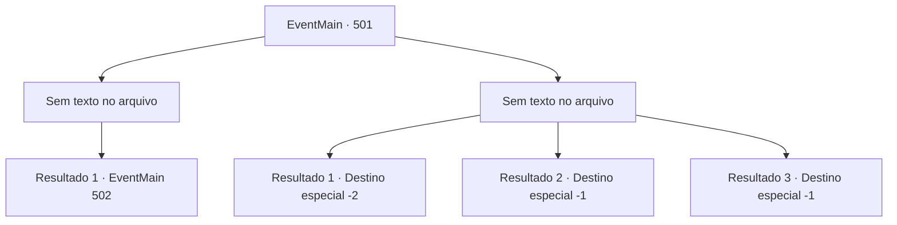

# Eventos principais · 501

[Índice da tabela](index.md) · [Índice geral](../index.md)

ID: `pt:EventMain:501` · Fonte: `EventMain4` · Versão: 1.2.47.

Mapeamento estático dos arquivos; a disponibilidade e a execução dependem do estado da run.

## Texto do evento

*Sem texto no arquivo.*

## Dados de entrada

```json
{
  "id": 501,
  "grade": 1,
  "normalGoal": "",
  "required": ""
}
```

## Mapa das escolhas



## Escolhas e resultados

### Escolha 1

*Sem texto no arquivo; o papel dessa opção depende da interface do jogo.*

Requisitos e outros campos da escolha:

```json
{
  "required": ""
}
```

#### Resultado 1.1

No momento em que você tenta matar Viyork, os paladinos próximos bloqueiam seu ataque. Atrás dos paladinos, um velho fala em voz baixa. Não é ninguém menos que Publius. 

 "Traga Viyork para cá. E aquele... Livre-se dele."

 À medida que suas ordens são emitidas, os paladinos gradualmente se aproximam e cercam você.

Continuação registrada: [Evento 502](0502.md) na mesma tabela.

```json
{
  "required": "",
  "chance": "1",
  "nextEvent": 502,
  "type": 2,
  "reward": "6_3_50",
  "place": 4
}
```

### Escolha 2

*Sem texto no arquivo; o papel dessa opção depende da interface do jogo.*

Requisitos e outros campos da escolha:

```json
{
  "required": ""
}
```

#### Resultado 2.1

Você luta contra Viyork, mas no final você é gravemente ferido e foge. Você não sabe o motivo de sua traição repentina, mas fugir é uma prioridade maior do que descobrir. 

 "O que você vai fazer agora?"

 Você não consegue responder à pergunta repentina de Kior e fica em silêncio. Então você ouve sua voz novamente. 

 "E que tal visitar meus adoradores? Eles são pessoas leais que não vão te trair, ao contrário dos repugnantes servos de Tere."

 Kior reitera o fato de estarem na vila de Kahida. Depois de pensar um pouco, você decide ouvi-lo e seguir para Kahida.

Continuação registrada: [Destino especial `-2`](../destinos-especiais.md).

```json
{
  "required": "1_0_2|1_1_2",
  "chance": "1",
  "nextEvent": -2,
  "type": 2,
  "reward": "0_0_-1|0_1_-1|13_4_23"
}
```

#### Resultado 2.2

Você tenta desesperadamente se levantar, mas seu corpo está impotente. Então, a espada de Viyork perfura seu ombro. A tormenta ardente do fogo se espalha instantaneamente. Você larga sua arma e cai de joelhos. Viyork retira a espada do seu ombro e limpa seu sangue. 

 "Todos..."

 Você desaba, observando o Arcebispo começar a falar.

Continuação registrada: [Destino especial `-1`](../destinos-especiais.md).

```json
{
  "required": "2_0_2",
  "chance": "1",
  "nextEvent": -1,
  "type": 2,
  "reward": "0_0_-1|0_1_-1|15_5_2|15_5_13"
}
```

#### Resultado 2.3

Você tenta desesperadamente se levantar, mas seu corpo está impotente. Então, a espada de Viyork perfura seu ombro. A tormenta ardente do fogo se espalha instantaneamente. Você larga sua arma e cai de joelhos. Viyork retira a espada do seu ombro e limpa seu sangue. 

 "Todos..."

 Você desaba, observando o Arcebispo começar a falar.

Continuação registrada: [Destino especial `-1`](../destinos-especiais.md).

```json
{
  "required": "2_1_2",
  "chance": "1",
  "nextEvent": -1,
  "type": 2,
  "reward": "0_0_-1|0_1_-1|15_5_2|15_5_13"
}
```

## Referências que chegam a este evento

- [Evento 495 · escolha 2 · resultado 1](0495.md#escolha-2)
