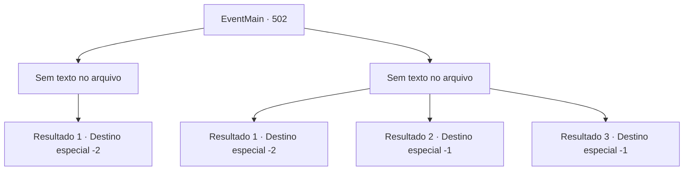

# Eventos principais · 502

[Índice da tabela](index.md) · [Índice geral](../index.md)

ID: `pt:EventMain:502` · Fonte: `EventMain4` · Versão: 1.2.47.

Mapeamento estático dos arquivos; a disponibilidade e a execução dependem do estado da run.

## Texto do evento

*Sem texto no arquivo.*

## Dados de entrada

```json
{
  "id": 502,
  "grade": 1,
  "normalGoal": "",
  "required": ""
}
```

## Mapa das escolhas



## Escolhas e resultados

### Escolha 1

*Sem texto no arquivo; o papel dessa opção depende da interface do jogo.*

Requisitos e outros campos da escolha:

```json
{
  "required": ""
}
```

#### Resultado 1.1

Todos os paladinos ao seu redor desabam, mortos. Você se vira para o Arcebispo em seguida, mas ele parece ter desaparecido junto com Viyork. Você corre na direção onde suspeita que o Arcebispo e Viyork tenham ido, mas não consegue encontrá-los em lugar nenhum. 

 "O que você vai fazer agora?"

 Você não consegue responder à pergunta repentina de Kior e fica em silêncio. Então você ouve sua voz novamente. 

 "E que tal visitar meus adoradores? Eles são pessoas leais que não vão te trair, ao contrário dos nojentos servos de Tere."

 Kior reitera o fato de que eles estão na vila de Kahida. Depois de pensar um pouco, você decide ouvi-lo e seguir para Kahida.

Continuação registrada: [Destino especial `-2`](../destinos-especiais.md).

```json
{
  "required": "",
  "chance": "1",
  "nextEvent": -2,
  "type": 2,
  "reward": "13_4_23"
}
```

### Escolha 2

*Sem texto no arquivo; o papel dessa opção depende da interface do jogo.*

Requisitos e outros campos da escolha:

```json
{
  "required": ""
}
```

#### Resultado 2.1

Envolvido no feroz ataque dos paladinos, você não tem escolha a não ser desistir de matar Publius por enquanto. 

 "O que você vai fazer agora?"

 Você não consegue responder à pergunta repentina de Kior e fica em silêncio. Então você ouve sua voz novamente. 

 "E que tal visitar meus adoradores? Eles são pessoas leais que não vão te trair, ao contrário dos nojentos servos de Tere."

 Kior reitera o fato de estarem na vila de Kahida. Depois de pensar um pouco, você decide ouvi-lo e seguir para Kahida.

Continuação registrada: [Destino especial `-2`](../destinos-especiais.md).

```json
{
  "required": "1_0_2|1_1_2",
  "chance": "1",
  "nextEvent": -2,
  "type": 2,
  "reward": "0_0_-1|0_1_-1|13_4_23"
}
```

#### Resultado 2.2

Seu corpo está ficando cada vez mais ferido, e sua respiração está ficando mais curta. Você mal consegue ficar em pé agora. Então, algo voa para o canto de sua visão. Você percebe que é uma arma contundente empunhada por um paladino enquanto ela bate em você. Seu corpo inclina e cai no chão.

Continuação registrada: [Destino especial `-1`](../destinos-especiais.md).

```json
{
  "required": "2_0_2",
  "chance": "1",
  "nextEvent": -1,
  "type": 2,
  "reward": "0_0_-1|0_1_-1|15_5_2|15_5_13"
}
```

#### Resultado 2.3

Seu corpo está ficando cada vez mais ferido, e sua respiração está ficando mais curta. Você mal consegue ficar em pé agora. Então, algo voa para o canto de sua visão. Você percebe que é uma arma contundente empunhada por um paladino enquanto ela bate em você. Seu corpo inclina e cai no chão.

Continuação registrada: [Destino especial `-1`](../destinos-especiais.md).

```json
{
  "required": "2_1_2",
  "chance": "1",
  "nextEvent": -1,
  "type": 2,
  "reward": "0_0_-1|0_1_-1|15_5_2|15_5_13"
}
```

## Referências que chegam a este evento

- [Evento 501 · escolha 1 · resultado 1](0501.md#escolha-1)
