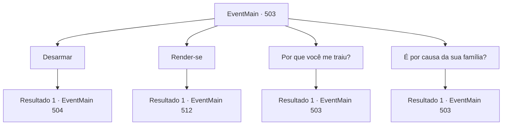

# Eventos principais · 503

[Índice da tabela](index.md) · [Índice geral](../index.md)

ID: `pt:EventMain:503` · Fonte: `EventMain4` · Versão: 1.2.47.

Mapeamento estático dos arquivos; a disponibilidade e a execução dependem do estado da run.

## Texto do evento


 "Peguem-no! Ali está o servo do demônio!"

 Você corria pelos becos estreitos, tentando escapar dos paladinos que haviam surgido de repente. Eles atacaram sem aviso enquanto você seguia em direção à vila de Kahida. Não demorou muito para que você chegasse a um beco sem saída. Ao se virar, viu os paladinos se aproximando, suas armaduras reluzindo à luz fraca. Na frente do grupo estava Viyork, que sorriu de forma arrogante e falou em tom presunçoso: 

 "O arcebispo mandou dizer que, se você se render agora, poderá ser perdoado. Então, qual é a sua decisão?"


## Dados de entrada

```json
{
  "id": 503,
  "grade": 1,
  "normalGoal": "",
  "required": "1_2_100|13_4_23"
}
```

## Mapa das escolhas



## Escolhas e resultados

### Escolha 1

Desarmar

Requisitos e outros campos da escolha:

```json
{
  "required": ""
}
```

#### Resultado 1.1

Em vez de responder, você tira sua arma e aponta para Viyork. Então Viyork balança a cabeça e levanta sua espada. 

 "Não há nada que possamos fazer... Todos ataquem!"

 Nesse momento, Viyork e os paladinos correm em sua direção.

Continuação registrada: [Evento 504](0504.md) na mesma tabela.

```json
{
  "required": "",
  "chance": "1",
  "nextEvent": 504,
  "type": 2,
  "reward": "6_3_147",
  "place": 4
}
```

### Escolha 2

Render-se

Requisitos e outros campos da escolha:

```json
{
  "required": ""
}
```

#### Resultado 2.1

Quando você se rende com as mãos para cima, os paladinos se aproximam e algemam seus pulsos. Eles te colocam em um comboio e seguem para um destino desconhecido. |drawing_tereCathedral| Após alguns dias de viagem, você chega a um lugar esplêndido chamado Catedral de Yerut. Todo o prédio é de mármore, com uma cúpula azul no topo. Por toda a parede externa, há esculturas e pinturas em mosaico em homenagem aos santos de Tere. Logo após descer do vagão, você é agarrado pelos paladinos e levado para dentro da catedral. Enquanto caminha pelo chão de mármore branco, você pode ver duas figuras à frente. Uma é um homem idoso e a outra é uma mulher. 

 "Bom dia, Arcebispo!"

 Quando os paladinos veem o homem idoso, eles se curvam em sinal de respeito. Com a exclamação deles, você percebe que o homem idoso é Publius.

Continuação registrada: [Evento 512](0512.md) na mesma tabela.

```json
{
  "required": "",
  "chance": "1",
  "nextEvent": 512,
  "type": 2,
  "reward": ""
}
```

### Escolha 3

Por que você me traiu?

Requisitos e outros campos da escolha:

```json
{
  "required": "18_368_3|5_369_0"
}
```

#### Resultado 3.1

Você pergunta a Viyork por que ele te traiu. Mas ele te questiona com uma expressão audaciosa. 

 "Eu não sei do que você está falando. Você teve um sonho comigo?"

 A partir das palavras de Viyork, você percebe que ele não vai admitir que cooperou com você.

Continuação registrada: [Evento 503](0503.md) na mesma tabela.

```json
{
  "required": "",
  "chance": "1",
  "nextEvent": 503,
  "type": 2,
  "reward": "5_369_1"
}
```

### Escolha 4

É por causa da sua família?

Requisitos e outros campos da escolha:

```json
{
  "required": "5_368_3|5_369_0"
}
```

#### Resultado 4.1

Você pergunta a Viyork por que ele te traiu. Mas ele te questiona com uma expressão audaciosa. 

 "Eu não sei do que você está falando. Você teve um sonho comigo?"

 A partir das palavras de Viyork, você percebe que ele não vai admitir que cooperou com você.

Continuação registrada: [Evento 503](0503.md) na mesma tabela.

```json
{
  "required": "",
  "chance": "1",
  "nextEvent": 503,
  "type": 2,
  "reward": "5_369_1"
}
```

## Referências que chegam a este evento

- [Evento 503 · escolha 3 · resultado 1](0503.md#escolha-3)
- [Evento 503 · escolha 4 · resultado 1](0503.md#escolha-4)
