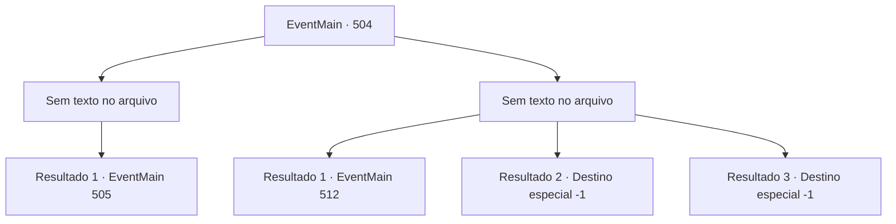

# Eventos principais · 504

[Índice da tabela](index.md) · [Índice geral](../index.md)

ID: `pt:EventMain:504` · Fonte: `EventMain4` · Versão: 1.2.47.

Mapeamento estático dos arquivos; a disponibilidade e a execução dependem do estado da run.

## Texto do evento

*Sem texto no arquivo.*

## Dados de entrada

```json
{
  "id": 504,
  "grade": 1,
  "normalGoal": "",
  "required": ""
}
```

## Mapa das escolhas



## Escolhas e resultados

### Escolha 1

*Sem texto no arquivo; o papel dessa opção depende da interface do jogo.*

Requisitos e outros campos da escolha:

```json
{
  "required": ""
}
```

#### Resultado 1.1

Você passa pelos paladinos caídos e se aproxima de Viyork. Viyork, que estava rastejando para longe, grita de medo. 

 "Eu, eu sinto muito! Eu não pude evitar porque Publius fez refém a minha família! Eu vou te mostrar o caminho para a Catedral de Yerut agora, então me perdoe...!"

 Você agarra sua cabeça sem ouvir seu discurso. Então você retira sua alma e a dedica a Kior. Os gritos de Viyork e as risadas de Kior ecoam em sua cabeça. 

 "Kahahaha!! Isso é ótimo! Realmente não resta muito agora. Vá para a Catedral de Yerut e dedique a alma do arcebispo a mim."

 Com um sorriso no rosto ensanguentado, você segue em direção à Catedral de Yerut.

Continuação registrada: [Evento 505](0505.md) na mesma tabela.

```json
{
  "required": "",
  "chance": "1",
  "nextEvent": 505,
  "type": 2,
  "reward": "0_3_-5"
}
```

### Escolha 2

*Sem texto no arquivo; o papel dessa opção depende da interface do jogo.*

Requisitos e outros campos da escolha:

```json
{
  "required": ""
}
```

#### Resultado 2.1


 "Isso vai te deixar quieto por um tempo. Leve-os embora!"

 Depois de perder para Viyork, você desmaia com uma explosão de sangue. Você pode sentir os paladinos te arrastando bruscamente, indo para um lugar desconhecido. |drawing_tereCathedral| Você está em frente a um prédio chamado Catedral de Yerut usando correntes. A catedral é um lugar esplêndido. Todo o prédio é feito de mármore com uma cúpula azul no topo. Por toda a parede externa há esculturas e pinturas em mosaico em homenagem aos santos de Tere. Enquanto você caminha pelo chão de mármore branco, você pode ver duas figuras à frente. Uma é um homem idoso e a outra é uma mulher. 

 "Bom dia, Arcebispo!"

 Quando os paladinos veem o homem idoso, eles se curvam em sinal de respeito. Com a exclamação deles, você percebe que o homem idoso é Publius.

Continuação registrada: [Evento 512](0512.md) na mesma tabela.

```json
{
  "required": "1_0_2|1_1_2",
  "chance": "1",
  "nextEvent": 512,
  "type": 2,
  "reward": "0_0_-1|0_1_-1"
}
```

#### Resultado 2.2

Você se curva em derrota, mas não há lugar para fugir porque os paladinos te cercaram. A espada voadora de Viyork corta você e você se ajoelha em uma dor tonturante. 

 "Isso vai te deixar quieto por um tempo. Leve-os embora!"

 Ao comando de Viyork, os paladinos te agarram e te arrastam para longe. Você tenta escapar deles, mas sua consciência está turva.

Continuação registrada: [Destino especial `-1`](../destinos-especiais.md).

```json
{
  "required": "2_0_2",
  "chance": "1",
  "nextEvent": -1,
  "type": 2,
  "reward": "0_0_-1|0_1_-1|15_5_2|15_5_13"
}
```

#### Resultado 2.3

Você se curva em derrota, mas não há lugar para fugir porque os paladinos te cercaram. A espada voadora de Viyork corta você e você se ajoelha em uma dor tonturante. 

 "Isso vai te deixar quieto por um tempo. Leve-os embora!"

 Ao comando de Viyork, os paladinos te agarram e te arrastam para longe. Você tenta escapar deles, mas sua consciência está turva.

Continuação registrada: [Destino especial `-1`](../destinos-especiais.md).

```json
{
  "required": "2_1_2",
  "chance": "1",
  "nextEvent": -1,
  "type": 2,
  "reward": "0_0_-1|0_1_-1|15_5_2|15_5_13"
}
```

## Referências que chegam a este evento

- [Evento 503 · escolha 1 · resultado 1](0503.md#escolha-1)
