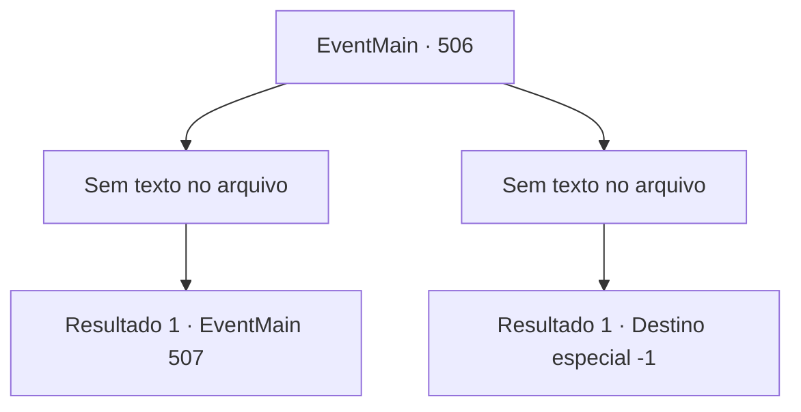

# Eventos principais · 506

[Índice da tabela](index.md) · [Índice geral](../index.md)

ID: `pt:EventMain:506` · Fonte: `EventMain4` · Versão: 1.2.47.

Mapeamento estático dos arquivos; a disponibilidade e a execução dependem do estado da run.

## Texto do evento

*Sem texto no arquivo.*

## Dados de entrada

```json
{
  "id": 506,
  "grade": 1,
  "normalGoal": "",
  "required": ""
}
```

## Mapa das escolhas



## Escolhas e resultados

### Escolha 1

*Sem texto no arquivo; o papel dessa opção depende da interface do jogo.*

Requisitos e outros campos da escolha:

```json
{
  "required": ""
}
```

#### Resultado 1.1

Você derruba os paladinos, sentindo o poder de Kior crescendo. O poder sombrio dentro de você irrompe como um vulcão ativo toda vez que você mata um deles. Você está prestes a matar outro paladino, quando de repente uma mulher de cabelos vermelhos aparece, bloqueando seu caminho. 

 "... que terrível. Valen, se livre do demônio. Eu vou te ajudar."|drawing_valenWithPublius| Atrás dela, um velho vestido com uma rica túnica vermelha bordada dá ordens. Ele tem rugas profundas na testa e uma barba impressionante cobrindo seu rosto. A mulher chamada Valen acena com a cabeça ao seu comando e diz: 'Sim, Arcebispo!'. Com sua resposta, você percebe que o velho é 'Publius'. Quando Publius lança um feitiço divino sobre ela, Valen salta em sua direção com a espada erguida.

Continuação registrada: [Evento 507](0507.md) na mesma tabela.

```json
{
  "required": "",
  "chance": "1",
  "nextEvent": 507,
  "type": 2,
  "reward": "6_3_148",
  "place": 4
}
```

### Escolha 2

*Sem texto no arquivo; o papel dessa opção depende da interface do jogo.*

Requisitos e outros campos da escolha:

```json
{
  "required": ""
}
```

#### Resultado 2.1

Os paladinos que guardam a catedral nem mesmo têm medo da morte. Em vez disso, eles defendem seus camaradas usando-se como escudos. Eles empunham suas espadas contra você enquanto sangram profusamente. E em seu ataque desesperado, você é derrubado.

Continuação registrada: [Destino especial `-1`](../destinos-especiais.md).

```json
{
  "required": "",
  "chance": "1",
  "nextEvent": -1,
  "type": 2,
  "reward": "0_0_-1|0_1_-1|15_5_2|15_5_13"
}
```

## Referências que chegam a este evento

- [Evento 505 · escolha 1 · resultado 1](0505.md#escolha-1)
