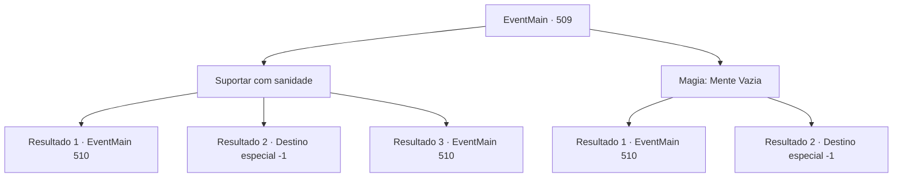

# Eventos principais · 509

[Índice da tabela](index.md) · [Índice geral](../index.md)

ID: `pt:EventMain:509` · Fonte: `EventMain4` · Versão: 1.2.47.

Mapeamento estático dos arquivos; a disponibilidade e a execução dependem do estado da run.

## Texto do evento

*Sem texto no arquivo.*

## Dados de entrada

```json
{
  "id": 509,
  "grade": 1,
  "normalGoal": "",
  "required": ""
}
```

## Mapa das escolhas



## Escolhas e resultados

### Escolha 1

Suportar com sanidade

Requisitos e outros campos da escolha:

```json
{
  "required": ""
}
```

#### Resultado 1.1

Você supera a Palavra de Poder com sua sanidade e agarra o pescoço de Valen, sufocando-a. Quando sua palavra de poder é quebrada, Publius vomita sangue pela força de sua resistência. 

 "Tossindo! Você... Seus pecados nunca serão perdoados por Tere!!"

 Você se aproxima de Publius, indiferente à sua condenação. E você lhe dá uma morte horrível. Um sorriso puxa os cantos de sua boca enquanto seu sangue respinga em sua bochecha. 

 "Ótimo trabalho. {1}. Vamos lá, dê suas almas para mim."

 Como Kior diz, você dedica as almas dos falecidos Valen e Publius a ele. Então Kior explode em risos satisfeitos. 

 "Khahaha!!! Ótimo! Que excelente! Bem, vou recompensá-lo por sua dedicação. Receba minha força. Vou lhe dar poder como você nunca experimentou antes."

 E então, com esse poder, ele lhe diz para apagar todas as evidências de Tere.

Continuação registrada: [Evento 510](0510.md) na mesma tabela.

```json
{
  "required": "24_7_1",
  "chance": "1|0_14_1",
  "nextEvent": 510,
  "type": 0,
  "reward": ""
}
```

#### Resultado 1.2

Você não pode parar a segunda palavra de poder e se sufoca. Lentamente, sua consciência começa a desaparecer. Nesse momento, você pode ouvir o som de Kior estalando a língua em sua cabeça. 

 "Ah não... Estávamos quase lá... Que pena..."

 No final de sua frase, você cai na escuridão.

Continuação registrada: [Destino especial `-1`](../destinos-especiais.md).

```json
{
  "required": "24_7_1",
  "chance": "16",
  "nextEvent": -1,
  "type": 1,
  "reward": "15_5_2|15_5_13|15_5_17"
}
```

#### Resultado 1.3

Você supera a Palavra de Poder com sua sanidade e agarra o pescoço de Valen, sufocando-a. A dominação da Palavra de Poder enfraquece diante de sua forte força de vontade. Quando sua palavra de poder é quebrada, Publius vomita sangue pela força de sua resistência. 

 "Tossindo! Você... Seus pecados nunca serão perdoados por Tere!!"

 Você se aproxima de Publius, indiferente à sua condenação. E você lhe dá uma morte horrível. Um sorriso puxa os cantos de sua boca enquanto seu sangue respinga em sua bochecha. 

 "Ótimo trabalho. {1}. Vamos lá, dê suas almas para mim."

 Como Kior diz, você dedica as almas dos falecidos Valen e Publius a ele. Então Kior explode em risos satisfeitos. 

 "Khahaha!!! Ótimo! Que excelente! Bem, eu vou recompensá-lo por sua dedicação. Receba minha força. Eu lhe darei poder como você nunca experimentou antes."

 E então, com esse poder, ele lhe diz para apagar todas as evidências de Tere.

Continuação registrada: [Evento 510](0510.md) na mesma tabela.

```json
{
  "required": "23_7_1",
  "chance": "1",
  "nextEvent": 510,
  "type": 2,
  "reward": ""
}
```

### Escolha 2

Magia: Mente Vazia

Requisitos e outros campos da escolha:

```json
{
  "required": "20_0_3|1_1_2"
}
```

#### Resultado 2.1

Você rapidamente lança Mind Blank, depois agarra o pescoço de Valen, sufocando-a. Mind Blank bloqueia os efeitos da magia mental, e Power Word falha. Quando sua palavra de poder é quebrada, Publius vomita sangue pela força de sua resistência. 

 "Tossindo! Você... Seus pecados nunca serão perdoados por Tere!!"

 Você se aproxima de Publius, indiferente à sua condenação. E você lhe dá uma morte horrível. Um sorriso puxa os cantos de sua boca enquanto seu sangue respinga em sua bochecha. 

 "Ótimo trabalho. {1}. Vamos lá, entregue suas almas para mim."

 Como Kior diz, você dedica as almas dos falecidos Valen e Publius a ele. Então Kior explode em risadas satisfeitas. 

 "Khahaha!!! Ótimo! Que excelente! Bem, vou recompensá-lo por sua dedicação. Receba minha força. Vou lhe dar poder como você nunca experimentou antes."

 E então, com esse poder, ele ordena que você apague todas as evidências de Tere.

Continuação registrada: [Evento 510](0510.md) na mesma tabela.

```json
{
  "required": "",
  "chance": "1|0_7_1|0_12_1",
  "nextEvent": 510,
  "type": 0,
  "reward": "0_1_-1"
}
```

#### Resultado 2.2

Você tenta lançar Mente em Branco, pois invalida a magia mental, mas não consegue vencer a magia da Palavra de Poder. Suas mãos se apertam em seu pescoço e lentamente sua consciência começa a desaparecer. Nesse momento, você pode ouvir o som de Kior clicando a língua em sua cabeça. 

 "Ah não... Estávamos quase lá... Que pena..."

 Ao final da frase, você cai na escuridão.

Continuação registrada: [Destino especial `-1`](../destinos-especiais.md).

```json
{
  "required": "",
  "chance": "25",
  "nextEvent": -1,
  "type": 1,
  "reward": "15_5_2|15_5_13|15_5_17|0_1_-1"
}
```

## Referências que chegam a este evento

- [Evento 508 · escolha 1 · resultado 2](0508.md#escolha-1)
- [Evento 508 · escolha 2 · resultado 2](0508.md#escolha-2)
