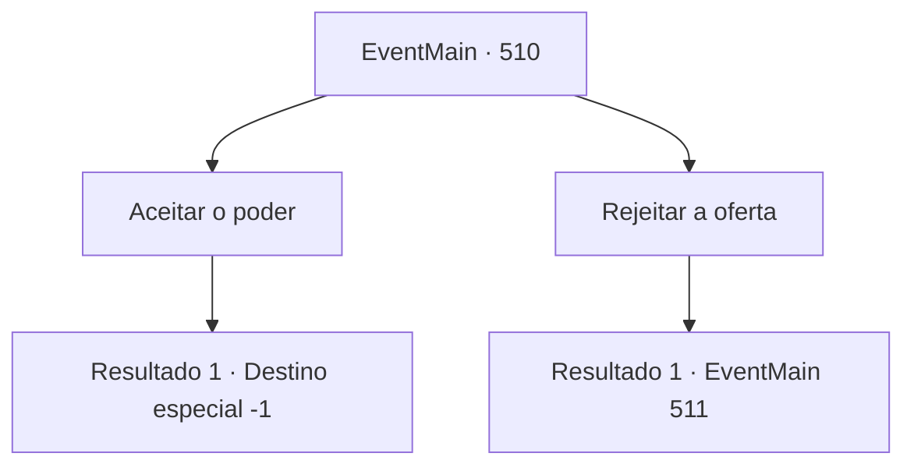

# Eventos principais · 510

[Índice da tabela](index.md) · [Índice geral](../index.md)

ID: `pt:EventMain:510` · Fonte: `EventMain4` · Versão: 1.2.47.

Mapeamento estático dos arquivos; a disponibilidade e a execução dependem do estado da run.

## Texto do evento

*Sem texto no arquivo.*

## Dados de entrada

```json
{
  "id": 510,
  "grade": 1,
  "normalGoal": "",
  "required": ""
}
```

## Mapa das escolhas



## Escolhas e resultados

### Escolha 1

Aceitar o poder

Requisitos e outros campos da escolha:

```json
{
  "required": ""
}
```

#### Resultado 1.1

Você aceita o poder de Kior. Então, você sente toda a força de sua força vinda de dentro do seu peito. Ela se espalha pela sua espinha e pelos seus membros. Mana negra está correndo pelo seu corpo. Seus olhos estão vermelhos e vidrados. 

 "Uau, você está tão legal. Bem, então, vamos buscar mais vingança. Vá apagar todas as evidências de Tere do mundo."

 Ouvindo a voz satisfeita de Kior, você sai da catedral.

Continuação registrada: [Destino especial `-1`](../destinos-especiais.md).

```json
{
  "required": "",
  "chance": "1",
  "nextEvent": -1,
  "type": 2,
  "reward": "15_5_5|15_5_8|15_5_14"
}
```

### Escolha 2

Rejeitar a oferta

Requisitos e outros campos da escolha:

```json
{
  "required": ""
}
```

#### Resultado 2.1

Você rejeita a oferta de Kior. A voz suave de Kior responde. 

 "Do que você está falando? Não foi apenas Publius quem matou sua família. O próprio Teresiano causou a morte injusta deles. Portanto, sua vingança só pode ser completa quando você se livrar de todos eles. Você não entende isso?"

 Ele afirma que é tudo por seu próprio bem e que você precisa abraçar uma força maior para se vingar. Ele também sussurra que sua família só pode resolver sua rixa e descansar em paz se você terminar o trabalho.

Continuação registrada: [Evento 511](0511.md) na mesma tabela.

```json
{
  "required": "",
  "chance": "1",
  "nextEvent": 511,
  "type": 2,
  "reward": ""
}
```

## Referências que chegam a este evento

- [Evento 508 · escolha 1 · resultado 1](0508.md#escolha-1)
- [Evento 508 · escolha 1 · resultado 3](0508.md#escolha-1)
- [Evento 508 · escolha 2 · resultado 1](0508.md#escolha-2)
- [Evento 509 · escolha 1 · resultado 1](0509.md#escolha-1)
- [Evento 509 · escolha 1 · resultado 3](0509.md#escolha-1)
- [Evento 509 · escolha 2 · resultado 1](0509.md#escolha-2)
- [Evento 515 · escolha 1 · resultado 1](0515.md#escolha-1)
