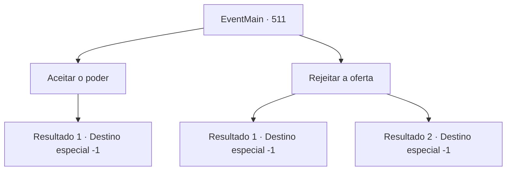

# Eventos principais · 511

[Índice da tabela](index.md) · [Índice geral](../index.md)

ID: `pt:EventMain:511` · Fonte: `EventMain4` · Versão: 1.2.47.

Mapeamento estático dos arquivos; a disponibilidade e a execução dependem do estado da run.

## Texto do evento

*Sem texto no arquivo.*

## Dados de entrada

```json
{
  "id": 511,
  "grade": 1,
  "normalGoal": "",
  "required": ""
}
```

## Mapa das escolhas



## Escolhas e resultados

### Escolha 1

Aceitar o poder

Requisitos e outros campos da escolha:

```json
{
  "required": ""
}
```

#### Resultado 1.1

Convencido pelas palavras sinceras de Kior, você aceita o seu poder. Então, você sente toda a força do seu poder vindo de dentro do seu peito. Ele se espalha pela sua espinha e pelos seus membros. Mana negra está correndo pelo seu corpo, e seus olhos estão vermelhos e vidrados. 

 "Uau, você está tão legal. Bem, então, vamos buscar mais vingança. Vamos apagar todas as evidências de Tere do mundo."

 Ouvindo a voz satisfeita de Kior, você sai da catedral.

Continuação registrada: [Destino especial `-1`](../destinos-especiais.md).

```json
{
  "required": "",
  "chance": "1",
  "nextEvent": -1,
  "type": 2,
  "reward": "15_5_5|15_5_8|15_5_14"
}
```

### Escolha 2

Rejeitar a oferta

Requisitos e outros campos da escolha:

```json
{
  "required": ""
}
```

#### Resultado 2.1

Você rejeita as palavras sinceras de Kior novamente. Então, de repente, mana negra começa a fluir para dentro de você. Você desesperadamente a resisti. 

 "Que idiota! Você não tinha escolha desde o início. VOCÊ FAZ O QUE EU DIGO!!"

 A voz de Kior, cheia de raiva, é horrivelmente fria e aterrorizante. E sua mana negra aperta sua mente. Mas você não desiste e consegue se livrar dela. A mana de Kior se dispersa como uma explosão, e você ouve sua voz novamente. 

 "...Eu não entendo. Resista a mim, e você morrerá em breve. Se você quer morrer assim, eu deixo você."

 Enquanto ele diz isso, a mana restante de Kior desaparece do seu corpo. E você não ouve mais a terrível voz de Kior. Quando a mana de Kior escapa, você rapidamente fica fraco. Agora você tem a sensação de que a morte está logo ali. Você caminha com dificuldade e sai da catedral.

Continuação registrada: [Destino especial `-1`](../destinos-especiais.md).

```json
{
  "required": "",
  "chance": "1|0_14_1",
  "nextEvent": -1,
  "type": 0,
  "reward": "15_5_0|15_5_3|15_5_13"
}
```

#### Resultado 2.2

Você rejeita as palavras sinceras de Kior novamente. Então, de repente, mana negra começa a fluir para dentro de você, Você desesperadamente a resisti. 

 "Que idiota! Você não tinha escolha desde o início. VOCÊ FAZ O QUE EU DIGO!!"

 A voz de Kior, cheia de raiva, é horrivelmente fria e aterrorizante. E sua mana negra aperta sua mente. Mas você não pode fazer nada. Sua consciência está ficando cada vez mais escura, e até as memórias de sua família desaparecem. É assim que você acaba sendo o fantoche de Kior.

Continuação registrada: [Destino especial `-1`](../destinos-especiais.md).

```json
{
  "required": "",
  "chance": "20",
  "nextEvent": -1,
  "type": 1,
  "reward": "15_5_5|15_5_8|15_5_14"
}
```

## Referências que chegam a este evento

- [Evento 510 · escolha 2 · resultado 1](0510.md#escolha-2)
