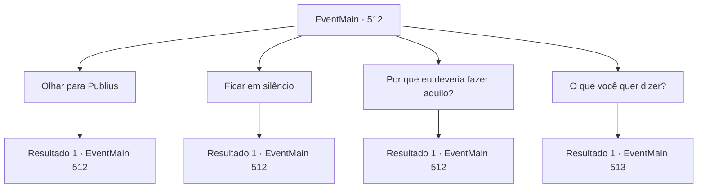

# Eventos principais · 512

[Índice da tabela](index.md) · [Índice geral](../index.md)

ID: `pt:EventMain:512` · Fonte: `EventMain4` · Versão: 1.2.47.

Mapeamento estático dos arquivos; a disponibilidade e a execução dependem do estado da run.

## Texto do evento

*Sem texto no arquivo.*

## Dados de entrada

```json
{
  "id": 512,
  "grade": 1,
  "normalGoal": "",
  "required": ""
}
```

## Mapa das escolhas



## Escolhas e resultados

### Escolha 1

Olhar para Publius

Requisitos e outros campos da escolha:

```json
{
  "required": "5_370_0"
}
```

#### Resultado 1.1


 "Por favor, deixe-nos por um momento. Não se preocupe, 'Valen' está ao meu lado."

 Publius está vestindo uma túnica sacerdotal vermelha bordada com esplendor. Sua testa tem rugas profundas e uma barba cobre sua parte inferior do rosto. Ao lado dele está uma jovem mulher meio-elfa de cabelos vermelhos, guardando-o. Quando os paladinos saem por ordem de Publius, ele abre a boca novamente. 

 "{1}. Você sabe por que estou me encontrando com você em vez de matá-lo?"


Continuação registrada: [Evento 512](0512.md) na mesma tabela.

```json
{
  "required": "",
  "chance": "1",
  "nextEvent": 512,
  "type": 2,
  "reward": "5_370_1"
}
```

### Escolha 2

Ficar em silêncio

Requisitos e outros campos da escolha:

```json
{
  "required": "5_370_1"
}
```

#### Resultado 2.1

Quando você está em silêncio, Publius continua com uma voz solene. 

 "É porque eu quero te dar uma chance. Se você quebrar seu contrato com Kior agora e jurar se redimir de seus pecados, eu prometo que vou te ajudar."

 Publius olha para você tranquilamente, com um sorriso relaxado, como se estivesse oferecendo uma grande gentileza.

Continuação registrada: [Evento 512](0512.md) na mesma tabela.

```json
{
  "required": "",
  "chance": "1",
  "nextEvent": 512,
  "type": 2,
  "reward": "5_370_2"
}
```

### Escolha 3

Por que eu deveria fazer aquilo?

Requisitos e outros campos da escolha:

```json
{
  "required": "5_370_2"
}
```

#### Resultado 3.1

Publius suspira diante da sua pergunta. Ele olha para você com olhos tristes e explica o motivo. 

 "Tolo... Você realmente acha que esse demônio Kior está te ajudando por pena? Você acha que essa é a primeira vez que ele seduz um ser humano? Isso já aconteceu muitas vezes."

 Publius estala a língua, dizendo que você está sendo enganado por Kior. 

 "Pense sobre isso. É realmente uma coincidência que você tenha ficado doente? Sua família já estava jogando nas mãos do demônio! Se você recusar minha oferta depois de tudo isso, eu devo executá-lo aqui mesmo."

 Publius fala como se estivesse genuinamente preocupado. Nesse momento, Kior responde em sua cabeça. 

 "Oh, meu. É uma crise. {1}. Você estará morto se não ceder. Mas não pode abrir mão de sua vingança por causa dessa bobagem, não é?"


Continuação registrada: [Evento 512](0512.md) na mesma tabela.

```json
{
  "required": "",
  "chance": "1",
  "nextEvent": 512,
  "type": 2,
  "reward": "5_370_3"
}
```

### Escolha 4

O que você quer dizer?

Requisitos e outros campos da escolha:

```json
{
  "required": "5_370_3"
}
```

#### Resultado 4.1

Você pergunta a Kior o que ele tem a dizer. Ele responde à pergunta com uma voz cativante. 

 "Haha... {1}. Já que você fez tanto por mim, não deveria eu fazer algo por você? Eu não sou um deus indiferente como Tere. Confie em mim e deixe tudo comigo. Então eu lhe darei o poder de se vingar."

 Enquanto você ouve a sugestão de Kior, Publius olha para você.

Continuação registrada: [Evento 513](0513.md) na mesma tabela.

```json
{
  "required": "",
  "chance": "1",
  "nextEvent": 513,
  "type": 2,
  "reward": "5_370_4"
}
```

## Referências que chegam a este evento

- [Evento 503 · escolha 2 · resultado 1](0503.md#escolha-2)
- [Evento 504 · escolha 2 · resultado 1](0504.md#escolha-2)
- [Evento 512 · escolha 1 · resultado 1](0512.md#escolha-1)
- [Evento 512 · escolha 2 · resultado 1](0512.md#escolha-2)
- [Evento 512 · escolha 3 · resultado 1](0512.md#escolha-3)
