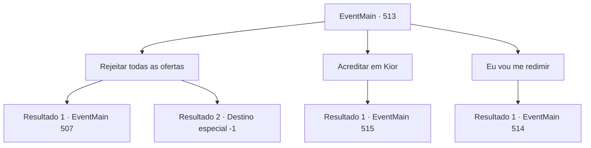

# Eventos principais · 513

[Índice da tabela](index.md) · [Índice geral](../index.md)

ID: `pt:EventMain:513` · Fonte: `EventMain4` · Versão: 1.2.47.

Mapeamento estático dos arquivos; a disponibilidade e a execução dependem do estado da run.

## Texto do evento

*Sem texto no arquivo.*

## Dados de entrada

```json
{
  "id": 513,
  "grade": 1,
  "normalGoal": "",
  "required": ""
}
```

## Mapa das escolhas



## Escolhas e resultados

### Escolha 1

Rejeitar todas as ofertas

Requisitos e outros campos da escolha:

```json
{
  "required": ""
}
```

#### Resultado 1.1

Você rejeita as ofertas de ambos Publius e Kior. Com sua resposta, Publius olha para Valen impotente. 

 "Se é isso que você quer, não posso te forçar. Valen, por favor."

 Com a ordem de Publius, Valen deixa o lado dele e se aproxima de você. No momento em que Valen puxa sua espada, você quebra com força as correntes em torno de seus pulsos e corre em direção a ela.

Continuação registrada: [Evento 507](0507.md) na mesma tabela.

```json
{
  "required": "",
  "chance": "1|0_5_1",
  "nextEvent": 507,
  "type": 0,
  "reward": "6_3_148",
  "place": 7
}
```

#### Resultado 1.2

Você rejeita as ofertas de Publius e Kior. E tenta quebrar as algemas para executar sua vingança sozinho. 

 "... Valen!"

 Mas seu plano falha. No momento em que você tenta quebrar as correntes, Valen se aproxima de você empunhando sua espada. Você perde a consciência com a dor ardente de sua espada. Em sua consciência desvanecendo, você ouve Kior clicando a língua. 

 "Tsk tsk... Que tolo."


Continuação registrada: [Destino especial `-1`](../destinos-especiais.md).

```json
{
  "required": "",
  "chance": "18",
  "nextEvent": -1,
  "type": 1,
  "reward": "15_5_2|15_5_13|15_5_17"
}
```

### Escolha 2

Acreditar em Kior

Requisitos e outros campos da escolha:

```json
{
  "required": ""
}
```

#### Resultado 2.1

Você acredita em Kior e deixa tudo nas mãos dele. E naquele exato momento, suas algemas se desfazem e você sente uma onda de mana negra dentro de você. 

 "Huh..! Valen! Ataque agora mesmo!"

 Publius grita com uma expressão atônita e lança um feitiço sagrado. Ao seu comando, Valen empunha sua espada. Você vê Valen atacar com poder divino e estende a mão para liberar a mana negra.

Continuação registrada: [Evento 515](0515.md) na mesma tabela.

```json
{
  "required": "",
  "chance": "1",
  "nextEvent": 515,
  "type": 2,
  "reward": "6_3_148|0_5_1|0_6_1|0_13_1|5_371_1",
  "place": 7
}
```

### Escolha 3

Eu vou me redimir

Requisitos e outros campos da escolha:

```json
{
  "required": ""
}
```

#### Resultado 3.1

Você concorda com o que Publius ordenou. As palavras duras de Kior inundam sua mente. 

 "O quê...? Seu tolo! Eu te salvei da morte e te ajudei até agora, e é assim que você me retribui? Você esquece para quem está vivendo?"

 Ao ouvir sua resposta, Publius responde com um sorriso benevolente. 

 "Você tomou uma boa decisão. Não se deixe influenciar pelo demônio novamente."

 Enquanto Publius ainda está falando, você ouve as palavras de Kior novamente. 

 "Khhh... Você vai se arrepender. De todas as maneiras, eu farei você se arrepender."

 No final de seu discurso, o poder de Kior deixa você. Você está sem fôlego e sente intuitivamente que seus dias estão contados. Publius examina sua condição e chama apressadamente os sacerdotes. Então ele começa a desenhar um círculo mágico no chão, borrifando óleo sagrado.

Continuação registrada: [Evento 514](0514.md) na mesma tabela.

```json
{
  "required": "",
  "chance": "1",
  "nextEvent": 514,
  "type": 2,
  "reward": "0_5_-1|0_6_-1|0_13_-1|0_3_20|5_431_1"
}
```

## Referências que chegam a este evento

- [Evento 512 · escolha 4 · resultado 1](0512.md#escolha-4)
