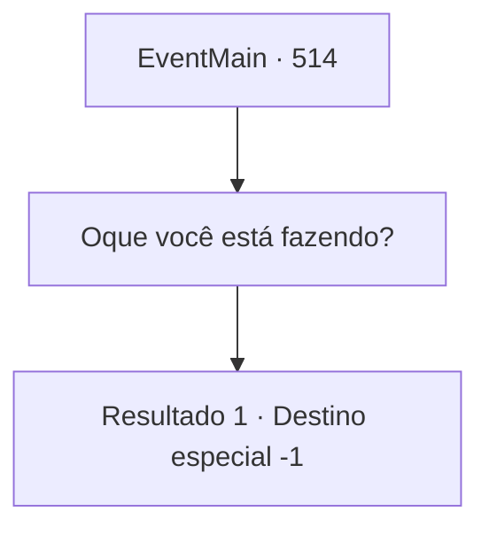

# Eventos principais · 514

[Índice da tabela](index.md) · [Índice geral](../index.md)

ID: `pt:EventMain:514` · Fonte: `EventMain4` · Versão: 1.2.47.

Mapeamento estático dos arquivos; a disponibilidade e a execução dependem do estado da run.

## Texto do evento

*Sem texto no arquivo.*

## Dados de entrada

```json
{
  "id": 514,
  "grade": 1,
  "normalGoal": "",
  "required": ""
}
```

## Mapa das escolhas



## Escolhas e resultados

### Escolha 1

Oque você está fazendo?

Requisitos e outros campos da escolha:

```json
{
  "required": ""
}
```

#### Resultado 1.1

Publius responde à sua pergunta enquanto desenha o círculo mágico. 

 "Seu corpo está incompleto. O poder de Kior estava te mantendo vivo, mas agora se foi. Você vai morrer em breve. Você não sente isso?"

 Ele diz que vai prolongar um pouco mais a sua vida, pois ainda não é a sua hora de morrer. Enquanto isso, os sacerdotes colocam escalas de prata e ouro no círculo mágico. Publius também derrama óleo sagrado sobre você. Em seguida, ele junta as mãos e reza. 

 "Poderoso deus Tere, este humilde servo implora a você..."

 À medida que suas orações começam, uma chama branca se eleva ao redor do seu corpo. O fogo quente te envolve e sua visão se torna branca. |drawing_whiteFlame| Quando a energia quente desaparece e você abre os olhos novamente. Sua cabeça se sente revigorada, como se uma névoa tivesse desaparecido. A raiva fervente diminui e você se acalma. 

 "Por favor... Permita que {1} se arrependa de seus pecados e entre em seu abraço."

 Após a oração, Publius se aproxima de você e estende a mão. Você pega a mão dele e se levanta.

Continuação registrada: [Destino especial `-1`](../destinos-especiais.md).

```json
{
  "required": "",
  "chance": "1",
  "nextEvent": -1,
  "type": 2,
  "reward": "15_5_12|0_13_1|0_7_1|0_14_1"
}
```

## Referências que chegam a este evento

- [Evento 513 · escolha 3 · resultado 1](0513.md#escolha-3)
