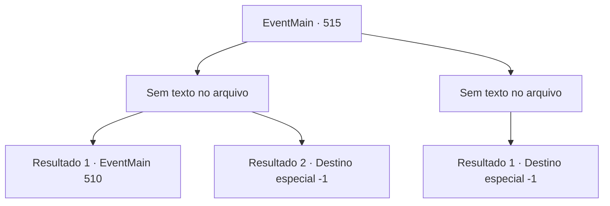

# Eventos principais · 515

[Índice da tabela](index.md) · [Índice geral](../index.md)

ID: `pt:EventMain:515` · Fonte: `EventMain4` · Versão: 1.2.47.

Mapeamento estático dos arquivos; a disponibilidade e a execução dependem do estado da run.

## Texto do evento

*Sem texto no arquivo.*

## Dados de entrada

```json
{
  "id": 515,
  "grade": 1,
  "normalGoal": "",
  "required": ""
}
```

## Mapa das escolhas



## Escolhas e resultados

### Escolha 1

*Sem texto no arquivo; o papel dessa opção depende da interface do jogo.*

Requisitos e outros campos da escolha:

```json
{
  "required": ""
}
```

#### Resultado 1.1

Você se livra de Valen e se aproxima de Publius. Então as palavras 'Ajoelhe-se!' saem de sua boca. Sua voz carrega um feitiço poderoso. 

 "Isso é uma 'palavra de poder'. É uma magia sagrada com o poder de forçar outro a obedecer, mas é inútil contra você agora. {1}."

 Enquanto Kior diz isso, você pausa por um momento, mas rapidamente recupera sua liberdade. Por outro lado, Publius desaba com a força de sua resistência. 

 "Tossindo! S... Seus pecados nunca serão perdoados por Tere!!"

 Você segura o rosto de Publius enquanto ele se contorce e grita. Você arranca sua alma. O corpo envelhecido de Publius se torna uma casca vazia e desaba. Depois de olhar para ele por um tempo, você se volta para o corpo de Valen. Você extrai a alma e a dedica a Kior. Então Kior explode em risos satisfeitos. 

 "Khahaha!!! Ótimo! Que excelente! Bem, vou recompensá-lo por sua dedicação. Receba minha força. Vou lhe dar poder como você nunca experimentou antes."

 E então, com esse poder, ele ordena que você apague todas as evidências de Tere.

Continuação registrada: [Evento 510](0510.md) na mesma tabela.

```json
{
  "required": "18_371_1",
  "chance": "1",
  "nextEvent": 510,
  "type": 2,
  "reward": ""
}
```

#### Resultado 1.2

Você se livra de Valen e se aproxima de Publius. Então as palavras 'Ajoelhe-se!' saem de sua boca. Sua voz carrega um feitiço poderoso. 

 "Isso é uma 'palavra de poder'. É uma magia sagrada com o poder de forçar outro a obedecer, mas é inútil contra você agora. {1}."

 Enquanto Kior diz isso, você pausa por um momento, mas rapidamente recupera sua liberdade. Por outro lado, Publius desaba com a força de sua resistência. 

 "Tossindo! S... Seus pecados nunca serão perdoados por Tere!!"

 Você segura o rosto de Publius enquanto ele se contorce e grita. Você arranca sua alma. O corpo envelhecido de Publius se torna uma casca vazia e desaba. Depois de olhar para ele por um tempo, você se volta para o corpo de Valen. Você extrai a alma e a dedica a Kior. Você ouve a voz satisfeita de Kior. 

 "Ufa. Grandes almas. Bom trabalho. {1}. Mas não podemos parar por aqui. Você concorda?"

 Ele diz que se você realmente quer alcançar vingança, não deve se satisfazer ainda. Você deve destruir todo o Teretian. Você deixa a catedral com um aceno. Agora nada importa para você, exceto destruir Tere com Kior.

Continuação registrada: [Destino especial `-1`](../destinos-especiais.md).

```json
{
  "required": "5_371_1",
  "chance": "1",
  "nextEvent": -1,
  "type": 2,
  "reward": "15_5_5|15_5_8|15_5_14"
}
```

### Escolha 2

*Sem texto no arquivo; o papel dessa opção depende da interface do jogo.*

Requisitos e outros campos da escolha:

```json
{
  "required": ""
}
```

#### Resultado 2.1

Tentas executar a tua vingança usando o poder adquirido através do teu novo contrato com Kior. Mas és derrotado pelo arcebispo, Valen, e pelos paladinos que correm para dentro da catedral. Assaltado pelos paladinos destemidos, pela poderosa magia divina de Publius e pela espada de Valen, és levado ao chão. 

 "Perdeste apesar da minha força... Isso é patético..."

 A voz de Kior ecoa na tua consciência que se vai enfraquecendo. Tentas pedir outra oportunidade, mas a tua voz não sai. Assim, a tua busca por vingança termina em fracasso.

Continuação registrada: [Destino especial `-1`](../destinos-especiais.md).

```json
{
  "required": "",
  "chance": "1",
  "nextEvent": -1,
  "type": 2,
  "reward": "0_0_-1|0_1_-1|15_5_2|15_5_13|15_5_17"
}
```

## Referências que chegam a este evento

- [Evento 513 · escolha 2 · resultado 1](0513.md#escolha-2)
