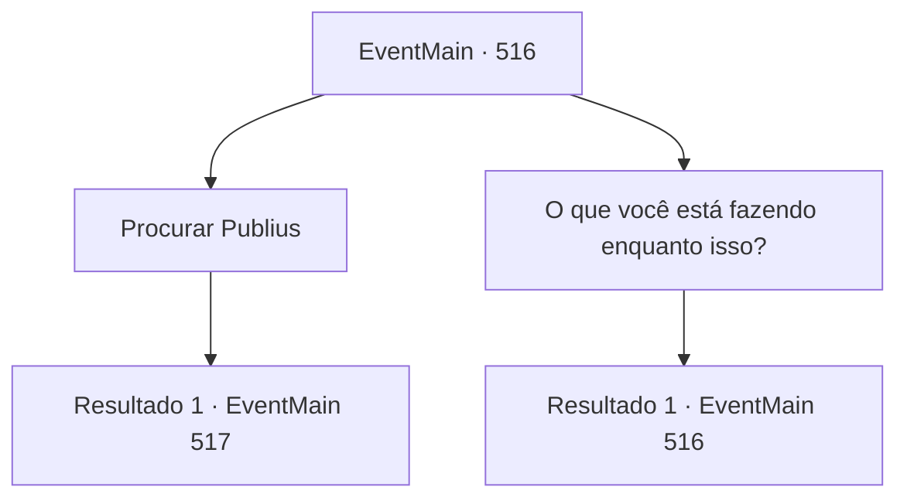

# Eventos principais · 516

[Índice da tabela](index.md) · [Índice geral](../index.md)

ID: `pt:EventMain:516` · Fonte: `EventMain4` · Versão: 1.2.47.

Mapeamento estático dos arquivos; a disponibilidade e a execução dependem do estado da run.

## Texto do evento

Você encontrou Viyork novamente na mansão dele.   Ele estava olhando calmamente para uma pintura pendurada na sala de visitas.   Você parou por um momento para observar a obra. Ela mostrava um navio navegando por um mar revolto, com o capitão caindo ao mar enquanto os marinheiros erguiam suas espadas e comemoravam.    

 "Publius desapareceu. Como você sabe, ele perdeu todos os subordinados que tanto prezava."

   Enquanto olhava para a pintura, Viyork começou a falar e tirou um mapa do bolso.   Ele apontou para um local marcado com um X e revelou calmamente sua intenção.    

 "Descobri o esconderijo de Publius. O 'Platô de Aether', exatamente aqui."

   Viyork entregou o mapa a você com um pequeno sorriso.    

 "Então, vá até lá."

  

## Dados de entrada

```json
{
  "id": 516,
  "grade": 1,
  "normalGoal": "",
  "required": "1_2_100|13_4_24"
}
```

## Mapa das escolhas



## Escolhas e resultados

### Escolha 1

Procurar Publius

Requisitos e outros campos da escolha:

```json
{
  "required": ""
}
```

#### Resultado 1.1

Você segue o mapa que Viyork lhe deu e vai para o lugar onde Publius está se escondendo. Fica na borda do 'Planalto Aether', bastante distante. |drawing_hidePublius| Chegando ao Planalto Aether alguns dias depois, você procura pelo penhasco onde Publius supostamente está se escondendo. Há um antigo mosteiro no topo do penhasco. E os degraus de pedra que levam ao mosteiro são construídos precariamente ao longo do penhasco.

Continuação registrada: [Evento 517](0517.md) na mesma tabela.

```json
{
  "required": "",
  "chance": "1",
  "nextEvent": 517,
  "type": 2,
  "reward": ""
}
```

### Escolha 2

O que você está fazendo enquanto isso?

Requisitos e outros campos da escolha:

```json
{
  "required": "5_372_0"
}
```

#### Resultado 2.1

Você pergunta a Viyork o que ele fará enquanto isso. 

 "E se Publius fugir? Estou pensando em estabelecer uma contramedida. Como ele é nosso último alvo, precisamos ter cuidado."


Continuação registrada: [Evento 516](0516.md) na mesma tabela.

```json
{
  "required": "",
  "chance": "1",
  "nextEvent": 516,
  "type": 2,
  "reward": "5_372_1"
}
```

## Referências que chegam a este evento

- [Evento 516 · escolha 2 · resultado 1](0516.md#escolha-2)
