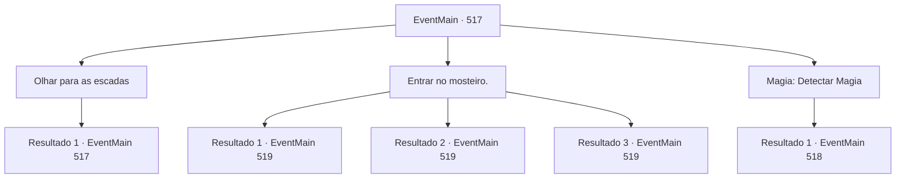

# Eventos principais · 517

[Índice da tabela](index.md) · [Índice geral](../index.md)

ID: `pt:EventMain:517` · Fonte: `EventMain4` · Versão: 1.2.47.

Mapeamento estático dos arquivos; a disponibilidade e a execução dependem do estado da run.

## Texto do evento

*Sem texto no arquivo.*

## Dados de entrada

```json
{
  "id": 517,
  "grade": 1,
  "normalGoal": "",
  "required": ""
}
```

## Mapa das escolhas



## Escolhas e resultados

### Escolha 1

Olhar para as escadas

Requisitos e outros campos da escolha:

```json
{
  "required": "5_373_0"
}
```

#### Resultado 1.1

Você olha para as estreitas escadas presas à falésia. Elas estão velhas, então a pedra está quebrada em todos os lugares. Não parece haver armadilhas montadas.

Continuação registrada: [Evento 517](0517.md) na mesma tabela.

```json
{
  "required": "",
  "chance": "1",
  "nextEvent": 517,
  "type": 2,
  "reward": "5_373_1"
}
```

### Escolha 2

Entrar no mosteiro.

Requisitos e outros campos da escolha:

```json
{
  "required": "5_373_1"
}
```

#### Resultado 2.1

Você sobe as escadas precárias e entra no mosteiro. Então, de repente, seu corpo fica lento e você cambaleia sem perceber. 

 "Eu sabia que você viria. Por isso, preparei uma barreira que enfraquece o poder do demônio."

 Ao virar a cabeça em direção ao som, você vê 'Publius', vestido com uma túnica sacerdotal vermelha bordada. |drawing_publius| 

 "Você não quer conversar por um segundo? {1}."

 Publius olha para você, perguntando com uma voz calma.

Continuação registrada: [Evento 519](0519.md) na mesma tabela.

```json
{
  "required": "21_10_1|21_0_1",
  "chance": "1",
  "nextEvent": 519,
  "type": 2,
  "reward": ""
}
```

#### Resultado 2.2

Em vez de subir as escadas precárias, você flutua no ar. E atravessa a parede monástica. Então, de repente, seu corpo fica lento e você cambaleia sem perceber. 

 "Eu sabia que você viria. Por isso preparei uma barreira que enfraquece o poder do demônio."

 Ao virar a cabeça em direção ao som, você vê 'Publius', vestido com uma túnica sacerdotal vermelha bordada. |drawing_publius| 

 "Você não quer conversar por um segundo? {1}."

 Publius olha para você, perguntando com uma voz calma.

Continuação registrada: [Evento 519](0519.md) na mesma tabela.

```json
{
  "required": "20_10_1",
  "chance": "1",
  "nextEvent": 519,
  "type": 2,
  "reward": ""
}
```

#### Resultado 2.3

Em vez de subir as escadas precárias, você flutua no ar. E atravessa a parede monástica. Então, de repente, seu corpo fica lento e você cambaleia sem perceber. 

 "Eu sabia que você viria. Por isso preparei uma barreira que enfraquece o poder do demônio."

 Ao virar a cabeça em direção ao som, você vê 'Publius', vestido com uma túnica sacerdotal vermelha bordada. |drawing_publius| 

 "Você não quer conversar por um segundo? {1}."

 Publius olha para você, perguntando com uma voz calma.

Continuação registrada: [Evento 519](0519.md) na mesma tabela.

```json
{
  "required": "20_0_1",
  "chance": "1",
  "nextEvent": 519,
  "type": 2,
  "reward": ""
}
```

### Escolha 3

Magia: Detectar Magia

Requisitos e outros campos da escolha:

```json
{
  "required": "20_0_1|1_1_2|5_373_1"
}
```

#### Resultado 3.1

Você detecta a magia dentro do mosteiro mesmo antes de lançar Detectar Magia. Há uma concentração intensa de mana, e você percebe que é uma espécie de barreira. Então, Kior sussurra em sua mente. 

 "Hmm... um arcebispo saberia como fazer isso... Se você for lá, meu poder enfraquecerá, então tenha cuidado."


Continuação registrada: [Evento 518](0518.md) na mesma tabela.

```json
{
  "required": "",
  "chance": "1",
  "nextEvent": 518,
  "type": 2,
  "reward": "0_1_-1"
}
```

## Referências que chegam a este evento

- [Evento 516 · escolha 1 · resultado 1](0516.md#escolha-1)
- [Evento 517 · escolha 1 · resultado 1](0517.md#escolha-1)
