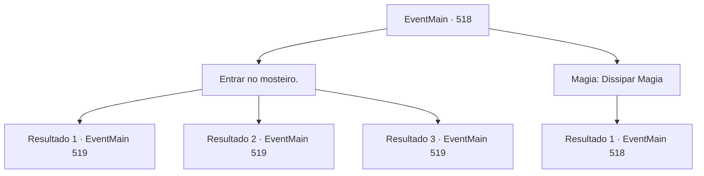

# Eventos principais · 518

[Índice da tabela](index.md) · [Índice geral](../index.md)

ID: `pt:EventMain:518` · Fonte: `EventMain4` · Versão: 1.2.47.

Mapeamento estático dos arquivos; a disponibilidade e a execução dependem do estado da run.

## Texto do evento

*Sem texto no arquivo.*

## Dados de entrada

```json
{
  "id": 518,
  "grade": 1,
  "normalGoal": "",
  "required": ""
}
```

## Mapa das escolhas



## Escolhas e resultados

### Escolha 1

Entrar no mosteiro.

Requisitos e outros campos da escolha:

```json
{
  "required": ""
}
```

#### Resultado 1.1

Você sobe as escadas precárias e entra no mosteiro. Então, de repente, seu corpo fica lento e você cambaleia sem perceber. 

 "Eu sabia que você viria. Por isso, preparei uma barreira que enfraquece o poder do demônio."

 Ao virar a cabeça em direção ao som, você vê 'Publius', vestido com uma túnica sacerdotal vermelha bordada. |drawing_publius| 

 "Você não quer conversar por um segundo? {1}."

 Publius olha para você, perguntando com uma voz calma.

Continuação registrada: [Evento 519](0519.md) na mesma tabela.

```json
{
  "required": "21_10_1|21_0_1",
  "chance": "1",
  "nextEvent": 519,
  "type": 2,
  "reward": ""
}
```

#### Resultado 1.2

Em vez de subir as escadas precárias, você flutua no ar. E atravessa a parede monástica. Então, de repente, seu corpo fica lento e você cambaleia sem perceber. 

 "Eu sabia que você viria. Por isso preparei uma barreira que enfraquece o poder do demônio."

 Ao virar a cabeça em direção ao som, você vê 'Publius', vestido com uma túnica sacerdotal vermelha bordada. |drawing_publius| 

 "Você não quer conversar por um segundo? {1}."

 Publius olha para você, perguntando com uma voz calma.

Continuação registrada: [Evento 519](0519.md) na mesma tabela.

```json
{
  "required": "20_10_1",
  "chance": "1",
  "nextEvent": 519,
  "type": 2,
  "reward": ""
}
```

#### Resultado 1.3

Em vez de subir as escadas precárias, você flutua no ar. E atravessa a parede monástica. Então, de repente, seu corpo fica lento e você cambaleia sem perceber. 

 "Eu sabia que você viria. Por isso preparei uma barreira que enfraquece o poder do demônio."

 Ao virar a cabeça em direção ao som, você vê 'Publius', vestido com uma túnica sacerdotal vermelha bordada. |drawing_publius| 

 "Você não quer conversar por um segundo? {1}."

 Publius olha para você, perguntando com uma voz calma.

Continuação registrada: [Evento 519](0519.md) na mesma tabela.

```json
{
  "required": "20_0_1",
  "chance": "1",
  "nextEvent": 519,
  "type": 2,
  "reward": ""
}
```

### Escolha 2

Magia: Dissipar Magia

Requisitos e outros campos da escolha:

```json
{
  "required": "20_0_2|1_1_2|5_374_0"
}
```

#### Resultado 2.1

Você lança Dissipar magia e desmonta a barreira montada no mosteiro. No entanto, a barreira é restaurada instantaneamente, e o resultado é o mesmo, não importa quantas vezes você tente. 

 "É um desperdício. Não desperdice sua magia."

 Kior resmunga como se estivesse te repreendendo.

Continuação registrada: [Evento 518](0518.md) na mesma tabela.

```json
{
  "required": "",
  "chance": "1",
  "nextEvent": 518,
  "type": 2,
  "reward": "0_1_-1|5_374_1"
}
```

## Referências que chegam a este evento

- [Evento 517 · escolha 3 · resultado 1](0517.md#escolha-3)
- [Evento 518 · escolha 2 · resultado 1](0518.md#escolha-2)
