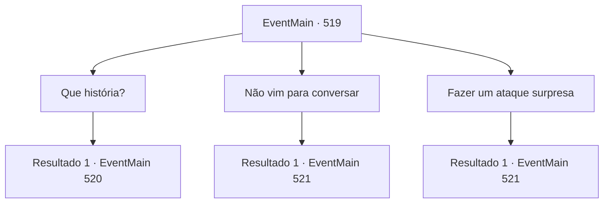

# Eventos principais · 519

[Índice da tabela](index.md) · [Índice geral](../index.md)

ID: `pt:EventMain:519` · Fonte: `EventMain4` · Versão: 1.2.47.

Mapeamento estático dos arquivos; a disponibilidade e a execução dependem do estado da run.

## Texto do evento

*Sem texto no arquivo.*

## Dados de entrada

```json
{
  "id": 519,
  "grade": 1,
  "normalGoal": "",
  "required": ""
}
```

## Mapa das escolhas



## Escolhas e resultados

### Escolha 1

Que história?

Requisitos e outros campos da escolha:

```json
{
  "required": ""
}
```

#### Resultado 1.1

Publius continua em um tom calmo após sua pergunta. 

 "Você sabe qual é o verdadeiro objetivo de Viyork? Ele quer tomar o assento do Arcebispo. Não há mais ninguém em quem eu possa confiar. Mais cedo ou mais tarde, ele vai me matar e tentar alcançar seu objetivo."

 Publius balança a cabeça e continua, olhando diretamente para você. Seus olhos estão cheios de convicção. 

 "E o que você acha que acontecerá se ele alcançar seu objetivo? Tenho certeza de que ele tentará te matar. Ele não é do tipo que deixa evidências para trás."


Continuação registrada: [Evento 520](0520.md) na mesma tabela.

```json
{
  "required": "",
  "chance": "1",
  "nextEvent": 520,
  "type": 2,
  "reward": ""
}
```

### Escolha 2

Não vim para conversar

Requisitos e outros campos da escolha:

```json
{
  "required": ""
}
```

#### Resultado 2.1

Você deu um passo mais perto de Publius, dizendo que não veio para conversar. Nesse exato momento, paladinos escondidos surgem de repente e se lançam contra você. Enquanto isso, Publius foge para dentro do mosteiro com vários paladinos. Você terá que lidar primeiro com os paladinos que estão bloqueando o caminho.

Continuação registrada: [Evento 521](0521.md) na mesma tabela.

```json
{
  "required": "",
  "chance": "1",
  "nextEvent": 521,
  "type": 2,
  "reward": "6_3_50",
  "place": 10
}
```

### Escolha 3

Fazer um ataque surpresa

Requisitos e outros campos da escolha:

```json
{
  "required": ""
}
```

#### Resultado 3.1

Você lança um ataque surpresa em Publius. No entanto, o ataque é bloqueado por uma flecha voadora. Naquele exato momento, paladinos escondidos surgem de repente e correm em sua direção. Enquanto isso, Publius foge para dentro do mosteiro com vários paladinos. Você terá que lidar primeiro com os paladinos que estão bloqueando o caminho.

Continuação registrada: [Evento 521](0521.md) na mesma tabela.

```json
{
  "required": "",
  "chance": "1",
  "nextEvent": 521,
  "type": 2,
  "reward": "6_3_50",
  "place": 10
}
```

## Referências que chegam a este evento

- [Evento 517 · escolha 2 · resultado 1](0517.md#escolha-2)
- [Evento 517 · escolha 2 · resultado 2](0517.md#escolha-2)
- [Evento 517 · escolha 2 · resultado 3](0517.md#escolha-2)
- [Evento 518 · escolha 1 · resultado 1](0518.md#escolha-1)
- [Evento 518 · escolha 1 · resultado 2](0518.md#escolha-1)
- [Evento 518 · escolha 1 · resultado 3](0518.md#escolha-1)
