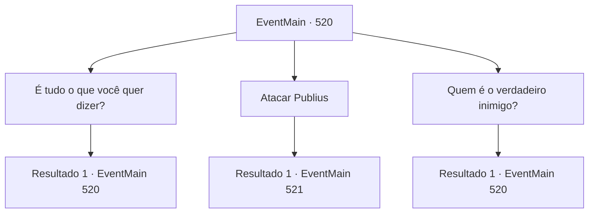

# Eventos principais · 520

[Índice da tabela](index.md) · [Índice geral](../index.md)

ID: `pt:EventMain:520` · Fonte: `EventMain4` · Versão: 1.2.47.

Mapeamento estático dos arquivos; a disponibilidade e a execução dependem do estado da run.

## Texto do evento

*Sem texto no arquivo.*

## Dados de entrada

```json
{
  "id": 520,
  "grade": 1,
  "normalGoal": "",
  "required": ""
}
```

## Mapa das escolhas



## Escolhas e resultados

### Escolha 1

É tudo o que você quer dizer?

Requisitos e outros campos da escolha:

```json
{
  "required": "5_375_0"
}
```

#### Resultado 1.1

Você saca sua arma, perguntando: 'É só isso que você quer dizer?'. Mesmo olhando para sua arma, Publius mantém uma expressão calma. 

 "Ainda há mais a dizer. Você parece pensar que sou inimigo de sua família, mas isso é um mal-entendido. Eu sei quem você realmente precisa se vingar."

 Publius promete trabalhar com você para matar Viyork e ele lhe dirá quem é o verdadeiro inimigo. Então, Kior sussurra em sua cabeça. 

 "É uma mentira, ele está tentando te enganar... Você não acredita, não é?"


Continuação registrada: [Evento 520](0520.md) na mesma tabela.

```json
{
  "required": "",
  "chance": "1",
  "nextEvent": 520,
  "type": 2,
  "reward": "5_375_1"
}
```

### Escolha 2

Atacar Publius

Requisitos e outros campos da escolha:

```json
{
  "required": "5_375_1"
}
```

#### Resultado 2.1

Você dá um passo mais perto de Publius para atacá-lo. Nesse exato momento, paladinos escondidos surgem de repente e se apressam em sua direção. Enquanto isso, Publius foge para dentro do mosteiro com vários paladinos. Você terá que lidar primeiro com os paladinos que estão bloqueando o caminho.

Continuação registrada: [Evento 521](0521.md) na mesma tabela.

```json
{
  "required": "",
  "chance": "1",
  "nextEvent": 521,
  "type": 2,
  "reward": "5_375_2|6_3_50",
  "place": 10
}
```

### Escolha 3

Quem é o verdadeiro inimigo?

Requisitos e outros campos da escolha:

```json
{
  "required": "5_375_1|5_376_0"
}
```

#### Resultado 3.1

Você pergunta a quem você realmente precisa se vingar. Mas Publius apenas balança a cabeça e diz que ele responderá se você prometer cooperar.

Continuação registrada: [Evento 520](0520.md) na mesma tabela.

```json
{
  "required": "",
  "chance": "1",
  "nextEvent": 520,
  "type": 2,
  "reward": "5_376_1"
}
```

## Referências que chegam a este evento

- [Evento 519 · escolha 1 · resultado 1](0519.md#escolha-1)
- [Evento 520 · escolha 1 · resultado 1](0520.md#escolha-1)
- [Evento 520 · escolha 3 · resultado 1](0520.md#escolha-3)
