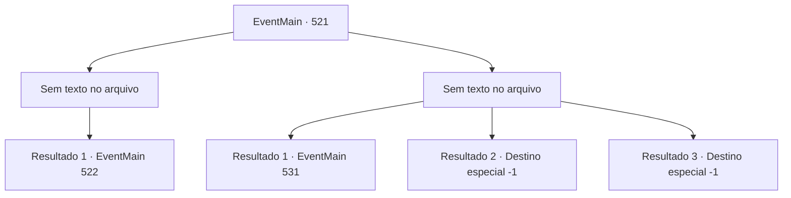

# Eventos principais · 521

[Índice da tabela](index.md) · [Índice geral](../index.md)

ID: `pt:EventMain:521` · Fonte: `EventMain4` · Versão: 1.2.47.

Mapeamento estático dos arquivos; a disponibilidade e a execução dependem do estado da run.

## Texto do evento

*Sem texto no arquivo.*

## Dados de entrada

```json
{
  "id": 521,
  "grade": 1,
  "normalGoal": "",
  "required": ""
}
```

## Mapa das escolhas



## Escolhas e resultados

### Escolha 1

*Sem texto no arquivo; o papel dessa opção depende da interface do jogo.*

Requisitos e outros campos da escolha:

```json
{
  "required": ""
}
```

#### Resultado 1.1

Você derruba os paladinos e corre atrás de Publius. Mas ele já desapareceu e se escondido. É como se ele nunca tivesse estado no mosteiro desde o início.

 Enquanto procura pelo mosteiro, de repente você encontra uma porta no chão de um quarto. Ao abrir a porta, você vê um corredor escuro e úmido. Depois de pensar por um tempo, você entra cuidadosamente e decide procurar por Publius. Logo após caminhar pelo corredor, uma bifurcação aparece no caminho.

Continuação registrada: [Evento 522](0522.md) na mesma tabela.

```json
{
  "required": "",
  "chance": "1",
  "nextEvent": 522,
  "type": 2,
  "reward": ""
}
```

### Escolha 2

*Sem texto no arquivo; o papel dessa opção depende da interface do jogo.*

Requisitos e outros campos da escolha:

```json
{
  "required": ""
}
```

#### Resultado 2.1

O ataque surpresa dos Santos Cavaleiros te deixa atordoado. Depois de lutar por muito tempo, você finalmente percebe que não pode vencer e escolhe fugir. Felizmente, os Santos Cavaleiros também estão gravemente feridos e não te perseguem.

 Você abre a porta do mosteiro e ouve muitos passos ao longe. Logo você encontra a origem do som. Viyork veio ao mosteiro com seus homens. Viyork olha para você na entrada e fala com um estalo de língua. 

 "Tsk... Parece que você falhou em matar Publius."

 Ele coloca a mão no seu ombro com um sorriso suspeito. 

 "Mas não se preocupe. {1}. Eu te disse. Tenho um plano em andamento. Siga-me."

 Com uma pequena risada, ele lidera seus homens ao longo do planalto.

Continuação registrada: [Evento 531](0531.md) na mesma tabela.

```json
{
  "required": "1_0_2|1_1_2",
  "chance": "1",
  "nextEvent": 531,
  "type": 2,
  "reward": "0_0_-1|0_1_-1"
}
```

#### Resultado 2.2

Você olha para os paladinos e vê um jorro de sangue. Você perfurou um deles com sua arma, mas outro te esfaqueou com sua espada para vingar seu companheiro. Você sente o repentino avanço da morte e tenta escapar dela. Mas a morte não permite.

Continuação registrada: [Destino especial `-1`](../destinos-especiais.md).

```json
{
  "required": "2_0_2",
  "chance": "1",
  "nextEvent": -1,
  "type": 2,
  "reward": "0_0_-1|0_1_-1|15_5_13|15_5_38"
}
```

#### Resultado 2.3

Você olha para os paladinos e vê um jorro de sangue. Você perfurou um deles com sua arma, mas outro te esfaqueou com sua espada para vingar seu companheiro. Você sente o repentino avanço da morte e tenta escapar dela. Mas a morte não permite.

Continuação registrada: [Destino especial `-1`](../destinos-especiais.md).

```json
{
  "required": "2_1_2",
  "chance": "1",
  "nextEvent": -1,
  "type": 2,
  "reward": "0_0_-1|0_1_-1|15_5_13|15_5_38"
}
```

## Referências que chegam a este evento

- [Evento 519 · escolha 2 · resultado 1](0519.md#escolha-2)
- [Evento 519 · escolha 3 · resultado 1](0519.md#escolha-3)
- [Evento 520 · escolha 2 · resultado 1](0520.md#escolha-2)
